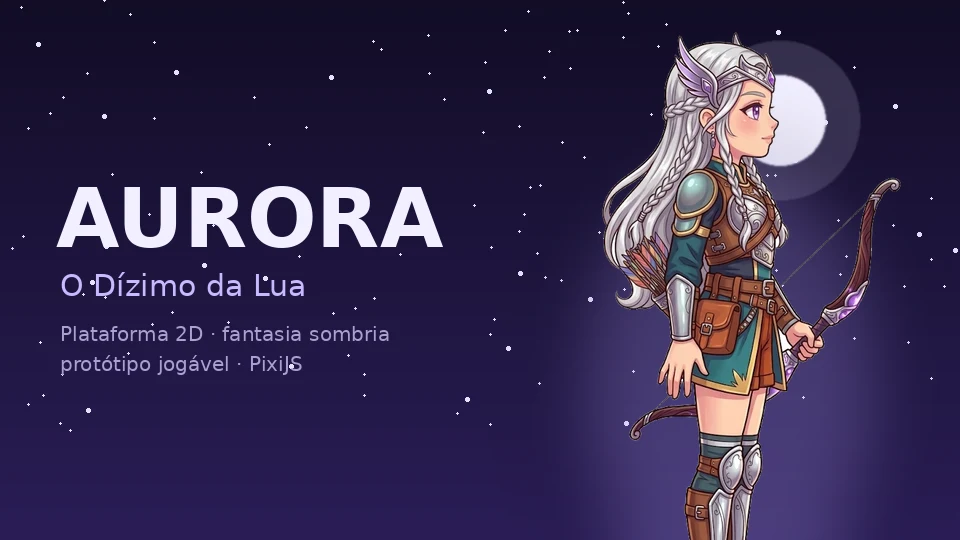

<div align="center">



# 🌙 Aurora: O Dízimo da Lua

**Plataforma 2D de ação e fantasia sombria, com uma heroína que respira, pisca e reage ao vento.**

[Jogar o protótipo ↗](https://paulomarcelli.github.io/Projetos/Projetos/Aurora/) · [Roteiro](docs/roteiro.md) · [Arquitetura](docs/ARQUITETURA.md) · [Passagem para a próxima IA](docs/PARA-A-PROXIMA-IA.md)

</div>

## O jogo
Aurora, a última da Casa Selênia (descendente da deusa da lua), é entregue como tributo ao Labirinto onde o Império
de Helion acorrenta um deus. A história mistura **mitologia grega** (o tributo ao Labirinto, Astérion, Selene,
Caronte, a Esfinge) com o clima de intriga e sobrevivência de grandes sagas de fantasia. Personagens, mundo e diálogos
são **originais**. Roteiro completo, com 3 atos, 13 fases e 4 finais: [`docs/roteiro.md`](docs/roteiro.md).

**Estado atual:** o **Prólogo — A Noite das Lanças** e a **Fase 1 — A Floresta da Névoa** estão jogáveis do começo
ao fim. No Prólogo, a Aurora criança (sem armas) atravessa o castelo às escuras sem ser vista pelos soldados da Lança
Dourada: anda abaixada, se esconde atrás de cortinas, mesas e colunas, sobe na galeria; as velas acesas são pontos de
retorno. Termina no altar, na neve com o Bram e no título. Depois vem a Fase 1 (a caçada, com 2 fogueiras, sombras,
alvos de palha, penhascos e a cena final).

| Já funciona | Falta |
|-------------|-------|
| Correr, pular (pulo variável, "pulo atrasado", memória do botão), Salto da Lua, esquiva, golpe de lâmina com volta à guarda, arco com flecha que voa e crava | Fases 2 a 13, chefes |
| Prólogo: furtividade (cone de visão, esconderijos, andar abaixada, ouvir passos), diálogos letra a letra, festa, altar e neve | Mais quadros de animação para os personagens do Prólogo (hoje eles ficam parados) |
| Aurora adulta redesenhada no Figma: todas as animações com a mesma personagem (arco com os dedos, corrida, golpe, sentar) | |
| Arte pintada (gerada no Figma): castelo, soldados, personagens, cena da neve; na Fase 1, céu, floresta em camadas, chão, pinheiros, galhos, placas, alvos e cervo | |
| Neve que levanta nos passos, no pulo e na aterrissagem, pegadas que somem, amassar ao pousar e esticar ao pular | |
| Painel de vida e mana com moldura de prata, retrato e dano atrasado; arco de luz no golpe, impacto, luz juntando no arco, rastro da flecha | |
| Cervo que anda, pasta, cheira e encara; lebres e pássaros que fogem; luar, luz das fogueiras, neve em 3 profundidades, neve pintada e pingentes no chão | |
| Aurora parada "viva" (respira, pisca, mão abre e fecha) e em movimento com o cabelo separado do corpo, reagindo ao vento | Diálogos com escolhas, som e música |
| Sentar na Fogueira Lunar (respirando), salvar, evoluir; dano em 3 quadros com clarão, recuo e hit-stop | Menu inicial e controles de toque |
| Fase 1 em dados, com teste automático (jogador robô, alcance dos saltos e ritmo) | Patrulha imperial na Fase 1 (precisa de arte dos soldados) |
| Sombra de névoa animada; cervo; neve, névoa e fundo de inverno | |

Para a próxima IA: [`docs/PARA-A-PROXIMA-IA.md`](docs/PARA-A-PROXIMA-IA.md) (estado, decisões, próximos passos).

## Controles
Sem nada no endereço, o jogo abre no **Prólogo** na primeira vez e na **Fase 1** depois. Para escolher:
`?fase=prologo` ou `?fase=1` no fim do link.

**Prólogo (Aurora criança):** ← → andar · Espaço pular · segure ↓ andar abaixada (devagar, vista só de perto, sem
barulho) · parada num esconderijo, segure ↓ para se esconder · E/Enter passar as falas · Tab pular o Prólogo.

**Fase 1:**

| Tecla | Ação |
|-------|------|
| ← → (ou A D) | andar |
| Espaço (ou ↑ W) | pular; de novo no ar = **Salto da Lua** (gasta mana) |
| Shift (ou C) | esquivar rolando |
| J (ou Z) | golpe de lâmina |
| K (ou X) | atirar com o arco |
| E (ou Enter) | descansar na Fogueira Lunar / levantar · avançar as falas da cena final |
| R | (no fim da fase) jogar de novo |
| 1 2 3 4 | (na fogueira) evoluir Vigor, Foco, Força, Precisão |
| L | lupa: aproxima a câmera para ver os detalhes da Aurora |
| H / V | testar as animações de dano e de vitória |

## Rodar no computador
Precisa de Node.js 18+ e Python 3.
```bash
cd Projetos/Aurora-Jogo/jogo
npm install
npm run preparar     # copia o PixiJS e as artes para jogo/
npm test             # 39 testes: física, progressão, salvamento, furtividade, a Fase 1 e o Prólogo
python3 -m http.server 8080
```
Abra `http://localhost:8080`. Precisa de um servidor (os módulos JavaScript não abrem com dois cliques em `file://`).
Para só jogar, use o link publicado: <https://paulomarcelli.github.io/Projetos/Projetos/Aurora/>.

## Pastas
```text
Aurora-Jogo/
├── jogo/                 o jogo (é isto que vai para o GitHub Pages)
│   ├── index.html
│   ├── src/              main.js, fisica.js, nivel.js, fase.js, aurora_viva.js, vento.js, fogueira.js, inimigos.js, hud.js, progresso.js
│   ├── fases/            fase1.json (a fase em dados: plataformas, criaturas, fogueiras, ritmo, falas)
│   ├── previa/           fogueira.html (prévia isolada da Fogueira Lunar)
│   ├── assets/           sprites (folha de animações, flecha) e viva (Aurora parada em alta resolução)
│   ├── vendor/           pixi.min.mjs (PixiJS 8.23, licença MIT)
│   ├── testes/           testes com o testador do Node
│   └── ferramentas/      preparar.mjs
├── arte/
│   ├── referencias/      arte de conceito aprovada da Aurora
│   ├── poses-originais/  tudo que veio do Gemini, sem mexer
│   ├── viva-original/    base + variações (olhos semicerrados, mão fechada) da Aurora parada
│   ├── sprites/          recortes, folha de sprites montada, prévias GIF, flecha (ver LEIA-ME.md)
│   └── boneco/           peças separadas (experimento arquivado)
├── ferramentas/          Python: recortar, fatiar folhas, montar a folha, compor a Aurora parada
├── experimentos/         código arquivado (boneco de peças)
└── docs/                 roteiro, arquitetura, ficha da Aurora, prompts de arte, passagem para a próxima IA
```

## Tecnologias
- **PixiJS 8** (renderização 2D com malhas deformáveis) + JavaScript sem empacotador.
- **Física própria** com os números da skill de plataforma (`gamedev-skills/platformer`, calculados com `jump_tuner.py`).
- **Python + Pillow + NumPy** para o fluxo de arte (recorte, fatiamento, alinhamento, composição).
- **Arte gerada com IA** (Google Gemini, e a Aurora criança no gerador do Figma com o modelo Gemini) pelo autor, a partir da ficha da Aurora. Declarar ao publicar em lojas.
