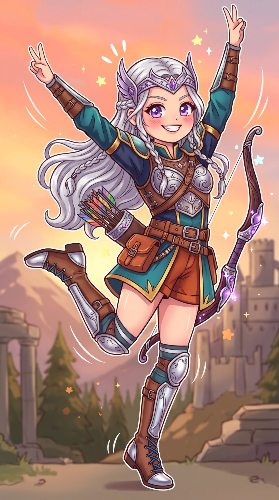

# Ficha visual — Aurora



Arte de conceito criada pelo usuário com IA (aprovada como visual oficial da Aurora).
Estilo da ilustração: anime/chibi suave, contorno marrom-escuro, contorno branco de "adesivo", cores quentes.

## Elementos fixos (manter em toda arte nova)
| Elemento | Descrição |
|----------|-----------|
| **Cabelo** | Prateado, muito longo e ondulado, com duas tranças finas na frente presas por anéis de prata |
| **Olhos** | Violeta, grandes, com brilho branco |
| **Tiara** | Diadema de prata com asas laterais e uma pedra violeta no centro: **a Coroa Lunar da Casa Selênia**, herança da mãe |
| **Armadura** | Peitoral de prata com arabescos sobre colete de couro marrom, cintas cruzadas |
| **Roupa** | Túnica azul-petróleo com barras douradas e mangas azul-marinho; shorts cor de ferrugem |
| **Braços** | Braçadeiras de couro com fivelas |
| **Pernas** | Meias listradas azul-petróleo e cinza, joelheiras e botas altas de couro com placas de prata e cadarço azul |
| **Arma** | Arco curvo de madeira escura com detalhes de prata e cristais violeta que brilham; aljava de couro no quadril |
| **Cores-chave** | Prata `#D9DDE3`, violeta `#9B6BD6`, azul-petróleo `#1F6F78`, azul-marinho `#24305E`, couro `#8A5A34`, ferrugem `#C8622B`, dourado `#D9A441` |

## Como o visual entra no roteiro
- **Ato I (caçadora escondida):** cabelo tingido de castanho, sem tiara nem peitoral de prata; capa cinza com capuz,
  túnica e couro. O prateado só aparece quando a chuva lava a tinta.
- **Ato II (Labirinto):** cabelo prateado à mostra, armadura de couro; o peitoral de prata ela ganha dos armeiros do Império para o desfile.
- **Ato III (a Lua Cheia):** visual completo da imagem. A **tiara** é a Coroa Lunar da mãe, que ela recupera do cofre de
  Caius no palácio (fase 12) e usa na luta final.
- **Flechas:** no jogo, as penas das flechas ficam **cinza e prata** (as coloridas da imagem destoam do tom do roteiro).

## Expressões necessárias
A imagem é a pose de vitória. O roteiro é pesado, então a Aurora precisa também de:
1. **Séria / concentrada** (padrão do jogo)
2. **Raiva** (diante de Caius)
3. **Luto** (morte de Teo e de Bram)
4. **Determinação** (escolhas finais)
5. **Sorriso pequeno** (raro, só com Lia), mais contido que o da imagem

## Poses para o jogo (câmera lateral)
Todas de perfil, voltada para a direita, corpo inteiro, fundo transparente:
parada, correndo, pulo (subida), queda, ataque com lâmina (3 quadros), puxar o arco, atirar, esquiva (rolamento),
Passo Lunar (dash com rastro prateado), dano, morte/queda, **vitória** (a pose da imagem).

## Prompt-base para gerar novas artes mantendo a personagem
Use a imagem aprovada como referência (imagem de entrada) e peça só a mudança:
```
Mesma personagem da imagem de referência: Aurora, guerreira de cabelo prateado longo com tranças,
olhos violeta, tiara de prata com asas e pedra violeta, peitoral de prata sobre colete de couro,
túnica azul-petróleo com barras douradas, shorts ferrugem, botas de couro com placas de prata, arco com cristais violeta.
NOVA POSE: [ex.: de perfil voltada para a direita, puxando o arco, expressão séria e concentrada]
Estilo igual ao da referência: anime suave, contorno marrom-escuro, cores quentes.
Fundo transparente, corpo inteiro, sem cortes. Sem texto, sem logos.
Manter exatamente: rosto, cores, roupa, tiara e arco.
```
