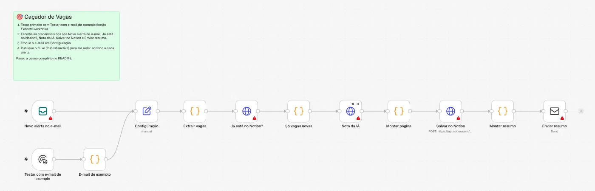
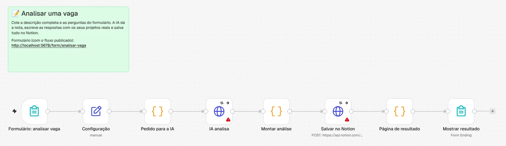

<div align="center">

# 🎯 Caçador de Vagas

**O n8n lê os alertas de vaga do LinkedIn no seu e-mail, a IA dá uma nota para cada vaga e um modelo de Machine Learning aprende o seu gosto.**


Tudo roda no seu computador. A IA usa a mesma chave da OpenAI da F.R.E.Y.A. (centavos por mês), ou Gemini e Ollama de graça.

</div>

## O que ele faz

```text
Alerta de vagas do LinkedIn (e-mail)
        │  o n8n lê assim que chega (IMAP)
        ▼
Extrair vagas ──► já está no Notion? ──► IA dá nota 0–10 ──► salva no Notion ──► e-mail com as melhores
                                         (OpenAI, Gemini       (banco "Vagas")
                                          ou Ollama)

Você marca 👍 / 👎 nas vagas ──► ml/treinar.py ──► seu modelo × a IA: quem acerta mais o seu gosto?
```

1. **Fluxo 01 · alertas do LinkedIn:** a cada alerta, as vagas novas ganham nota, explicação, pontos fortes, lacunas, área, nível e modalidade, e vão para o Notion. Você recebe um e-mail só com as vagas de nota 7 ou mais.
2. **Fluxo 02 · analisar uma vaga:** um formulário em `localhost:5678/form/analisar-vaga`. Você cola a descrição completa e as perguntas da candidatura, e a IA devolve a nota, **rascunhos de resposta com os seus projetos reais**, uma mensagem para o recrutador e o que destacar no currículo.
3. **Machine Learning:** com as vagas que você marcou em "Gostei?", treina um modelo próprio (TF-IDF + Regressão Logística) e compara com a nota da IA, usando validação cruzada.

<table>
  <tr>
    <td><br><sub><b>Fluxo 01</b> · do alerta ao resumo</sub></td>
  </tr>
  <tr>
    <td><br><sub><b>Fluxo 02</b> · do formulário à análise</sub></td>
  </tr>
</table>

> [!NOTE]
> **Sem raspagem do LinkedIn.** O projeto só lê os e-mails de alerta que o próprio LinkedIn manda para você. Nada acessa o site do LinkedIn, então não há risco para a sua conta.

## Do que você precisa

| | Para quê |
|---|---|
| [Docker Desktop](https://www.docker.com/products/docker-desktop/) | Rodar o n8n. Sem Docker: `npx n8n` (precisa do Node.js 24) |
| E-mail do Yahoo com uma senha de app | Ler os alertas (IMAP) e mandar o resumo (SMTP) |
| A chave da OpenAI da F.R.E.Y.A. (`OPENAI_API_KEY` no `.env` dela) | A IA (`gpt-4o-mini`). Alternativas: Gemini (grátis) ou Ollama local |
| Notion | O banco "Vagas" (já criado em DASHBOARD › VAGAS) |
| Python 3.11+ | Só para a parte de Machine Learning |

## Passo a passo

### 1. Subir o n8n

```bash
docker compose up -d
```

Abra **http://localhost:5678** e crie a sua conta local, que fica só no seu computador.

### 2. Alertas de vaga no LinkedIn

1. Confira se o e-mail do LinkedIn é o do **Yahoo**: LinkedIn › Configurações › Login e segurança › Endereços de e-mail. Os alertas vão para o e-mail principal.
2. Pesquise vagas no LinkedIn: "estágio dados", "python júnior", "inteligência artificial estágio" e assim por diante.
3. Ative o **alerta** de cada pesquisa, com frequência **diária** e aviso **por e-mail**.

### 3. Yahoo: pasta, filtro e senha de app

1. **Senha de app:** no Yahoo, vá em Informações da conta › **Segurança da conta** › **Gerar senha de app**. Dê o nome "n8n" e copie a senha de 16 letras. O n8n entra com ela, nunca com a sua senha normal.
2. **Pasta:** no Yahoo Mail, crie uma pasta chamada `Vagas`.
3. **Filtro:** Configurações › Mais configurações › **Filtros** › Adicionar: **De** contém `jobalerts-noreply@linkedin.com` → mover para a pasta `Vagas`.

   O fluxo lê os e-mails **não lidos** da pasta `Vagas` e os marca como lidos. Assim nada se perde se você abrir o Yahoo antes.

### 4. Notion: integração

1. Em [notion.so/profile/integrations](https://www.notion.so/profile/integrations), crie uma **integração interna** e copie o token.
2. Abra o banco **Vagas** (DASHBOARD › VAGAS) › `•••` › **Conexões** › adicione a integração.

### 5. Importar os fluxos

No n8n, crie um workflow em branco, abra o menu **⋯** no canto superior direito › **Import from File** e escolha `n8n/01-alertas-linkedin.json`. Repita com um workflow novo para `n8n/02-analisar-vaga.json`.

### 6. Criar as credenciais

Em cada nó com triângulo vermelho, clique e escolha **Create new credential**:

| Credencial | Tipo | Preenchimento | Nós |
|---|---|---|---|
| **Notion** | Header Auth | Name `Authorization` · Value `Bearer SEU_TOKEN_DO_NOTION` | Já está no Notion?, Salvar no Notion |
| **IA (OpenAI)** | Header Auth | Name `Authorization` · Value `Bearer ` + a mesma `OPENAI_API_KEY` do `.env` da F.R.E.Y.A. | Nota da IA, IA analisa |
| **Yahoo IMAP** | IMAP | Usuário: seu e-mail do Yahoo · Senha: a senha de app · Host `imap.mail.yahoo.com` · Porta `993` · SSL/TLS ligado | Novo alerta no e-mail |
| **Yahoo SMTP** | SMTP | Usuário: seu e-mail do Yahoo · Senha: a senha de app · Host `smtp.mail.yahoo.com` · Porta `465` · SSL/TLS ligado | Enviar resumo |

No nó **Configuração** (nos dois fluxos), confira `email_resumo`: é o e-mail do Yahoo que envia e recebe o resumo. Ali também ficam o seu perfil, o modelo da IA e a nota mínima do resumo.

> [!TIP]
> **Quer a IA de graça?** Use o Gemini: crie uma chave em [aistudio.google.com/apikey](https://aistudio.google.com/apikey), ponha `Bearer SUA_CHAVE_DO_GEMINI` na credencial de IA e, no nó **Configuração**, `llm_url` = `https://generativelanguage.googleapis.com/v1beta/openai/chat/completions` e `llm_modelo` = o modelo Flash mais recente do AI Studio (por exemplo `gemini-2.5-flash`).

### 7. Testar

1. No fluxo 01, clique na seta do botão **Execute** e escolha **Testar com e-mail de exemplo**.
2. Duas vagas **de exemplo** (marcadas "EXEMPLO") vão aparecer no Notion: uma com nota alta e outra com nota baixa. Você recebe o e-mail de resumo com a boa.
3. Apague as duas do Notion depois.

### 8. Ligar

Clique em **Publish** nos dois fluxos:
- o 01 passa a rodar sozinho a cada alerta, enquanto o n8n estiver ligado;
- o 02 fica em **http://localhost:5678/form/analisar-vaga**.

## Machine Learning: o seu modelo contra a IA

1. Durante umas duas semanas, marque **Gostei?** (👍 Sim / 👎 Não) nas vagas do Notion. O treino exige pelo menos 20 vagas marcadas, com 5 de cada tipo.
2. Depois rode:

```bash
pip install -r ml/requirements.txt
```

```bash
NOTION_TOKEN=SEU_TOKEN_DO_NOTION python ml/exportar.py
```

```bash
python ml/treinar.py
```

```bash
python ml/prever.py
```

O que cada um faz:
- `exportar.py` baixa as vagas do Notion para `ml/dados/vagas.csv`;
- `treinar.py` treina, avalia e escreve `ml/resultados/relatorio.md`;
- `prever.py` ordena as vagas ainda não marcadas pela chance de você gostar.

No Windows (PowerShell), troque a linha do token por `$env:NOTION_TOKEN="SEU_TOKEN"; python ml/exportar.py`.

O relatório traz:
- **acurácia, precisão, revocação e F1** de três "previsores" nas mesmas vagas: o seu modelo, a IA (nota ≥ 7) e o chute da maioria;
- a **matriz de confusão** do seu modelo e da IA;
- as **palavras que mais pesam** para você gostar ou não de uma vaga.

**Como a avaliação é feita:** validação cruzada estratificada. Cada vaga é prevista por um modelo que não a viu no treino, então a nota não é inflada por "decorar" os dados.

## IA local com Ollama (sem chave nenhuma)

```bash
docker compose --profile ollama up -d
```

```bash
docker compose exec ollama ollama pull qwen2.5:7b
```

No nó **Configuração**:
- `llm_url` = `http://ollama:11434/v1/chat/completions`
- `llm_modelo` = `qwen2.5:7b`

Na credencial de IA, qualquer valor serve (por exemplo `Bearer ollama`).

Modelos de 7B precisam de uns 8 GB de RAM, são mais lentos em CPU e erram mais que o Gemini.

## Limites

- O e-mail de alerta traz só título, empresa e local, então a nota do fluxo 01 é uma triagem. Para decidir, cole a descrição completa no fluxo 02.
- A IA pode errar. Ela foi instruída a não inventar experiência, mas **revise toda resposta antes de enviar**.
- O fluxo pede uma nota a cada 1,5 segundo, para não esbarrar no limite por minuto da API. No plano grátis do Gemini, suba esse intervalo para 5 segundos (opção *Batching* do nó **Nota da IA**).
- Com a OpenAI, cada vaga custa uma fração de centavo com o `gpt-4o-mini`. Ponha um limite de gasto mensal em platform.openai.com › Limits.
- O fluxo 01 só funciona com o n8n ligado. E-mails que chegam com ele desligado ficam não lidos e são lidos quando ele volta.

## Estrutura

```text
Cacador-de-Vagas/
├── docker-compose.yml          # n8n (+ Ollama opcional)
├── perfil.md                   # seu perfil: a IA usa isto para dar a nota
├── n8n/
│   ├── 01-alertas-linkedin.json
│   ├── 02-analisar-vaga.json
│   ├── montar_fluxos.py        # gera os JSON a partir de codigo/ e perfil.md
│   └── codigo/                 # o JavaScript de cada nó de código
├── ml/
│   ├── exportar.py             # Notion → CSV
│   ├── treinar.py              # treino + avaliação + relatório
│   └── prever.py               # ordena as vagas novas
└── testes/
    ├── teste_extrair_vagas.js  # leitor de e-mails (4 cenários)
    └── teste_ml.py             # treino ponta a ponta com dados fictícios
```

Mudou o perfil ou o código de um nó? Rode `python n8n/montar_fluxos.py` e importe o fluxo de novo.

Para rodar os testes:

```bash
node testes/teste_extrair_vagas.js
```

```bash
python testes/teste_ml.py
```
