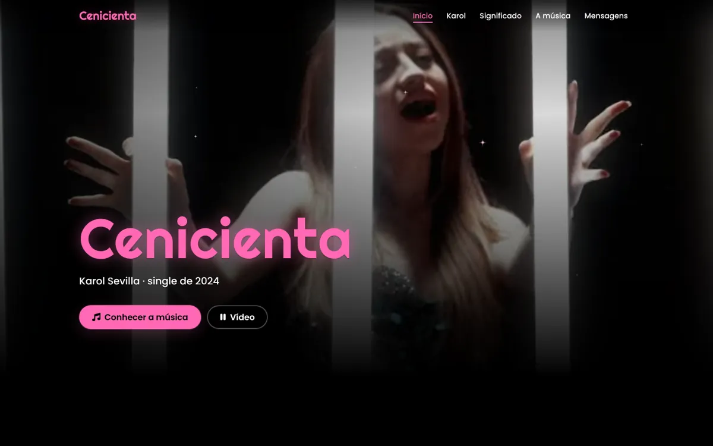
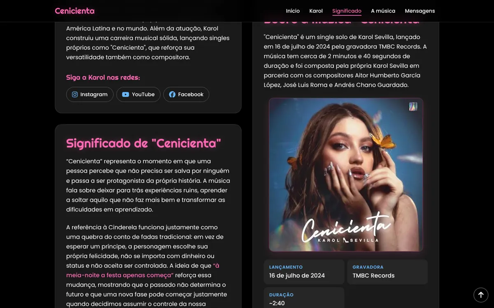
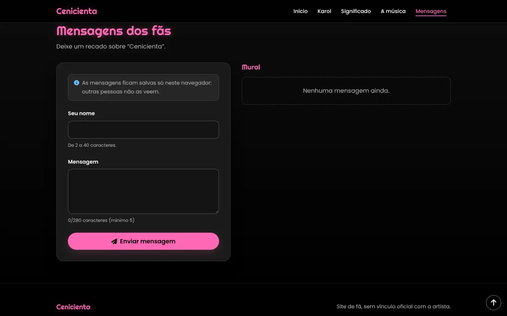
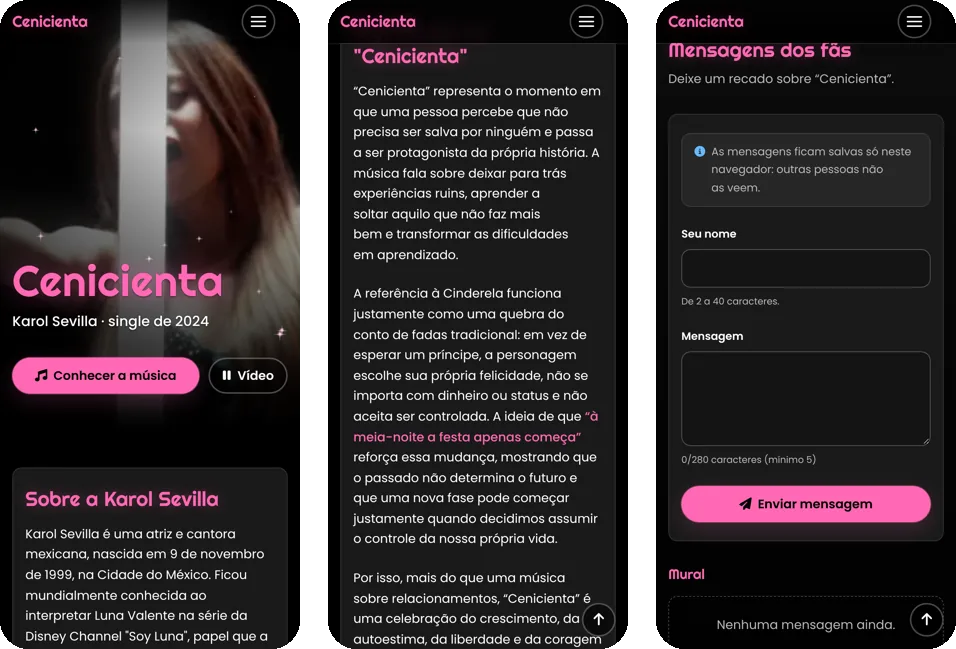

<div align="center">

# 👠 Cenicienta · Karol Sevilla

**Um site de fã para o single de 2024: a música, o significado e o clipe.**

[](https://paulomarcelli.github.io/Projetos/Projetos/Cenicienta/)


<br>



<sub>O clipe toca no fundo do topo e pausa sozinho quando sai da tela.</sub>

</div>

<br>

> [!NOTE]
> Projeto **de fã**, sem vínculo oficial com a Karol Sevilla ou com a gravadora. O clipe e a capa pertencem aos seus autores.

## ✨ A ideia

"Cenicienta" fala de alguém que percebe que não precisa ser salva por ninguém. O site leva essa ideia para o visual: o fundo preto da meia-noite, o rosa neon do título e brilhos discretos que aparecem enquanto você rola.

| Cor | | Uso |
|---|---|---|
| Rosa | `#FF69B4` | Título, botões e destaques |
| Preto | `#0D0D0D` | Fundo da "meia-noite" |
| Azul | `#69B9FF` | Detalhes e links |

Fontes: **Righteous** nos títulos e **Poppins** nos textos.

## 🖼️ As seções

<table>
  <tr>
    <td width="50%"></td>
    <td width="50%"></td>
  </tr>
  <tr>
    <td align="center"><sub><b>Significado e a música</b>: a história da letra, a capa e a ficha técnica</sub></td>
    <td align="center"><sub><b>Mensagens dos fãs</b>: um mural com validação e contador</sub></td>
  </tr>
</table>

<p align="center">
  <br>
  <sub><b>No celular</b>: menu de tela cheia e tudo em uma coluna</sub>
</p>

## 🎬 O que o site tem

- **Clipe no topo**, numa versão leve (cerca de 7 MB) que já começa no trecho certo, com botão de pausar.
- **Sobre a Karol**, **Significado** e **Sobre a música**, com a ficha técnica (lançamento, gravadora, duração e composição) e um botão de compartilhar.
- **Menu fixo** que marca a seção em que você está.
- **Mural de mensagens** com validação, contador de caracteres e apagar com desfazer. As mensagens ficam só no seu navegador (`localStorage`).
- Animações leves ao rolar, que se desligam com **"reduzir movimento"**.
- Dá para navegar pelo teclado, com foco visível, alvos de toque de 44 px e textos para leitores de tela.

## 🛠️ Como rodar

Abra o `index.html` no navegador ou use o **Live Server** do VS Code. Se preferir o terminal:

```bash
python3 -m http.server 8000
```

Depois é só abrir `http://localhost:8000`.

## 📁 Estrutura

```text
Cenicienta/
├── index.html          # estrutura e conteúdo
├── style.css           # cores, espaçamentos, tipografia e layout
├── components.css      # menu, formulário, mural e avisos
├── motion.css          # animações e microinterações
├── script.js           # menu, vídeo, formulário, mural e compartilhar
├── motion.js           # animações que precisam de JavaScript
├── assets/             # vídeo leve do topo (webm/mp4) e imagem de espera
├── images.jpg          # capa da música
├── cenicienta.mp4      # vídeo original, guardado como fonte
└── docs/               # DESIGN_SYSTEM.md e as imagens deste README
```

## 🙌 Créditos

- Música de **Karol Sevilla**, Aitor Humberto García López, José Luis Roma e Andrés Chano Guardado (TMBC Records, 2024).
- Fontes **Righteous** e **Poppins** (Google Fonts).

<div align="center">
<br>

Feito com 💗 por **Paulo Marcelli** · ADS · FECAP

</div>
