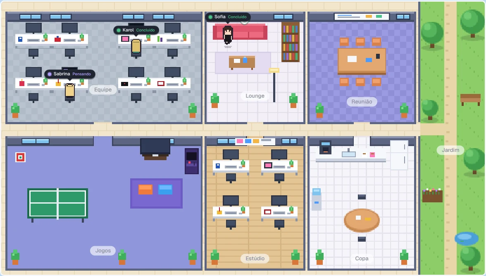

<div align="center">

# 🏢 Escritório do Paulo

**O escritório da minha equipe de agentes de IA: cada figurinha mostra o que o seu agente está fazendo de verdade.**

[](https://www.figma.com/design/JFyZCMHbS1ASDzSdbGu6pC)


<br>


</div>

<br>

> [!NOTE]
> Roda **só na sua máquina** (127.0.0.1), não tem versão publicada. As figurinhas são desenhos originais inspirados nos
> Vingadores, feitos para este projeto pessoal; a Sofia tem identidade própria. As capturas desta página usam o Claude de
> simulação dos testes, por isso aparece a faixa "Simulação".

## ✨ A ideia

Os agentes de IA trabalham escondidos no terminal. Aqui eles ganham um escritório: cada um tem a sua mesa, a sua
figurinha e um crachá com o estado. Quando a Sofia está no Figma, o monitor dela acende e ela se mexe; quando o Peter
espera o Design System, ele fica com a ampulheta e um fio tracejado até a mesa dela.

**Nada se mexe à toa.** Um agente só aparece trabalhando, pensando ou pesquisando enquanto existe uma execução real
dele no Claude Code. Sem execução, ele está disponível; esperando outra tarefa, aguardando; quando termina, concluído;
quando falha, com erro.

## 🦸 A equipe

| | Agente | Papel | Inspiração |
|---|---|---|---|
| 🛡️ | **Steve** | Coordenação: divide o pedido em tarefas e define a ordem | Capitão América |
| 🎨 | **Sofia** | Design: Design System no Figma antes de qualquer interface | identidade própria |
| ⚙️ | **Tony** | Arquitetura: estrutura, tecnologias, publicação | Homem de Ferro |
| 🔮 | **Stephen** | Pesquisa e análise: fontes, checagem, comparações | Doutor Estranho |
| 🕸️ | **Peter** | Front-end: implementa a interface a partir do Design System | Homem-Aranha |
| 🧪 | **Bruce** | Back-end e dados: servidores, APIs, bancos e pipelines | Hulk |
| ✨ | **Wanda** | Engenharia de IA: prompts, agentes, modelos e avaliação | Feiticeira Escarlate |
| 🕵️ | **Natasha** | QA e segurança: testes, capturas, revisão de segurança | Viúva Negra |

Os agentes são de verdade: cada um tem o seu arquivo em [`.claude/agents/`](../../.claude/agents), com instruções,
ferramentas, critério de qualidade e regras de colaboração, uma memória em [`agentes/memoria/`](../../agentes/memoria)
e o [protocolo da equipe](../../agentes/PROTOCOLO.md). Foram criados com a skill `criar-agente`.


## 🎬 O que dá para fazer

- **Novo pedido:** escreva o que você quer. O Steve monta o plano (ou use um fluxo pronto: interface nova, projeto de
  IA, pesquisa) e as tarefas aparecem na **mesa de projeto**, em colunas pela ordem das dependências.
- **Executar projeto:** cada tarefa começa sozinha quando as anteriores terminam, e cada agente recebe as entregas das
  tarefas de que depende.
- **Regra permanente:** todo projeto com interface começa pelo Design System da Sofia. Se o plano esquecer, o
  escritório acrescenta a tarefa dela e prende o front-end nela.
- **Clicar num crachá:** abre a gaveta do agente com o estado, a tarefa, o passo a passo ao vivo ("Lendo app.js",
  "Trabalhando no Figma"), o desempenho (concluídas, erros, tempo médio, custo), as ferramentas e o histórico.
- **Nova tarefa:** dê um trabalho direto a um agente, com dependências.
- **Conversas comuns também aparecem:** com os ganchos ligados, quando você chama um agente no VS Code ou no terminal,
  ele aparece trabalhando no escritório e a tarefa entra na lista.



## ▶️ Rodar

Precisa do **Node 20 ou mais novo** e do **Claude Code** instalado e com a conta conectada.

```bash
node Projetos/Escritorio-do-Paulo/bin/escritorio.mjs iniciar --abrir
```

Abre em <http://127.0.0.1:4310>. Para o escritório acompanhar também as conversas do Claude Code (uma vez só):

```bash
node Projetos/Escritorio-do-Paulo/bin/escritorio.mjs ganchos instalar
```

Pelo terminal, com o escritório aberto:

```bash
node Projetos/Escritorio-do-Paulo/bin/escritorio.mjs tarefas
```

```bash
node Projetos/Escritorio-do-Paulo/bin/escritorio.mjs pedido "Uma página de inscrição para o meu curso" --auto
```

As tarefas, o histórico e as entregas ficam em `dados/` (fora do git). Os ajustes ficam em `escritorio.config.json`:
porta, modelo, modo de permissão, comandos liberados para os agentes e quantos rodam ao mesmo tempo.

### Figurinhas pessoais

As figurinhas no estilo sticker (as sete da folha que escolhi e a da Sofia, feita no mesmo estilo) ficam fora do
repositório, que é público. Para usar, instale o pacote `figurinhas-pessoais.zip` uma vez:

```bash
node Projetos/Escritorio-do-Paulo/bin/escritorio.mjs figurinhas caminho/para/figurinhas-pessoais.zip
```

Elas vão para `web/avatares/pessoais/` (fora do git) e aparecem no mapa e na gaveta. Também dá para apontar uma pasta
com arquivos `steve.png`, `sofia.png`, `tony.png`… (o nome é o do agente). Sem elas, o escritório usa os desenhos de
`web/js/avatares.js`, no mesmo jeito de figurinha.

### Agente novo

Crie o agente com a skill `criar-agente` (arquivo em `.claude/agents/`). Ele aparece no escritório sozinho, numa mesa
livre; para dar cor, figurinha e papel, acrescente a entrada dele em `equipe.json` e o desenho em `web/js/avatares.js`.

## 🧰 Como foi feito

- **Execução real:** o escritório roda `claude -p --agent <nome> --output-format stream-json` e lê cada ferramenta que o
  agente usa, quando ele chama outro agente, o resultado, o tempo e o custo.
- **Ganchos do Claude Code:** `ganchos/enviar.mjs` repassa os eventos das conversas comuns (`SubagentStart`,
  `PreToolUse`, `SubagentStop`…) para o servidor e sai em menos de meio segundo; nunca atrapalha a conversa.
- **Servidor Node sem dependências:** HTTP só em 127.0.0.1, eventos por SSE, dados em JSON com gravação atômica.
- **Mapa em pixel art desenhado por código** (canvas de 336 × 176 ampliado sem suavização) e figurinhas em SVG por cima.
- **Design System no Figma** feito pela Sofia: variáveis de cor, estado e medida, estilos de texto, componentes
  (botão, chip de estado, crachá, tarefa, nó da mesa, marco, figurinha), animações e padrões de interação. Os tokens do
  CSS têm os mesmos nomes. Detalhes em [`docs/design-system.md`](docs/design-system.md).
- **Arquitetura:** [`docs/arquitetura.md`](docs/arquitetura.md).
- **Testes:** `npm test` (22 testes: tarefas, planos, regra do Design System, estados, colaboração, cancelamento, ganchos,
  persistência e segurança). Conferido também com execuções reais do Claude Code, pelo painel e por uma conversa comum.
