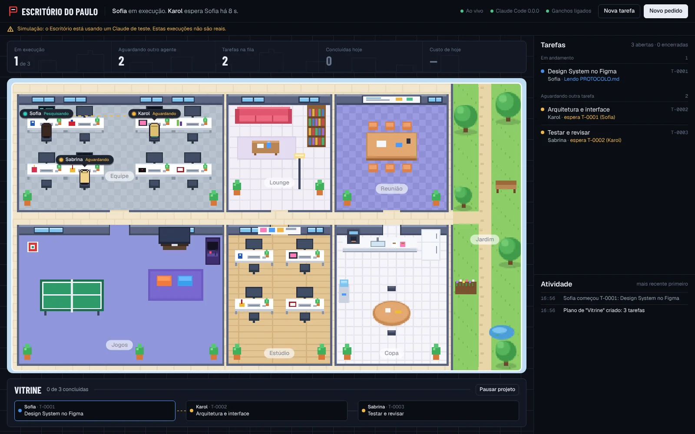
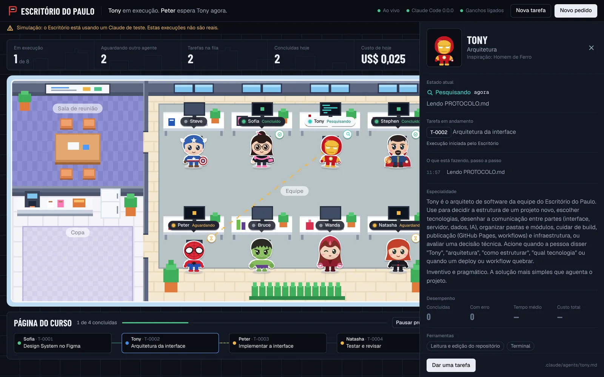

<div align="center">

# 🏢 Escritório do Paulo

**O escritório da minha equipe de agentes de IA: cada figurinha mostra o que o seu agente está fazendo de verdade.**

[](https://paulomarcelli.github.io/Projetos/Projetos/Escritorio-do-Paulo/)
[](https://www.figma.com/design/JFyZCMHbS1ASDzSdbGu6pC)


<br>



</div>

<br>

> [!NOTE]
> Os agentes rodam **só no seu computador**. O [endereço online](https://paulomarcelli.github.io/Projetos/Projetos/Escritorio-do-Paulo/)
> mostra, ao vivo, o escritório aberto nesse mesmo computador; sem ele, a página avisa que está fechado. As agentes
> são três personagens minhas (Sofia, Karol e Sabrina), desenhadas em pixel art a partir dos retratos delas. As capturas
> desta página usam o Claude de simulação dos testes, por isso aparece a faixa "Simulação".

## ✨ A ideia

Os agentes de IA trabalham escondidos no terminal. Aqui eles ganham um escritório: cada um tem a sua mesa, a sua
personagem em pixel art e um crachá com o estado. Quando a Sofia está no Figma, o monitor dela acende; quando a Karol
espera o Design System, ela fica com a ampulheta e um fio tracejado até a mesa dela.

**O escritório é vivo, mas não finge.** Quem está disponível se diverte: joga pingue-pongue em dupla, senta no sofá
para jogar videogame, joga fliperama, lê no lounge, toma café na copa, rega as plantas e passeia no jardim. Quando termina uma tarefa, leva a entrega andando até
quem continua o trabalho. Mas um agente só aparece trabalhando, pensando ou pesquisando enquanto existe uma execução
real dele no Claude Code: nessa hora ele larga o que estava fazendo e volta para a mesa. Esperando outra tarefa, fica
na mesa aguardando; quando falha, com erro.

## 👩‍💻 A equipe

| | Agente | Papel | No mapa |
|---|---|---|---|
| 🎨 | **Sofia** | Design: Design System no Figma antes de qualquer interface, direção de arte, revisão visual | cabelo castanho-escuro comprido, vestido preto |
| 💻 | **Karol** | Desenvolvimento: arquitetura, front-end, back-end e dados, engenharia de IA, publicação | loira-mel, jaqueta verde, short coral, bota amarela |
| 📋 | **Sabrina** | Coordenação, pesquisa e QA: monta o plano, checa fatos, testa e revisa antes de publicar | loira clara com laço preto, blusa preta |

Os agentes são de verdade: cada um tem o seu arquivo em [`.claude/agents/`](../../.claude/agents), com instruções,
ferramentas, critério de qualidade e regras de colaboração, uma memória em [`agentes/memoria/`](../../agentes/memoria)
e o [protocolo da equipe](../../agentes/PROTOCOLO.md). Foram criados com a skill `criar-agente`.



## 🎬 O que dá para fazer

- **Novo pedido:** escreva o que você quer. A Sabrina monta o plano (ou use um fluxo pronto: interface nova, projeto de
  IA, pesquisa) e as tarefas aparecem na **mesa de projeto**, em colunas pela ordem das dependências.
- **Executar projeto:** cada tarefa começa sozinha quando as anteriores terminam, e cada agente recebe as entregas das
  tarefas de que depende.
- **Regra permanente:** todo projeto com interface começa pelo Design System da Sofia. Se o plano esquecer, o
  escritório acrescenta a tarefa dela e prende o front-end nela.
- **Clicar num crachá:** abre a gaveta do agente com o estado, a tarefa, o passo a passo ao vivo ("Lendo app.js",
  "Trabalhando no Figma"), o desempenho (concluídas, erros, tempo médio, custo), as ferramentas e o histórico.
- **Nova tarefa:** dê um trabalho direto a um agente, com dependências.
- **Conversas comuns também aparecem:** com os ganchos ligados, quando você chama um agente no VS Code ou no terminal,
  ele aparece trabalhando no escritório e a tarefa entra na lista.


## ▶️ Rodar

Precisa do **Node 20 ou mais novo** e do **Claude Code** instalado e com a conta conectada.

```bash
node Projetos/Escritorio-do-Paulo/bin/escritorio.mjs iniciar --abrir
```

Para ele **abrir sozinho** (uma vez só, no seu computador):

```bash
node Projetos/Escritorio-do-Paulo/bin/escritorio.mjs autoiniciar instalar
```

A partir daí o Escritório abre quando o computador liga (Mac, Windows ou Linux) e volta se cair. Além disso, quando você
abre o Claude Code neste repositório e ele estiver fechado, o próprio Claude Code o abre em segundo plano (gancho de
início de sessão; nas sessões na nuvem, nada acontece). Para desligar: `autoiniciar remover`.

Abre em <http://127.0.0.1:4310>. Com ele aberto, o **endereço online** também funciona nesse computador:
<https://paulomarcelli.github.io/Projetos/Projetos/Escritorio-do-Paulo/>. Na primeira vez, o Chrome pergunta se o site
pode acessar dispositivos da rede local: clique em **Permitir** (é assim que a página encontra o escritório). A página
online só lê e mexe no escritório da sua máquina; nenhum outro site consegue, e nada sai do computador. Para o escritório acompanhar também as conversas do Claude Code (uma vez só):

```bash
node Projetos/Escritorio-do-Paulo/bin/escritorio.mjs ganchos instalar
```

Pelo terminal, com o escritório aberto:

```bash
node Projetos/Escritorio-do-Paulo/bin/escritorio.mjs tarefas
```

```bash
node Projetos/Escritorio-do-Paulo/bin/escritorio.mjs pedido "Uma página de inscrição para o meu curso" --auto
```

As tarefas, o histórico e as entregas ficam em `dados/` (fora do git). Os ajustes ficam em `escritorio.config.json`:
porta, modelo, modo de permissão, comandos liberados para os agentes e quantos rodam ao mesmo tempo.

### Figurinhas pessoais

Os retratos animados das três (as ilustrações originais, com respiração, cabeça e cabelo em movimento) ficam fora do
repositório, que é público. Para usar, instale o pacote `figurinhas-pessoais.zip` uma vez:

```bash
node Projetos/Escritorio-do-Paulo/bin/escritorio.mjs figurinhas caminho/para/figurinhas-pessoais.zip
```

Eles vão para `web/avatares/pessoais/` (fora do git) e aparecem na gaveta de cada agente. Também dá para apontar uma
pasta com arquivos `sofia.webp`, `karol.webp`, `sabrina.webp` (o nome é o da agente; aceita png, jpg e webp). Sem eles,
a gaveta mostra a personagem em pixel art ampliada.

### Agente novo

Crie o agente com a skill `criar-agente` (arquivo em `.claude/agents/`). Ele aparece no escritório sozinho, numa mesa
livre, com um visual padrão; para dar cor e papel, acrescente a entrada dele em `equipe.json`, e o visual em pixel art
(cabelo, pele, roupa, acessório) em `VISUAIS`, no `web/js/sprites.js`.

## 🧰 Como foi feito

- **Execução real:** o escritório roda `claude -p --agent <nome> --output-format stream-json` e lê cada ferramenta que o
  agente usa, quando ele chama outro agente, o resultado, o tempo e o custo.
- **Ganchos do Claude Code:** `ganchos/enviar.mjs` repassa os eventos das conversas comuns (`SubagentStart`,
  `PreToolUse`, `SubagentStop`…) para o servidor e sai em menos de meio segundo; nunca atrapalha a conversa.
- **Servidor Node sem dependências:** HTTP só em 127.0.0.1, eventos por SSE, dados em JSON com gravação atômica.
- **Mapa em pixel art desenhado por código** (canvas de 480 × 272 ampliado sem suavização): seis salas e um jardim,
  caminhos ligados num grafo (as agentes andam pelo caminho mais curto, Dijkstra) e uma tabela de atividades de lazer
  (onde, em que pose, virada para onde e por quanto tempo). As personagens são sprites de 12 × 20 pixels com contorno,
  quatro direções, passos e pose sentada, desenhados por código em `web/js/sprites.js`.
- **Design System no Figma** feito pela Sofia: variáveis de cor, estado e medida, estilos de texto, componentes
  (botão, chip de estado, crachá, tarefa, nó da mesa, marco, figurinha), animações e padrões de interação. Os tokens do
  CSS têm os mesmos nomes. Detalhes em [`docs/design-system.md`](docs/design-system.md).
- **Arquitetura:** [`docs/arquitetura.md`](docs/arquitetura.md).
- **Testes:** `npm test` (23 testes: tarefas, planos, regra do Design System, estados, colaboração, cancelamento, ganchos,
  persistência e segurança). Conferido também com execuções reais do Claude Code, pelo painel e por uma conversa comum.
