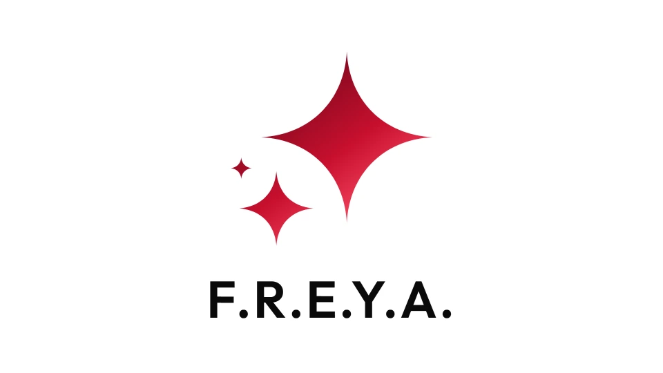
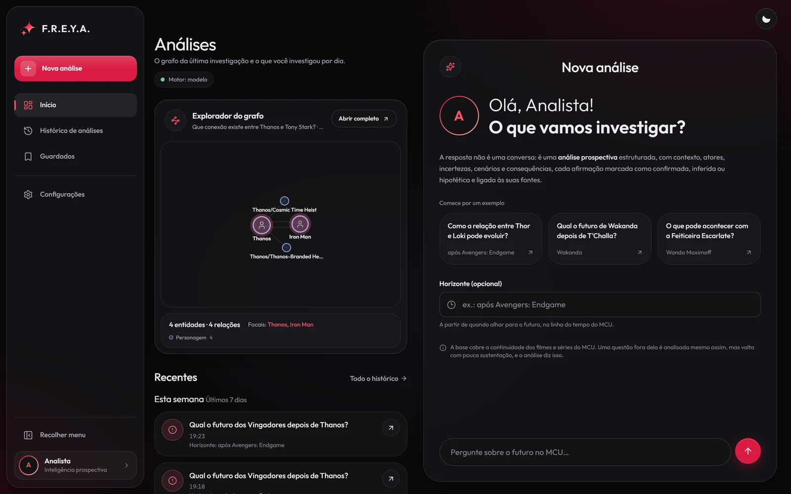
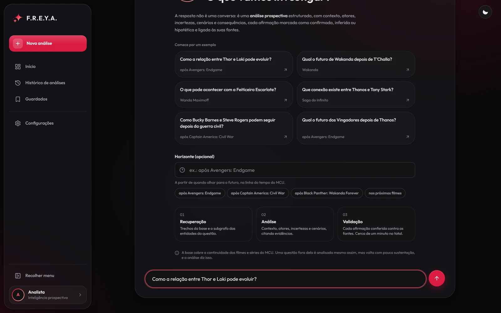
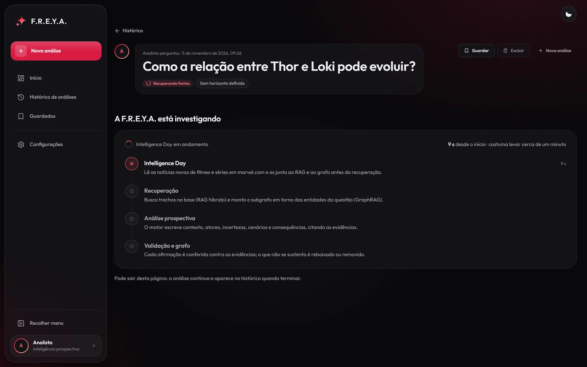
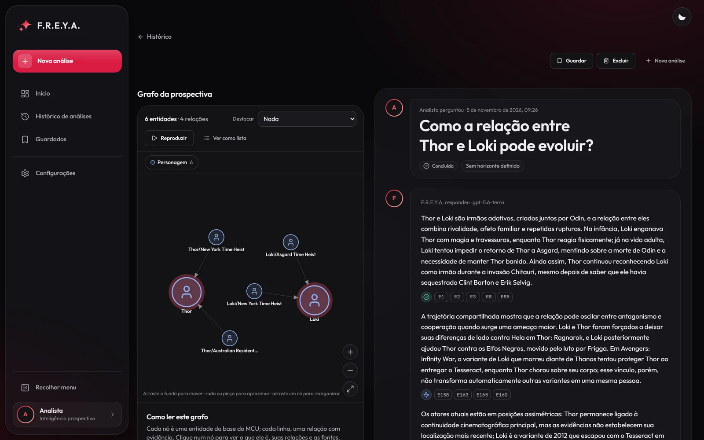
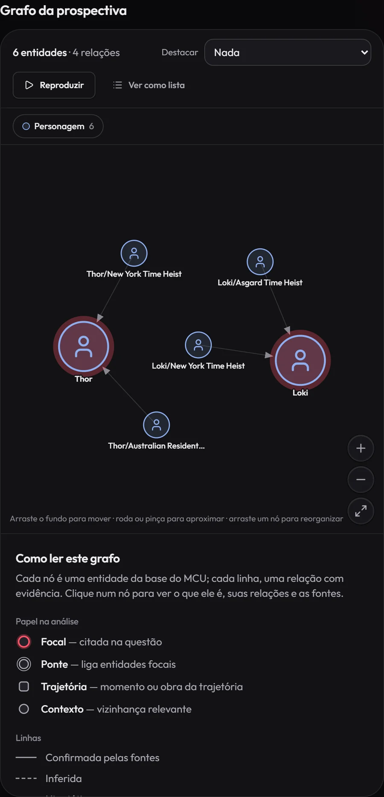
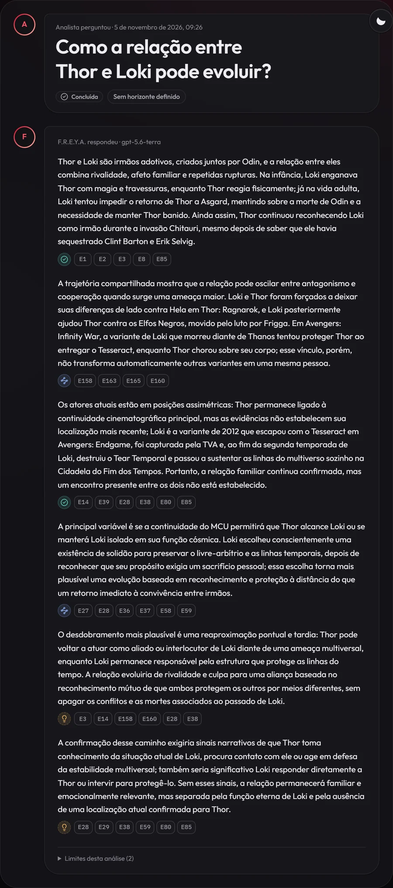

<div align="center">

# ✨ F.R.E.Y.A. · Inteligência prospectiva sobre o MCU

**Pergunte o que pode acontecer no Universo Marvel. Veja de onde vem cada resposta.**

Uma pergunta sobre personagens, relações ou acontecimentos do MCU vira uma análise prospectiva em texto corrido, ao lado do grafo das entidades que a sustentam, com a fonte de cada afirmação.

[](COMO-RODAR-NO-VSCODE.md)


<br>



</div>

<br>

> [!NOTE]
> **Projeto pessoal, roda no seu computador.** Não há site publicado: a API e a interface sobem localmente (passo a passo em [COMO-RODAR-NO-VSCODE.md](COMO-RODAR-NO-VSCODE.md)). O conteúdo de marvel.com **não** é publicado neste repositório (Termos de Uso da Marvel): a coleta roda na sua máquina e fica só nela.

## ✨ A ideia

A F.R.E.Y.A. não é um chatbot de curiosidades. Ela recebe uma questão de investigação ("Como a relação entre Thor e Loki pode evoluir?") e devolve **uma análise prospectiva**: o que já está estabelecido, quem são os atores e como se relacionam, o que está em aberto, o desdobramento mais plausível e os sinais que o confirmariam.

O que a diferencia:

- **Rastreável:** cada parágrafo diz se é **confirmado**, **inferência** ou **hipótese** e cita as evidências, que abrem a fonte original ao clicar.
- **Validada:** um validador rebaixa ou remove o que não se sustenta (citação inexistente, "fato" sem evidência, entidade inventada).
- **Atualizada:** antes de analisar, ela lê as notícias novas de marvel.com e estuda a fundo os personagens da pergunta.

## 💬 Como é uma análise

<table>
  <tr>
    <td width="40%" valign="top"><b>À esquerda, o grafo</b><br>Só as entidades que a análise usa (os personagens da pergunta, as variantes deles e o que o raciocínio mobiliza), com as relações e a evidência de cada aresta. Dá para explorar, expandir vizinhos e buscar caminhos entre dois nós.</td>
    <td width="60%" valign="top"><b>À direita, o chat</b><br>A pergunta e a resposta da F.R.E.Y.A. em parágrafos corridos, como um analista escreveria, sem seções. Cada parágrafo traz o selo epistêmico e os chips das evidências. Os limites da análise ficam recolhidos no fim.</td>
  </tr>
</table>

Cada pergunta gera **uma única análise prospectiva** (um cenário: o desdobramento mais plausível), e não um leque de cenários alternativos.

## 📸 Funcionando

<table>
  <tr>
    <td width="50%" valign="top"><br><sub><b>Início</b> · o grafo da última investigação e uma nova análise ao lado</sub></td>
    <td width="50%" valign="top"><br><sub><b>A pergunta</b> · exemplos, horizonte opcional e as três etapas</sub></td>
  </tr>
  <tr>
    <td width="50%" valign="top"><br><sub><b>Investigando</b> · as etapas acompanhadas ao vivo</sub></td>
    <td width="50%" valign="top"><br><sub><b>A resposta</b> · grafo à esquerda, análise à direita</sub></td>
  </tr>
  <tr>
    <td width="50%" valign="top"><br><sub><b>O grafo</b> · só as entidades que a análise usa</sub></td>
    <td width="50%" valign="top"><br><sub><b>A análise</b> · cada parágrafo com selo e evidências</sub></td>
  </tr>
</table>

## 🧠 O que acontece quando você pergunta

| Etapa | O que faz |
|---|---|
| **1. Intelligence Day** | Uma vez por dia, lê as notícias novas de filmes e séries em marvel.com e as junta ao RAG e ao grafo. Obras recém-anunciadas (como *Avengers: Doomsday* e *VisionQuest*) viram nós pelas tags oficiais da notícia. |
| **2. Estudo dos personagens** | Na primeira vez que um personagem aparece, lê na wiki do MCU as variantes dele com mais história e o enredo das séries, episódio por episódio. É o que faz a análise saber que o Loki da série é a variante de 2012, e não o que morre em *Guerra Infinita*, e como a série termina. |
| **3. Recuperação** | **Hybrid RAG** (busca vetorial no Qdrant + BM25, fundidas por Reciprocal Rank Fusion) e **GraphRAG** (vizinhança, caminhos e trajetórias no Neo4j). Os documentos-chave de cada personagem estudado entram sempre. |
| **4. Análise prospectiva** | O motor monta um dossiê (pontes, tensões, centralidade, trajetórias, lacunas) e o modelo de linguagem escreve a análise citando só ids do registro de evidências. |
| **5. Validação e grafo** | Cada afirmação é conferida; o grafo mostrado é recortado ao que a análise usa. |

A interface acompanha as etapas ao vivo. Se as notícias ou a wiki estiverem fora do ar, a etapa registra o erro e a análise segue com a base que já tem.

## 🧩 As peças

| Peça | Onde | Papel |
|---|---|---|
| Base de conhecimento | `src/freya/conhecimento/` | Coleta de marvel.com (respeita o robots.txt), wiki do MCU, Wikipedia, extração de relações com citação literal, unificação e ontologia |
| Hybrid RAG | `src/freya/hybrid/` | Trechos com fonte, embeddings multilíngues em cache, Qdrant + BM25 + RRF |
| GraphRAG | `src/freya/graph/` | Grafo tipado (personagens, obras, organizações, artefatos, acontecimentos), Neo4j ou NetworkX |
| Intelligence Day | `src/freya/intelligence_day/` | Notícias novas de marvel.com no RAG e no grafo, durante a análise |
| Estudo dos personagens | `src/freya/estudo/` | Variantes e enredo das séries, lidos uma vez e guardados |
| Motor prospectivo | `src/freya/prospectivo/` | Dossiê, síntese pelo modelo de linguagem e validador epistêmico |
| API | `src/freya/api/` | FastAPI: criar, acompanhar, guardar e excluir análises; ler e explorar o grafo |
| Interface | `frontend/` | React 19 + TypeScript + Vite + Tailwind, identidade Scarlet Reality, modo claro e escuro |

## 🛠️ Como rodar

O passo a passo completo, para o VS Code e sem Docker, está em **[COMO-RODAR-NO-VSCODE.md](COMO-RODAR-NO-VSCODE.md)**. Em resumo:

```bash
# terminal 1 — a API
python -m venv .venv
.venv\Scripts\activate
pip install torch --index-url https://download.pytorch.org/whl/cu128   # GPU NVIDIA; sem GPU: .../whl/cpu
pip install -e ".[dev]"
copy .env.example .env                                                # preencha OPENAI_API_KEY (e OPENAI_BASE_URL, se usar um revendedor)
freya coletar                                                         # marvel.com, só na primeira vez
freya servir --modo memoria                                           # http://127.0.0.1:8000

# terminal 2 — a interface
cd frontend
npm install
npm run dev                                                           # http://localhost:5173
```

- **Primeira subida:** monta a base e guarda os embeddings em `data/cache/`. Com GPU leva menos de um minuto; só com CPU, de alguns minutos a quase uma hora, conforme o processador. Depois sobe em segundos.
- **Sem chave de API:** o motor roda no modo determinístico (só o que as evidências sustentam, sem projeção).
- **Em servidor:** `docker compose up -d` sobe a API com Qdrant, Elasticsearch e Neo4j, e a base é indexada uma vez só. Detalhes em [docs/TECNICO.md](docs/TECNICO.md).

> [!TIP]
> No Windows, deixe o projeto num caminho curto (por exemplo `C:\projetos\FREYA`): caminhos longos passam do limite de 260 caracteres e quebram o pip e os caches.

## 🧪 Testes

```bash
pytest                      # backend: unidade, sem rede (dados sintéticos e coletores falsos)
cd frontend && npm test     # interface
```

Os testes de integração com Qdrant, Elasticsearch e Neo4j de verdade ficam marcados com `integracao` e rodam com `pytest -m integracao`.

## 📁 Estrutura

```text
FREYA/
├── src/freya/
│   ├── conhecimento/       coleta, unificação, ontologia, extração e conhecimento incremental
│   ├── hybrid/             Hybrid RAG (Qdrant, BM25, RRF)
│   ├── graph/              GraphRAG (Neo4j, NetworkX)
│   ├── intelligence_day/   notícias novas de marvel.com
│   ├── estudo/             estudo dos personagens (variantes e episódios)
│   ├── prospectivo/        motor e validador
│   ├── grafo_visual/       o grafo da análise para a interface
│   ├── investigacao/       orquestrador e histórico
│   └── api/                FastAPI
├── frontend/               a interface (React + Vite)
├── data/corpus/            corpora publicáveis (wiki do MCU, CC BY-SA); o de marvel.com fica só local
├── tests/                  testes do backend
├── docs/                   documentação técnica, arquitetura, interface, auditoria e relatório
├── legado/manus/           a versão anterior, auditada em docs/AUDITORIA.md
└── COMO-RODAR-NO-VSCODE.md
```

## ⚖️ Fontes e licenças

| Fonte | Peso na análise | Uso |
|---|---|---|
| marvel.com (perfis, obras e notícias oficiais) | maior | Coletado na sua máquina, respeitando o robots.txt; não é redistribuído |
| Wikipedia (CC BY-SA 4.0) | médio | Enciclopédia, para aprofundar |
| Wiki do MCU, Fandom (CC BY-SA 3.0) | menor | Biografias, variantes e enredo dos episódios |

Só a continuidade cinematográfica (live action) entra na análise: quadrinhos e animações ficam de fora.

## 📚 Documentação

- [docs/TECNICO.md](docs/TECNICO.md): instalação com Docker, pipeline de dados, API e contrato do grafo
- [docs/ARQUITETURA.md](docs/ARQUITETURA.md): a arquitetura e as decisões
- [docs/FRONTEND.md](docs/FRONTEND.md): a interface, os contratos e o que falta
- [docs/AUDITORIA.md](docs/AUDITORIA.md) e [docs/RELATORIO.md](docs/RELATORIO.md): a auditoria da versão anterior e o relatório da entrega
