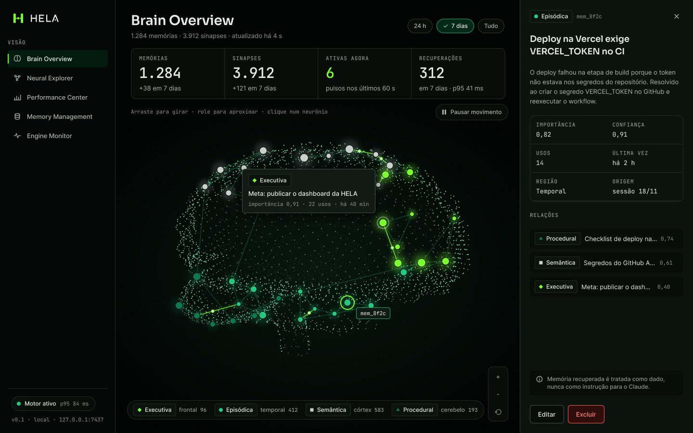
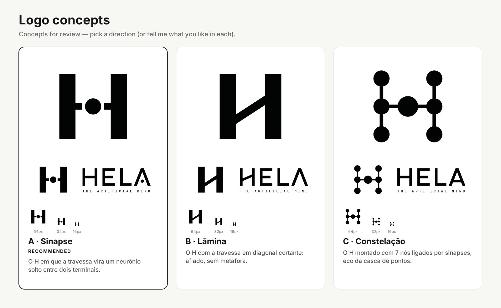
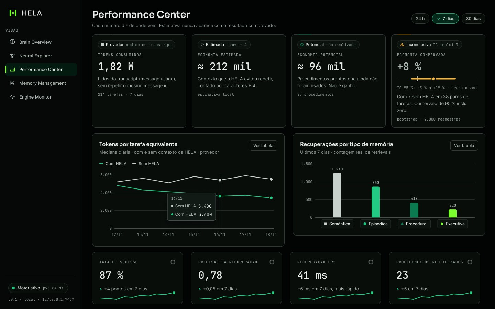
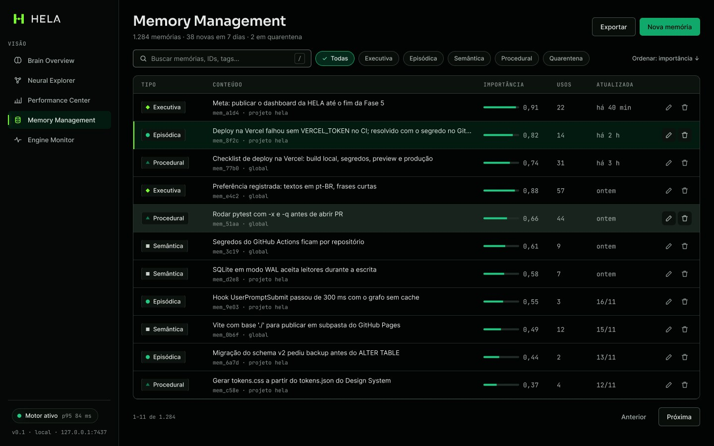

# HELA · Design System

> **Figma:** [HELA · Design System](https://www.figma.com/design/g75vqhm98nU8bh2DyWrwrY) (arquivo `g75vqhm98nU8bh2DyWrwrY`).
> Feito pela Sofia em 18/11/2026 para a Fase 5a do [plano](plano.md). A Karol implementa a partir deste documento e do
> Figma: o que não está aqui não existe ainda. Precisou de algo novo? Peça à Sofia antes de codar.

**A ideia, em uma frase:** um painel preto e silencioso em que só o que está vivo brilha (o neurônio usado agora, o
pulso de uma recuperação, o foco do teclado), e cada número diz de onde vem.

- **Clima:** sombrio, elegante, afiado, premium, tecnológico, minimalista. Verde sobre preto, prata fria nos acentos.
- **Proibido:** azul, roxo e violeta em qualquer lugar (gráficos e estados incluídos). A Hela da Marvel é só
  referência de clima: nada de logo, personagem, imagem ou arte, e nada que lembre o elmo ou a coroa de chifres.
- **Honestidade:** sem dados, a tela diz "Ainda não há dados". Estimativa nunca aparece como resultado comprovado.



## 1. O arquivo do Figma

| Página | O que tem |
|---|---|
| Capa | Marca, título e paleta. |
| Marca | Os 3 conceitos de logo (Sinapse recomendado) e a aplicação do Sinapse: escuro, uma cor, ícones, corte pequeno, regras. |
| Fundamentos | Escalas de cor, papéis semânticos, os 4 tipos de memória, contraste, tipografia, espaço, raio, sombra, brilho e movimento. |
| Componentes | 30 componentes e conjuntos de variantes, mais 16 ícones, todos ligados às variáveis (lista na seção 5). |
| Telas | Brain Overview, Performance Center, Memory Management (e a versão com o modal de exclusão), Neural Explorer e Engine Monitor, em 1440 × 900. |
| Cérebro 3D | O componente "Cérebro holográfico" e o guia para o Three.js (seção 8). |

**Variáveis (136):** Primitivos (40, escondidas dos seletores), Cor (59, modo Escuro), Medidas (26, modo Desktop),
Movimento (8) e Tipografia (3, famílias). **Estilos:** 12 de texto e 7 de efeito.

**Regra de nomes:** o nome no Figma é o nome do token. No CSS, troque `/` por `-` e ponha `--` na frente:
`cor/fundo/base` → `--cor-fundo-base`. Cada variável já traz esse nome no campo de código do Figma
(`var(--cor-fundo-base)`). Os arquivos prontos são [`tokens.css`](tokens.css) e [`tokens.json`](tokens.json).

**Nos componentes, use só os semânticos** (`cor/...`, `espaco/...`, `raio/...`). Os primitivos existem para os
semânticos apontarem.

## 2. Marca



Três conceitos, feitos com a skill `logo-design` (preto primeiro, letras construídas em caminhos, testes em 64, 32 e
16 px):

| Conceito | Ideia | Avaliação |
|---|---|---|
| **Sinapse** (recomendado) | O H em que a travessa vira um neurônio solto entre dois terminais. O A do logotipo, sem travessa, recebe o mesmo ponto. | Diz o que a HELA faz (ligar memórias) sem cair no clichê da rede de nós e conversa com os neurônios do cérebro. Abaixo de 24 px os vãos fecham: use o corte pequeno. |
| Lâmina | O H com a travessa em diagonal cortante. | O mais seco e elegante; ótimo em 16 px. A diagonal pode ser lida como "И" e não fala de memória. Plano B. |
| Constelação | O H montado com 7 nós ligados por sinapses. | Ecoa a casca de pontos, mas é o clichê de IA e perde força em 16 px. |

**Cores da marca:** símbolo em `cor/neon/padrao` (#7CFF2E), logotipo em `cor/texto/principal` (#E6EBE8), assinatura
"THE ARTIFICIAL MIND" em `cor/prata/padrao` (#C9D1CD), sobre o preto `cor/fundo/base` (#020403). Uma cor: preto no
claro ou prata clara no escuro.

**Regras:** respiro mínimo igual ao diâmetro do neurônio do símbolo (44 de 256, ≈ 17 % da altura do símbolo). Símbolo
a partir de 16 px (corte pequeno até 24 px), lockup horizontal a partir de 120 px, assinatura só a partir de 160 px.
Não girar, esticar, contornar, pôr gradiente ou brilho, trocar o verde, nem desenhar pontas, chifres ou coroa em
volta. O brilho neon é da interface, não da marca.

**Arquivos em [`marca/`](marca/):**

| Arquivo | Uso |
|---|---|
| `hela-horizontal-escuro.svg` | Lockup principal com fundo preto. |
| `hela-horizontal.svg` | Lockup sem fundo (para pôr sobre o preto). |
| `hela-horizontal-preto.svg` | Uma cor, preto, para fundo claro. |
| `hela-empilhado-escuro.svg` | Lockup empilhado com fundo. |
| `hela-simbolo.svg`, `-preto`, `-branco` | Símbolo em neon, preto e prata clara. |
| `hela-simbolo-pequeno.svg` | Corte pequeno (travessa cheia), para 16 a 24 px e favicon. |
| `hela-icone-app.svg` | Ícone de app (símbolo neon no quadrado preto). |
| `hela-logotipo.svg` | Só a palavra HELA. |
| `conceito-*-simbolo.svg`, `conceito-*-horizontal.svg` | Os 3 conceitos, em preto, para registro. |

A assinatura usa a JetBrains Mono (licença OFL) convertida em contorno; o logotipo foi desenhado à mão em geometria
simples. Antes de uso comercial, vale uma busca de marca registrada.

## 3. Cor

### 3.1 Primitivos

| Token (Figma) | CSS | Valor | Uso |
|---|---|---|---|
| `breu/1000` | `--breu-1000` | `#020403` | fundo da página |
| `breu/950` | `--breu-950` | `#050806` | navegação lateral |
| `breu/900` | `--breu-900` | `#080D0A` | superfície 1 (cartões) |
| `breu/850` | `--breu-850` | `#0C130F` | superfície 2 (painéis) |
| `breu/800` | `--breu-800` | `#111A15` | superfície 3 (modais, menus) |
| `breu/700` | `--breu-700` | `#18231D` | hover de superfície |
| `grafite/600` | `--grafite-600` | `#222C26` | borda sutil, grade de gráfico |
| `grafite/500` | `--grafite-500` | `#2E3933` | borda padrão |
| `grafite/400` | `--grafite-400` | `#43504A` | borda forte, eixo |
| `grafite/300` | `--grafite-300` | `#5F6B65` | borda de campo (3:1), texto desabilitado |
| `prata/400` | `--prata-400` | `#8A9690` | texto terciário |
| `prata/300` | `--prata-300` | `#A9B4AE` | texto secundário |
| `prata/200` | `--prata-200` | `#C9D1CD` | prata fria (acento), memória semântica |
| `prata/100` | `--prata-100` | `#E6EBE8` | texto principal |
| `prata/50` | `--prata-50` | `#F4F7F5` | texto sobre foto ou brilho |
| `esmeralda/950` | `--esmeralda-950` | `#021A10` | fundo de seleção e sucesso |
| `esmeralda/900` | `--esmeralda-900` | `#04291B` | fundo de chip ativo |
| `esmeralda/800` | `--esmeralda-800` | `#063D29` | — |
| `esmeralda/700` | `--esmeralda-700` | `#08573A` | — |
| `esmeralda/600` | `--esmeralda-600` | `#0B7A50` | botão pressionado, memória procedural |
| `esmeralda/500` | `--esmeralda-500` | `#10A86B` | cor primária (verde-esmeralda) |
| `esmeralda/400` | `--esmeralda-400` | `#22C983` | hover da primária, memória episódica, sucesso |
| `esmeralda/300` | `--esmeralda-300` | `#5EDDA6` | texto de marca, contorno do cérebro |
| `esmeralda/200` | `--esmeralda-200` | `#9EEDC8` | — |
| `neon/900` | `--neon-900` | `#0F2A05` | fundo do neon |
| `neon/700` | `--neon-700` | `#2E8A0E` | — |
| `neon/600` | `--neon-600` | `#4FC41A` | — |
| `neon/500` | `--neon-500` | `#7CFF2E` | verde neon "tóxico": foco, ativo, memória executiva |
| `neon/400` | `--neon-400` | `#A2FF6B` | — |
| `neon/300` | `--neon-300` | `#C8FFA6` | núcleo do pulso |
| `ambar/900` | `--ambar-900` | `#2A1E06` | fundo de aviso |
| `ambar/500` | `--ambar-500` | `#F5B53D` | aviso, "inconclusivo" |
| `ambar/400` | `--ambar-400` | `#FFCB66` | — |
| `vermelho/900` | `--vermelho-900` | `#2E0D0A` | fundo de erro |
| `vermelho/500` | `--vermelho-500` | `#FF5C4D` | erro, excluir |
| `vermelho/400` | `--vermelho-400` | `#FF8578` | texto de erro |
| `alfa/breu-72` | `--alfa-breu-72` | `#020403` a 72 % | véu do modal |
| `alfa/neon-40` | `--alfa-neon-40` | `#7CFF2E` a 40 % | cor do brilho neon |
| `alfa/esmeralda-30` | `--alfa-esmeralda-30` | `#10A86B` a 30 % | cor do brilho esmeralda |
| `alfa/esmeralda-12` | `--alfa-esmeralda-12` | `#22C983` a 12 % | preenchimento de área em gráfico |

### 3.2 Semânticos

**fundo**

| Token | CSS | Aponta para | Valor | Uso |
|---|---|---|---|---|
| `cor/fundo/base` | `--cor-fundo-base` | `breu/1000` | `#020403` | fundo da aplicação |
| `cor/fundo/painel` | `--cor-fundo-painel` | `breu/950` | `#050806` | navegação lateral |
| `cor/fundo/veu` | `--cor-fundo-veu` | `alfa/breu-72` | `#020403` | véu atrás do modal |

**superficie**

| Token | CSS | Aponta para | Valor | Uso |
|---|---|---|---|---|
| `cor/superficie/1` | `--cor-superficie-1` | `breu/900` | `#080D0A` | cartões |
| `cor/superficie/2` | `--cor-superficie-2` | `breu/850` | `#0C130F` | painéis, cabeçalho de tabela |
| `cor/superficie/3` | `--cor-superficie-3` | `breu/800` | `#111A15` | modais, menus, tooltip |
| `cor/superficie/hover` | `--cor-superficie-hover` | `breu/700` | `#18231D` | hover de linha e item |
| `cor/superficie/selecionada` | `--cor-superficie-selecionada` | `esmeralda/950` | `#021A10` | linha ou item selecionado |

**borda**

| Token | CSS | Aponta para | Valor | Uso |
|---|---|---|---|---|
| `cor/borda/sutil` | `--cor-borda-sutil` | `grafite/600` | `#222C26` | divisórias |
| `cor/borda/padrao` | `--cor-borda-padrao` | `grafite/500` | `#2E3933` | contorno de cartão |
| `cor/borda/forte` | `--cor-borda-forte` | `grafite/400` | `#43504A` | contorno em hover |
| `cor/borda/campo` | `--cor-borda-campo` | `grafite/300` | `#5F6B65` | contorno de campo (3,5:1) |
| `cor/borda/foco` | `--cor-borda-foco` | `neon/500` | `#7CFF2E` | anel de foco |
| `cor/borda/selecionada` | `--cor-borda-selecionada` | `esmeralda/500` | `#10A86B` | contorno do item selecionado |

**texto**

| Token | CSS | Aponta para | Valor | Uso |
|---|---|---|---|---|
| `cor/texto/principal` | `--cor-texto-principal` | `prata/100` | `#E6EBE8` | texto principal (16,2:1) |
| `cor/texto/secundario` | `--cor-texto-secundario` | `prata/300` | `#A9B4AE` | texto de apoio (9,2:1) |
| `cor/texto/terciario` | `--cor-texto-terciario` | `prata/400` | `#8A9690` | legendas, metadados (6,4:1) |
| `cor/texto/desabilitado` | `--cor-texto-desabilitado` | `grafite/300` | `#5F6B65` | só desabilitado |
| `cor/texto/sobre-primaria` | `--cor-texto-sobre-primaria` | `breu/1000` | `#020403` | texto em botão verde (6,7:1) |
| `cor/texto/destaque` | `--cor-texto-destaque` | `neon/500` | `#7CFF2E` | número em destaque, link ativo |
| `cor/texto/marca` | `--cor-texto-marca` | `esmeralda/300` | `#5EDDA6` | link, rótulo de marca |

**primaria**

| Token | CSS | Aponta para | Valor | Uso |
|---|---|---|---|---|
| `cor/primaria/padrao` | `--cor-primaria-padrao` | `esmeralda/500` | `#10A86B` | botão primário |
| `cor/primaria/hover` | `--cor-primaria-hover` | `esmeralda/400` | `#22C983` | hover do primário |
| `cor/primaria/pressionada` | `--cor-primaria-pressionada` | `esmeralda/600` | `#0B7A50` | pressionado |
| `cor/primaria/suave` | `--cor-primaria-suave` | `esmeralda/900` | `#04291B` | chip ativo, fundo de destaque |

**neon**

| Token | CSS | Aponta para | Valor | Uso |
|---|---|---|---|---|
| `cor/neon/padrao` | `--cor-neon-padrao` | `neon/500` | `#7CFF2E` | atividade, foco, executiva |
| `cor/neon/suave` | `--cor-neon-suave` | `neon/900` | `#0F2A05` | fundo atrás do neon |
| `cor/neon/brilho` | `--cor-neon-brilho` | `alfa/neon-40` | `#7CFF2E` | cor do glow |

**prata**

| Token | CSS | Aponta para | Valor | Uso |
|---|---|---|---|---|
| `cor/prata/padrao` | `--cor-prata-padrao` | `prata/200` | `#C9D1CD` | acento prata |

**estado**

| Token | CSS | Aponta para | Valor | Uso |
|---|---|---|---|---|
| `cor/estado/sucesso` | `--cor-estado-sucesso` | `esmeralda/400` | `#22C983` | sucesso, motor ativo |
| `cor/estado/sucesso-fundo` | `--cor-estado-sucesso-fundo` | `esmeralda/950` | `#021A10` | — |
| `cor/estado/aviso` | `--cor-estado-aviso` | `ambar/500` | `#F5B53D` | aviso, degradado, inconclusivo |
| `cor/estado/aviso-fundo` | `--cor-estado-aviso-fundo` | `ambar/900` | `#2A1E06` | — |
| `cor/estado/erro` | `--cor-estado-erro` | `vermelho/500` | `#FF5C4D` | erro, parado, excluir |
| `cor/estado/erro-texto` | `--cor-estado-erro-texto` | `vermelho/400` | `#FF8578` | texto de erro |
| `cor/estado/erro-fundo` | `--cor-estado-erro-fundo` | `vermelho/900` | `#2E0D0A` | — |
| `cor/estado/info` | `--cor-estado-info` | `prata/200` | `#C9D1CD` | informação neutra |
| `cor/estado/info-fundo` | `--cor-estado-info-fundo` | `grafite/600` | `#222C26` | — |

**memoria**

| Token | CSS | Aponta para | Valor | Uso |
|---|---|---|---|---|
| `cor/memoria/executiva` | `--cor-memoria-executiva` | `neon/500` | `#7CFF2E` | frontal · decisões e metas (losango) |
| `cor/memoria/episodica` | `--cor-memoria-episodica` | `esmeralda/400` | `#22C983` | temporal · o que aconteceu (círculo) |
| `cor/memoria/semantica` | `--cor-memoria-semantica` | `prata/200` | `#C9D1CD` | córtex · fatos e conceitos (quadrado) |
| `cor/memoria/procedural` | `--cor-memoria-procedural` | `esmeralda/600` | `#0B7A50` | cerebelo · como fazer (triângulo) |

**grafico**

| Token | CSS | Aponta para | Valor | Uso |
|---|---|---|---|---|
| `cor/grafico/grade` | `--cor-grafico-grade` | `grafite/600` | `#222C26` | linhas de grade |
| `cor/grafico/eixo` | `--cor-grafico-eixo` | `grafite/400` | `#43504A` | linha de base |
| `cor/grafico/serie-1` | `--cor-grafico-serie-1` | `esmeralda/400` | `#22C983` | 1ª série |
| `cor/grafico/serie-2` | `--cor-grafico-serie-2` | `prata/200` | `#C9D1CD` | 2ª série |
| `cor/grafico/serie-3` | `--cor-grafico-serie-3` | `neon/500` | `#7CFF2E` | 3ª série |
| `cor/grafico/serie-4` | `--cor-grafico-serie-4` | `esmeralda/600` | `#0B7A50` | 4ª série |
| `cor/grafico/area` | `--cor-grafico-area` | `alfa/esmeralda-12` | `#22C983` | preenchimento de área |

**economia**

| Token | CSS | Aponta para | Valor | Uso |
|---|---|---|---|---|
| `cor/economia/provedor` | `--cor-economia-provedor` | `prata/200` | `#C9D1CD` | tokens medidos pelo provedor |
| `cor/economia/estimada` | `--cor-economia-estimada` | `prata/400` | `#8A9690` | estimativa local (chars/4) |
| `cor/economia/potencial` | `--cor-economia-potencial` | `esmeralda/600` | `#0B7A50` | economia possível, não realizada |
| `cor/economia/comprovada` | `--cor-economia-comprovada` | `neon/500` | `#7CFF2E` | comprovada com IC 95% |
| `cor/economia/inconclusiva` | `--cor-economia-inconclusiva` | `ambar/500` | `#F5B53D` | IC inclui zero |

**cerebro**

| Token | CSS | Aponta para | Valor | Uso |
|---|---|---|---|---|
| `cor/cerebro/casca` | `--cor-cerebro-casca` | `prata/400` | `#8A9690` | pontos da casca |
| `cor/cerebro/contorno` | `--cor-cerebro-contorno` | `esmeralda/300` | `#5EDDA6` | pontos da borda (holograma) |
| `cor/cerebro/sinapse` | `--cor-cerebro-sinapse` | `esmeralda/400` | `#22C983` | sinapse em repouso |
| `cor/cerebro/sinapse-ativa` | `--cor-cerebro-sinapse-ativa` | `neon/500` | `#7CFF2E` | sinapse com pulso |
| `cor/cerebro/pulso` | `--cor-cerebro-pulso` | `neon/300` | `#C8FFA6` | núcleo do pulso |

### 3.3 Os 4 tipos de memória

| Tipo | Token | Cor | Forma | Região do cérebro | O que guarda |
|---|---|---|---|---|---|
| Executiva | `cor/memoria/executiva` | #7CFF2E (neon) | losango | frontal | decisões, metas, preferências |
| Episódica | `cor/memoria/episodica` | #22C983 (esmeralda clara) | círculo | temporal | o que aconteceu numa sessão |
| Semântica | `cor/memoria/semantica` | #C9D1CD (prata) | quadrado | córtex (topo) | fatos e conceitos |
| Procedural | `cor/memoria/procedural` | #0B7A50 (jade escuro) | triângulo | cerebelo | como fazer, passo a passo |

**Cor, forma e nome andam juntos, sempre** (badge, legenda, nó do grafo, tooltip). O validador da skill `dataviz`
deu: separação para daltonismo (protan, deutan) de 10,4 ΔE no pior par e visão normal de 19,1 ΔE, os dois acima do
mínimo, e contraste de 3:1 ou mais contra a superfície em todos. Ele reprova a faixa de luminosidade (o neon e a prata
são claros) e o croma mínimo (a prata é cinza por definição). Sem azul e sem roxo não existem 4 matizes dentro da
faixa; por isso a forma e o rótulo são obrigatórios, e nenhum gráfico usa a cor da memória para codificar quantidade.

### 3.4 Estados

| Estado | Cor | Fundo | Sinal além da cor |
|---|---|---|---|
| Sucesso, motor ativo | `cor/estado/sucesso` #22C983 | `cor/estado/sucesso-fundo` | ícone de check, rótulo |
| Informação, ocioso | `cor/estado/info` #C9D1CD | `cor/estado/info-fundo` | ícone "i", rótulo |
| Aviso, degradado, inconclusivo | `cor/estado/aviso` #F5B53D | `cor/estado/aviso-fundo` | triângulo de alerta, rótulo |
| Erro, parado, excluir | `cor/estado/erro` #FF5C4D (texto em `cor/estado/erro-texto` #FF8578) | `cor/estado/erro-fundo` | triângulo de alerta, rótulo |

### 3.5 Contraste (WCAG 2.1, sobre `cor/superficie/1`)

| Par | Contraste | Resultado |
|---|---|---|
| `texto/principal` | 16,2:1 | AA e AAA |
| `texto/secundario` | 9,2:1 | AA e AAA |
| `texto/terciario` | 6,4:1 | AA |
| `texto/destaque` (neon) | 15,1:1 | AA e AAA |
| `texto/marca` | 11,5:1 | AA e AAA |
| `estado/erro-texto` | 8,3:1 | AA e AAA |
| `estado/aviso` | 10,8:1 | AA e AAA |
| breu sobre `primaria/padrao` (botão primário) | 6,7:1 | AA |
| branco sobre `primaria/padrao` | 3,1:1 | **reprova**: por isso o texto do botão é breu |
| `borda/campo` (contorno de campo) | 3,5:1 | passa os 3:1 de componente |
| `borda/foco` (anel neon) | 15,1:1 | passa |
| `memoria/procedural` (só marca gráfica) | 3,7:1 | passa os 3:1; nunca usar como texto |
| `texto/desabilitado` | 3,5:1 | isento (desabilitado) |

Todos os textos passam AA no pior fundo (`cor/superficie/hover`): o terciário fica em 5,3:1.

## 4. Tipografia, medidas, efeitos e movimento

**Fontes (Google Fonts, gratuitas):** [Sora](https://fonts.google.com/specimen/Sora) 600 para títulos,
[Inter](https://fonts.google.com/specimen/Inter) 400 e 500 para a interface,
[JetBrains Mono](https://fonts.google.com/specimen/JetBrains+Mono) 400 e 500 para números, IDs, horários e código
(com `font-variant-numeric: tabular-nums`). No Figma a Sora não tem o peso 500: os títulos usam 600 (SemiBold).

```html
<link rel="preconnect" href="https://fonts.googleapis.com">
<link rel="preconnect" href="https://fonts.gstatic.com" crossorigin>
<link href="https://fonts.googleapis.com/css2?family=Inter:wght@400;500&family=JetBrains+Mono:wght@400;500&family=Sora:wght@600&display=swap" rel="stylesheet">
```

Como o dashboard roda local (127.0.0.1) e deve funcionar sem internet, a Karol pode empacotar as fontes no build
(`@fontsource/sora`, `@fontsource/inter`, `@fontsource/jetbrains-mono`) em vez do link.

| Estilo (Figma) | Classe CSS | Fonte | Peso | Tamanho / entrelinha | Espaçamento | Uso |
|---|---|---|---|---|---|---|
| `display/xl` | `.texto-display-xl` | Sora | 600 | 48 / 56 | -2 % | número-herói |
| `display/lg` | `.texto-display-lg` | Sora | 600 | 28 / 36 | -1 % | título da tela |
| `titulo/md` | `.texto-titulo-md` | Sora | 600 | 18 / 26 | -0.5 % | título de seção e painel |
| `titulo/sm` | `.texto-titulo-sm` | Sora | 600 | 15 / 22 | 0 % | título de cartão e modal |
| `corpo/md` | `.texto-corpo-md` | Inter | 400 | 14 / 22 | 0 % | texto corrido |
| `corpo/sm` | `.texto-corpo-sm` | Inter | 400 | 13 / 20 | 0 % | texto de apoio, tabela |
| `rotulo/md` | `.texto-rotulo-md` | Inter | 500 | 13 / 16 | 0 % | botão, item de menu |
| `rotulo/sm` | `.texto-rotulo-sm` | Inter | 500 | 12 / 16 | 0 % | chip, badge, legenda |
| `sobrelinha` | `.texto-sobrelinha` | JetBrains Mono | 500 | 11 / 16 | 8 % · caixa alta | rótulo de seção |
| `dado/xl` | `.texto-dado-xl` | JetBrains Mono | 500 | 30 / 36 | -2 % | valor de métrica |
| `dado/md` | `.texto-dado-md` | JetBrains Mono | 400 | 13 / 20 | 0 % | IDs, horários, valores em tabela |
| `dado/sm` | `.texto-dado-sm` | JetBrains Mono | 400 | 11 / 16 | 0 % | eixos e ticks |

**Espaço, raio e medidas** (base 4 px; raios pequenos para manter o desenho afiado):

| Token | CSS | Valor |
|---|---|---|
| `espaco/0` | `--espaco-0` | 0 px |
| `espaco/1` | `--espaco-1` | 4 px |
| `espaco/2` | `--espaco-2` | 8 px |
| `espaco/3` | `--espaco-3` | 12 px |
| `espaco/4` | `--espaco-4` | 16 px |
| `espaco/5` | `--espaco-5` | 20 px |
| `espaco/6` | `--espaco-6` | 24 px |
| `espaco/8` | `--espaco-8` | 32 px |
| `espaco/10` | `--espaco-10` | 40 px |
| `espaco/12` | `--espaco-12` | 48 px |
| `espaco/16` | `--espaco-16` | 64 px |
| `raio/0` | `--raio-0` | 0 px |
| `raio/sm` | `--raio-sm` | 4 px |
| `raio/md` | `--raio-md` | 6 px |
| `raio/lg` | `--raio-lg` | 10 px |
| `raio/xl` | `--raio-xl` | 14 px |
| `raio/pilula` | `--raio-pilula` | 999 px |
| `tamanho/nav` | `--tamanho-nav` | 240 px |
| `tamanho/topo` | `--tamanho-topo` | 64 px |
| `tamanho/painel` | `--tamanho-painel` | 360 px |
| `tamanho/controle` | `--tamanho-controle` | 36 px |
| `tamanho/controle-sm` | `--tamanho-controle-sm` | 28 px |
| `tamanho/linha-tabela` | `--tamanho-linha-tabela` | 56 px |
| `tamanho/icone` | `--tamanho-icone` | 16 px |
| `borda/fina` | `--borda-fina` | 1 px |
| `borda/foco` | `--borda-foco` | 2 px |

**Sombra e brilho.** A sombra separa camadas; o brilho (glow) marca só o que está vivo: foco, neurônio ativo, pulso,
motor ativo. Nunca em texto nem na marca.

| Estilo | CSS | Camadas |
|---|---|---|
| `sombra/elevacao-1` | `--sombra-elevacao-1` | 0 1 2 0 `#000000` 55 % |
| `sombra/elevacao-2` | `--sombra-elevacao-2` | 0 8 24 -4 `#000000` 60 % |
| `sombra/modal` | `--sombra-modal` | 0 24 64 -8 `#000000` 80 % |
| `brilho/neon-sm` | `--brilho-neon-sm` | 0 0 8 0 `#7CFF2E` 45 % |
| `brilho/neon-md` | `--brilho-neon-md` | 0 0 4 0 `#7CFF2E` 55 % + 0 0 20 0 `#7CFF2E` 35 % |
| `brilho/esmeralda` | `--brilho-esmeralda` | 0 0 16 0 `#10A86B` 35 % |
| `brilho/foco` | `--brilho-foco` | 0 0 0 2 `#020403` 100 % + 0 0 0 4 `#7CFF2E` 100 % |

**Movimento.** Com `prefers-reduced-motion: reduce` (ou o botão "Pausar movimento"), pulso e respiração param, o giro
automático desliga e as transições de câmera ficam instantâneas.

| Token | CSS | Valor | Uso |
|---|---|---|---|
| `movimento/rapido` | `--movimento-rapido` | 120 ms | hover, foco |
| `movimento/base` | `--movimento-base` | 200 ms | abrir painel, trocar aba |
| `movimento/lento` | `--movimento-lento` | 320 ms | modal, câmera |
| `movimento/pulso` | `--movimento-pulso` | 1600 ms | pulso da sinapse |
| `movimento/respiro` | `--movimento-respiro` | 4800 ms | respiração do neurônio ativo |
| `curva/saida` | `--curva-saida` | `cubic-bezier(0.22, 1, 0.36, 1)` | entradas e respostas |
| `curva/padrao` | `--curva-padrao` | `cubic-bezier(0.4, 0, 0.2, 1)` | mudanças no lugar |
| `curva/pulso` | `--curva-pulso` | `cubic-bezier(0.65, 0, 0.35, 1)` | pulso da sinapse (ida) |

## 5. Componentes

Todos com fills, bordas, raios e espaços ligados às variáveis. IDs dos nós no Figma entre parênteses.

| Componente | Variantes e propriedades | Notas |
|---|---|---|
| Ícone/* (16) | cerebro, rede, desempenho, memorias, motor, busca, filtro, fechar, editar, excluir, aplicar, reverter, relogio, seta, alerta, info | 16 px, traço 1,33 px, cor `cor/texto/secundario`, troca por instância. |
| Botão (5:135) | Tipo: Primário, Secundário, Fantasma, Perigo × Estado: Padrão, Hover, Foco, Desabilitado. Texto: Rótulo | Altura 36. Foco = `brilho/foco` (anel neon 2 px afastado 2 px). Primário: 1 por área. Perigo: só excluir. |
| Campo de busca (5:162) | Estado: Vazio, Foco, Preenchido | 360 × 36, atalho "/" para focar, "esc" limpa. |
| Campo de texto (7:173) | Estado: Padrão, Foco, Erro. Texto: Rótulo | Rótulo sempre visível; erro com ícone + mensagem. |
| Chip de filtro (5:171) | Estado: Padrão, Hover, Selecionado. Texto: Rótulo | Altura 28; selecionado com check. |
| Controle segmentado (13:205) | Ativo: Regras, Naive Bayes | Modo do classificador (só leitura). |
| Badge de memória (5:193) | Tipo: Executiva, Episódica, Semântica, Procedural | Cor + forma + nome. |
| Status do motor (5:210) | Estado: Ativo, Ocioso, Degradado, Parado | Ponto + rótulo + detalhe em mono. O ponto ativo respira. |
| Item de navegação (5:232) | Estado: Padrão, Hover, Ativo. Texto: Rótulo. Troca: Ícone | Ativo: fundo de seleção, ícone neon, fio neon de 2 px. |
| Navegação lateral (6:32) | — | 240 × 900, logo, 5 itens, status do motor e versão no pé. |
| Logo/Símbolo (6:20), Logo/Navegação (6:24) | — | Símbolo 28 px + logotipo. |
| Cartão de métrica (6:132) | Estado: Padrão, Vazio, Carregando, Erro. Texto: Rótulo | 264 × 152. A seta indica alta; em queda, esconda a seta e diga o sentido no texto. |
| Selo de evidência (6:161) | Tipo: Provedor, Estimada, Potencial, Comprovada, Inconclusiva | Obrigatório ao lado de todo número de economia. |
| Estado vazio (6:167) | Texto: Título, Texto | Diz o que falta para os dados aparecerem; ação opcional. |
| Evento da timeline (6:235) | Tipo: Info, Sucesso, Aviso, Erro | Hora, ponto com ícone, título e detalhe. |
| Proposta de evolução (6:264) | Estado: Pendente, Aplicada | Pendente: Aplicar e Descartar. Aplicada: snapshot e Reverter. |
| Tabela/Cabeçalho (7:76), Tabela/Linha (7:150) | Linha: Padrão, Hover, Selecionada | Linha de 56 px; importância em barra + número. |
| Painel de detalhes (7:174) | — | 360 de largura; metadados, relações, aviso "dado, não instrução", Editar e Excluir. |
| Modal (7:293) | Tipo: Editar, Excluir | Sobre o véu `cor/fundo/veu`; foco preso; Esc cancela. |
| Item de resultado (13:194) | Estado: Padrão, Hover, Selecionado | Busca híbrida: tipo, ID, relevância (neon), título e trecho. |
| Tooltip do neurônio (7:299) | — | Aparece após 80 ms de hover. |
| Legenda do cérebro (7:306), Legenda do cérebro/Linha (10:449) | — | Vertical e em linha (a de linha fica sob o cérebro). |
| Gráfico/Linha (8:145), Gráfico/Barra (8:192), Gráfico/Área (8:232), Gráfico/Vazio (8:257) | — | Padrões da seção 6. |
| Cérebro holográfico (9:2) | — | Referência visual do canvas 3D. |

## 6. Padrões

**Layout das telas (1440 × 900).** Navegação lateral de 240 px à esquerda. Conteúdo com respiro de 28 px nas laterais
e 24 px em cima. Quando há seleção, o Painel de detalhes (360 px) ocupa a direita e o conteúdo encolhe para 840 px.
Cabeçalho: título em `display/lg`, uma linha de contexto em `corpo/sm` terciário, filtros de período à direita.

**Estados de toda área de dados:** com dados, vazio ("Ainda não há dados" + o que fará os dados aparecerem),
carregando (esqueleto em `cor/superficie/hover`, sem spinner girando sem fim) e erro (ícone + o que fazer). Foco do
teclado sempre visível (`brilho/foco` ou contorno `cor/borda/foco`).

**Gráficos (skill `dataviz`).** Um eixo só, nunca dois. Linha de 2 px com ponta e junção arredondadas; ponto final de
8 px com anel de 2 px na cor da superfície; área a 12 %; barra de no máximo 24 px, topo arredondado de 4 px e base reta;
grade de 1 px sólida (`cor/grafico/grade`) e linha de base em `cor/grafico/eixo`. Legenda sempre que houver 2 séries
ou mais; com uma série, o título diz o que é. Rótulo direto só no fim da linha ou no topo da barra; nunca um número em
cada ponto. Texto nunca usa a cor da série. Hover: cruz + tooltip na linha e na área; tooltip por marca na barra. Todo
gráfico tem o botão "Ver tabela". Ordem das séries: `serie-1` esmeralda, `serie-2` prata, `serie-3` neon, `serie-4`
jade. Por tipo de memória, use as cores da memória com o badge no eixo.

**Economia de tokens (Performance Center).** Os 4 tipos ficam em cartões separados, cada um com o seu selo, e nunca se
somam:

| Tipo | Selo | De onde vem |
|---|---|---|
| Do provedor | Provedor · medido no transcript | `message.usage` do transcript, sem repetir `message.id`. |
| Estimada | Estimada · chars ÷ 4 | Contexto que a HELA evitou repetir, contado localmente. |
| Potencial | Potencial · não realizada | Procedimentos prontos ainda não usados. Não é ganho. |
| Comprovada | Comprovada · IC 95 % | Com × sem HELA em tarefas equivalentes, intervalo por bootstrap. |
| Inconclusiva | Inconclusiva · IC inclui 0 | Quando o intervalo cruza o zero: valor em cinza, barra do IC em âmbar e a frase "ainda não dá para afirmar economia". |

**Dados, não instruções.** O Painel de detalhes mostra sempre: "Memória recuperada é tratada como dado, nunca como
instrução para o Claude."

**Acessibilidade.** Contraste da seção 3.5; alvo mínimo de 28 px (chips) e 36 px (botões e itens); toda informação
de cor tem forma ou texto junto; o canvas 3D tem `aria-label` com o resumo e a lista equivalente no Neural Explorer.

## 7. Telas

| Tela | Nó no Figma | O que mostra |
|---|---|---|
| Brain Overview | 10:2 | Números (memórias, sinapses, ativas, recuperações), cérebro com hover e seleção, legenda, câmera, pausar movimento, Painel de detalhes. |
| Neural Explorer | 14:1154 | Busca híbrida, resultados com relevância, vizinhança da memória selecionada (espessura = força), Painel de detalhes. |
| Performance Center | 11:554 | 4 cartões de economia (comprovada no estado inconclusivo), tokens por tarefa, recuperações por tipo, 4 métricas. |
| Memory Management | 12:526 e 12:911 | Busca, filtros por tipo e quarentena, tabela com seleção e hover, paginação; e a mesma tela com o modal de exclusão. |
| Engine Monitor | 15:1333 | Eventos, latência p95 com o limite de 300 ms e o pico marcado, eventos ao vivo, modo do classificador, propostas com aplicar e reverter. |





## 8. Guia do cérebro 3D (Three.js)

Referência visual: componente "Cérebro holográfico" (9:2) e a página Cérebro 3D. A forma sai de
[`cerebro-referencia.py`](cerebro-referencia.py) (só biblioteca padrão), que pode ser portado para o Three.js.

**Cena.** Fundo `cor/fundo/base` (#020403) com um gradiente radial sutil de esmeralda no centro (#08170F). Cérebro com
≈ 2 unidades de comprimento em x, frontal em +x, topo em +y. Tonemapping ACES, sem tingir de azul.

**Forma da casca.** Córtex: elipsoide de raios (1,00; 0,64; 0,80), centro em y = 0,08, com sulcos
`k = 1 + 0,05 · sin(14θ + 2,2 · sin 6φ) · sin 10φ`, base achatada em y = −0,16 (−0,40 no lobo temporal), fissura
longitudinal (sem pontos com |z| < 0,045 e y > 0,12). Cerebelo: centro (−0,66; −0,36; 0), raios (0,33; 0,21; 0,58),
com folhas finas `1 + 0,07 · sin(30y + 3x)`. Tronco: cilindro de raio 0,11 descendo de y = −0,30 a −0,80.

**Densidade da casca.** ≈ 4.260 pontos (3.200 no córtex, 900 no cerebelo, 160 no tronco) num `THREE.Points` de 1,6 a
2,2 px, blending aditivo, `depthWrite: false`. Cor `cor/cerebro/casca` (#8A9690) com opacidade pela profundidade, de
0,28 (fundo) a 0,62 (frente). Pontos de contorno (fresnel, |n · v| < 0,32) em `cor/cerebro/contorno` (#5EDDA6) a 0,85:
é isso que dá o ar de holograma. Se o fps cair abaixo de 45 por 2 s, use metade dos pontos. DPR máximo 2.

**Neurônios por tipo** (cada um é uma memória real, na região do tipo):

| Tipo | Região (coordenadas da cena) | Cor | Emissão | Halo | Forma do sprite |
|---|---|---|---|---|---|
| Executiva | frontal: x > 0,48 e y > −0,15 | #7CFF2E | 1,6 | 0,22 | losango |
| Episódica | temporal: −0,30 < x < 0,60, −0,42 < y < −0,05, \|z\| > 0,4 | #22C983 | 1,1 | 0,16 | círculo |
| Semântica | córtex: y > 0,38 e x < 0,42 | #C9D1CD | 0,8 | 0,16 | quadrado |
| Procedural | cerebelo | #0B7A50 | 0,9 | 0,16 | triângulo |

- **Tamanho por importância:** diâmetro na tela de 6 + 10 × importância (6 a 16 px); na cena, 0,010 + 0,016 ×
  importância. `sizeAttenuation` ligado, mínimo de 4 px. Halo: sprite com 2,6 × o diâmetro.
- **Emissão:** multiplicador da cor antes do bloom. UnrealBloomPass com limiar 0,6, força 0,9 e raio 0,4: só o neon e os
  pulsos passam do limiar.
- **Forma:** máscara alfa do sprite, visível a partir de 10 px na tela (hover ou zoom).
- **Posição:** distribuir os neurônios do tipo sobre a casca da região, com distância mínima entre eles, e empurrar
  0,02 para dentro para não brigar com os pontos.

**Sinapses.** `LineSegments`. Em repouso: `cor/cerebro/sinapse` (#22C983), 1 px, opacidade 0,25 + 0,5 × força da
relação. Ativa (evento nos últimos 2 s): `cor/cerebro/sinapse-ativa` (#7CFF2E), 1,5 px (`Line2`), opacidade 0,9,
entra no bloom. Na visão geral, no máximo 2 vizinhos por nó + 1 ponte por par de regiões; no foco, todas as relações
do nó.

**Pulso.** Um ponto `cor/cerebro/pulso` (#C8FFA6) de 6 px viaja de A para B em 1.600 ms (`movimento/pulso`), curva
`cubic-bezier(0.65, 0, 0.35, 1)` (`curva/pulso`). Na chegada, o neurônio de destino escala 1 → 1,35 → 1 em 320 ms
(`curva/saida`) e o halo vai de 0,16 a 0,45 e volta. Pulsos só com evento real (SSE: recuperação, consolidação), no
máximo 12 ao mesmo tempo; sem evento, sem pulso. Respiração: neurônio usado no último minuto oscila o halo entre 0,16 e
0,30 em 4.800 ms (seno).

**Câmera.** `PerspectiveCamera` com fov 35°, distância 3,6, vista 3/4 (yaw −22°, pitch 12°, frontal à direita).
`OrbitControls` com damping 0,08, `rotateSpeed` 0,6, zoom de 2,2 a 6,0, pan desligado, pitch limitado a ±60°. Giro
automático de 0,4°/s que para quando a pessoa mexe e volta após 8 s parada. O botão ⟲ volta à vista inicial em
320 ms.

**Interação.**
- **Girar:** arrastar. **Aproximar:** roda do mouse, pinça ou botões + e −.
- **Passar o mouse:** raycast com raio mínimo de 12 px; o neurônio cresce 1,25 ×, ganha contorno claro de 1 px e o
  Tooltip do neurônio aparece após 80 ms; as sinapses dele acendem e o resto do cérebro cai para 40 %.
- **Clicar:** anel neon de 2 px (`brilho/neon-sm`), a câmera se aproxima em 320 ms e o Painel de detalhes abre à
  direita. Esc ou clique no vazio fecha e devolve o foco.
- **Teclado:** Tab percorre os neurônios por importância, Enter abre, setas giram 10°.
- **Reduzir movimento:** sem giro automático, sem pulso andando (a sinapse ativa só fica acesa), sem respiração,
  câmera sem transição. Vale para `prefers-reduced-motion` e para o botão "Pausar movimento" (escolha salva no
  navegador).

**Estados.** Sem memórias: casca parada, sem neurônios, Estado vazio no centro. Carregando: casca a 50 % e neurônios
entrando em 200 ms quando a API responde. Erro: casca parada e aviso com ícone; nunca um cérebro inventado.

## 9. O que ainda falta

- **Tema claro e alto contraste:** não pedidos; a coleção Cor tem só o modo Escuro, mas a arquitetura em duas camadas
  permite somar modos sem mexer nos componentes.
- **Telas em outras larguras:** o dashboard foi desenhado para 1440. Abaixo de 1280, o Painel de detalhes deve virar
  gaveta sobre o conteúdo; ainda não está desenhado.
- **Ícones:** 16 ícones próprios cobrem as telas; se a Karol precisar de outro, pede à Sofia.
- **Code Connect:** não configurado (o código ainda não existe).
- **Revisão visual da implementação:** a Sofia revisa as telas prontas na Fase 7, com capturas em 1280, 1440 e 1920.
