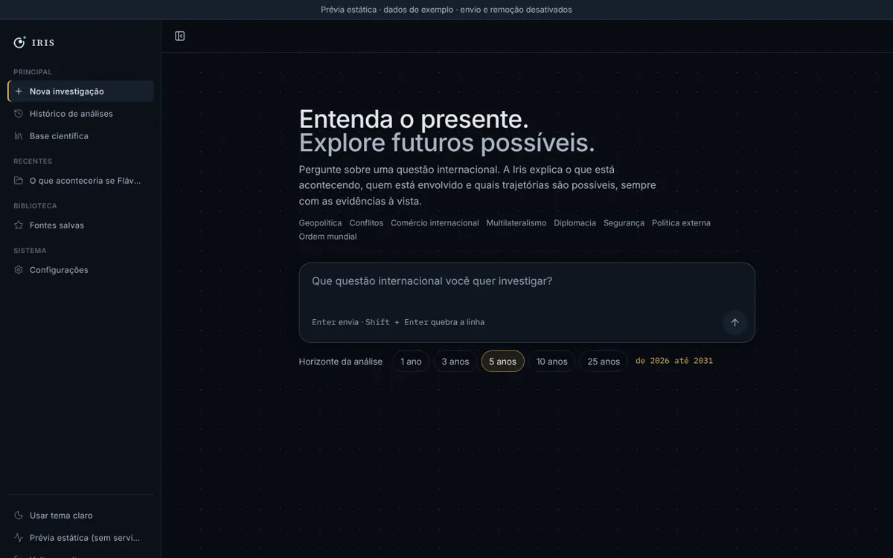
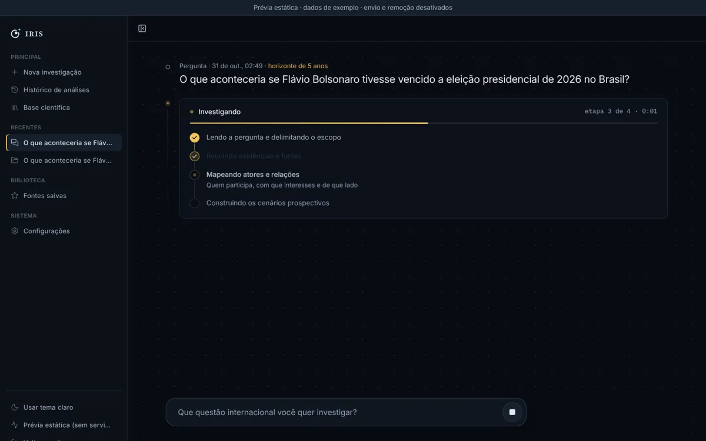
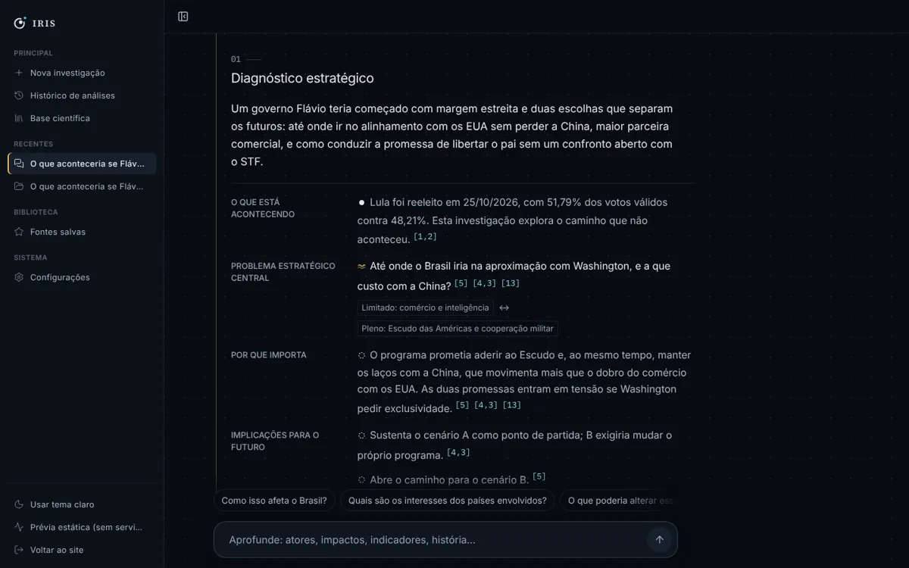
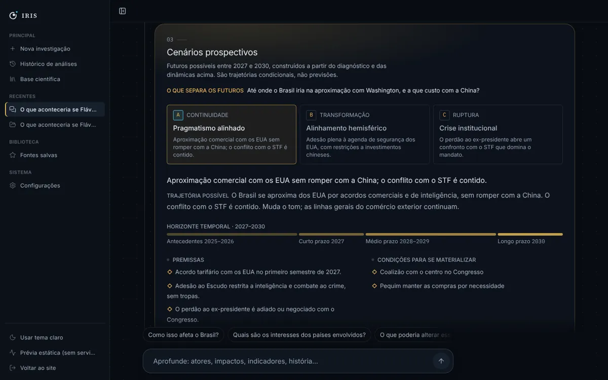
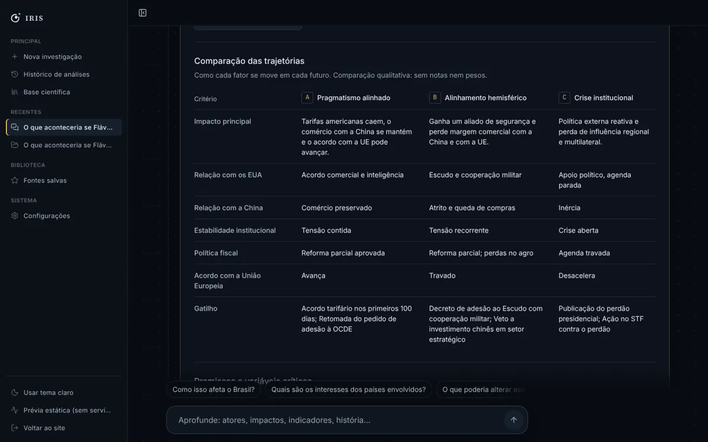
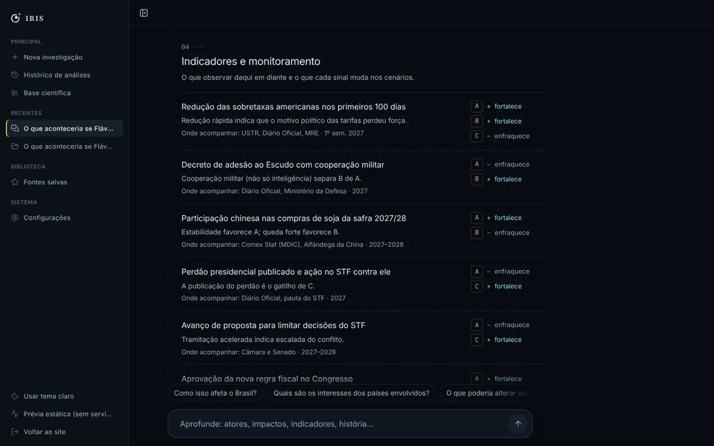
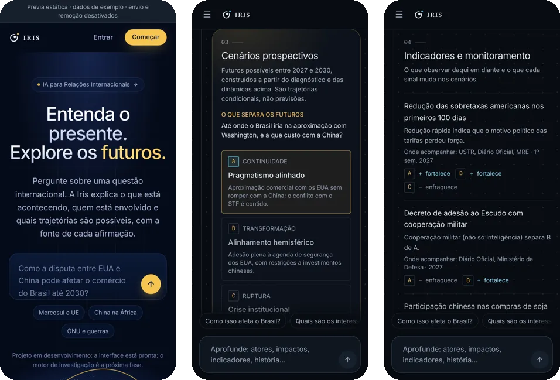

<div align="center">

# 👁️ Iris · Inteligência estratégica em Relações Internacionais

**Entenda o presente. Explore os futuros.**

Pergunte sobre uma questão internacional: a Iris explica o que está acontecendo, quem está envolvido e quais trajetórias são possíveis, com a fonte de cada afirmação.

[](https://paulomarcelli.github.io/Projetos/Projetos/Iris/)


<br>


</div>

<br>

> [!IMPORTANT]
> **Projeto em desenvolvimento.** A interface está pronta, mas o motor de investigação ainda não existe no servidor. A prévia publicada roda **sem servidor**, com uma investigação de exemplo identificada na tela como "dados de exemplo". Nada do que aparece nela é resultado real da Iris.

## ✨ A ideia

A Iris é uma plataforma de **prospectiva estratégica** para Relações Internacionais. Ela não tenta prever o futuro: monta cenários como **hipóteses**, separa fato, inferência, hipótese e incerteza em cada frase e mostra de onde vem cada afirmação.

Cada resposta segue a mesma lógica:

**Compreender o presente → identificar as dinâmicas → construir futuros → monitorar sinais → atualizar os cenários.**

| Cor | | Uso |
|---|---|---|
| Abismo | `#080C12` | Fundo |
| Ouro | `#F2C45A` | Os cenários, o núcleo da análise, e as chamadas principais |
| Ciano | `#52C7E8` | Evidências, citações e sinais |

Fontes: **Inter** no texto e **IBM Plex Mono** nos dados e datas.

## 🧭 Como é uma resposta

<table>
  <tr>
    <td width="50%"></td>
    <td width="50%"></td>
  </tr>
  <tr>
    <td align="center"><sub><b>A pergunta</b>: com o horizonte de 1 a 25 anos escolhido embaixo</sub></td>
    <td align="center"><sub><b>Investigando</b>: as etapas aparecem enquanto a análise é feita</sub></td>
  </tr>
  <tr>
    <td width="50%"></td>
    <td width="50%"></td>
  </tr>
  <tr>
    <td align="center"><sub><b>01 Diagnóstico estratégico</b>: o problema central e por que ele importa</sub></td>
    <td align="center"><sub><b>03 Cenários prospectivos</b>: trajetórias condicionais, não previsões</sub></td>
  </tr>
  <tr>
    <td width="50%"></td>
    <td width="50%"></td>
  </tr>
  <tr>
    <td align="center"><sub><b>Comparação das trajetórias</b>: qualitativa, sem notas nem pesos</sub></td>
    <td align="center"><sub><b>04 Monitoramento</b>: o que cada sinal muda nos cenários</sub></td>
  </tr>
</table>

<p align="center">
  <br>
  <sub><b>No celular</b>: a mesma análise, em uma coluna</sub>
</p>

## 🧩 As cinco partes

1. **Diagnóstico estratégico**: o que está acontecendo, o problema central e as implicações.
2. **Dinâmicas geopolíticas**: atores, interesses, alianças, rivalidades e dependências, em texto corrido.
3. **Cenários prospectivos**: premissas, condições, o que favorece e o que dificulta, consequências, riscos e o que obrigaria a rever cada cenário. Probabilidade só aparece se vier com método.
4. **Indicadores e monitoramento**: os sinais a acompanhar e o efeito de cada um sobre os cenários.
5. **Explorar a investigação**: mapa das relações, linha do tempo, evidências e fontes, método e limites.

## 🏗️ O que já existe

| Parte | Estado |
|---|---|
| Interface (landing, conversa, investigação, mapa, timeline, evidências, contas) | 🟢 Pronta, com dados de exemplo na prévia |
| API FastAPI com `/health` | 🟢 Pronta |
| Ingestão de PDFs científicos (`/documents`): upload validado, texto por página, metadados com origem | 🟢 Pronta |
| Busca híbrida, RAG, agentes e geração de cenários | 🟡 Próximas fases |
| Login e controle de acesso | 🔴 Ainda não existe (a API é só para desenvolvimento local) |

O contrato que o servidor precisa cumprir para alimentar a conversa está em [`frontend/docs/CONTRATO-CONVERSA.md`](frontend/docs/CONTRATO-CONVERSA.md).

## 🛠️ Como rodar

**Interface** (com os dados de exemplo):

```bash
cd frontend
npm install
npm run dev
```

Para gerar a prévia estática, a mesma que está no Pages (`frontend/dist-previa/`):

```bash
npm run build:previa
```

**API** (Python 3.12, [uv](https://docs.astral.sh/uv/) e Docker para o PostgreSQL):

```bash
uv sync
cp .env.example .env
docker compose up -d --wait
uv run alembic upgrade head
uv run uvicorn app.main:create_app --factory --reload
```

O passo a passo completo da API, os testes e os limites de segurança estão em [`docs/BACKEND.md`](docs/BACKEND.md).

## 📁 Estrutura

```text
Iris/
├── frontend/              # interface: React 19, Vite, TypeScript, Tailwind 4
│   ├── src/
│   │   ├── features/      # conversa, investigação, cenários, relações, timeline, evidências
│   │   ├── pages/         # landing, conversa, análise e contas
│   │   ├── components/    # peças de interface compartilhadas
│   │   └── styles/        # tokens de design
│   └── docs/              # arquitetura, design e o contrato da conversa
├── app/                   # API FastAPI: saúde, documentos, banco e cliente de IA
├── migrations/            # Alembic
├── tests/                 # testes da API (pytest)
└── docs/                  # BACKEND.md e as imagens deste README
```

<div align="center">
<br>

Feito com 👁️ por **Paulo Marcelli** · ADS · FECAP

</div>
