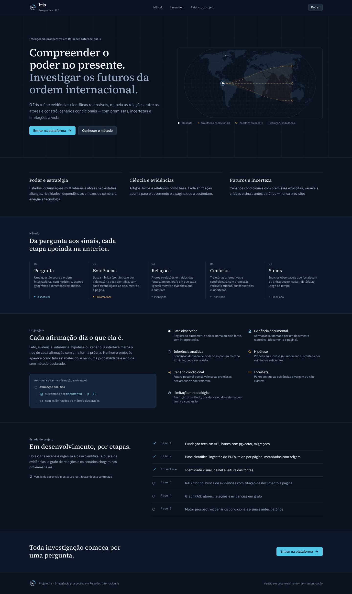

# Projeto Iris: interface

Interface web da Iris: React 19, Vite, TypeScript e Tailwind CSS 4, com os tokens de design
centralizados em `src/styles/` (`variaveis.css` tem os tokens). A landing e as telas de conta usam a biblioteca Motion
(`motion/react`, com `LazyMotion`), carregada só nessas páginas; a plataforma anima com CSS.



## Telas e endereços

| Endereço | Tela |
|---|---|
| `/` | Landing: hero, como funciona, a plataforma (capturas reais), diferenciais, chamada final com o estado real de cada etapa |
| `/entrar`, `/criar-conta`, `/recuperar-senha`, `/redefinir-senha?token=…` | Telas de conta, numa moldura comum com transição entre elas (veja a nota abaixo) |
| `/app` | Início: uma conversa nova com a Iris (análise, cenários prospectivos, mapa, timeline e fontes em cada resposta). Sem motor no servidor, a resposta diz isso e oferece guardar a pergunta como rascunho; na prévia, responde com a investigação de exemplo, marcada como demonstração. Ver `docs/CONTRATO-CONVERSA.md` |
| `/app/conversas/:id` | Uma conversa do histórico (guardado neste navegador) |
| `/app/nova` | A pergunta com parâmetros (horizonte, regiões, dimensões, profundidade), o formulário anterior à conversa |
| `/app/investigacoes` | Histórico de análises: conversas, investigações e rascunhos (editar um rascunho com `?rascunho=id`) |
| `/app/investigacoes/:id` | Resultado de uma investigação, em três áreas: Análise, Mapa de relações e Timeline prospectiva (`?area=relacoes`, `?area=timeline`). Sem API ainda: fora da prévia, mostra um estado vazio |
| `/app/relacoes` e `/app/relacoes/:id` | Atalho mantido para links antigos: leva a `/app/investigacoes/:id?area=relacoes` (sem id, a investigação principal) |
| `/app/base-cientifica` | Painel da base (indicadores, anos de publicação, completude dos metadados, idiomas) e pesquisa de fontes |
| `/app/base-cientifica/:id` | Leitor da fonte: texto por página, ficha bibliográfica com a origem de cada campo, integridade |
| `/app/favoritos` | Fontes marcadas |
| `/app/configuracoes` | Estado do sistema e acesso à gestão do acervo |
| `/app/configuracoes/acervo` | **Gestão do acervo** (administração): envio de PDFs, lista com filtros e remoção |
| `/app/design-system` | Referência visual |

**Documentos não estão no menu principal.** Quem pesquisa consulta as fontes na Base científica (é
para lá que as citações vão apontar). Enviar e remover PDFs é tarefa de administração, em
Configurações → Gestão do acervo. Os endereços antigos `/documentos` são redirecionados.

**Autenticação.** O servidor ainda não tem usuários, sessão nem envio de e-mail. As quatro telas de
conta estão prontas (validação, regras de senha, carregamento, erros por campo, estados de sucesso),
mas chamam um único módulo, `src/services/autenticacao.ts`, que hoje responde "indisponível" sem fazer
chamada de rede. As telas dizem isso: nenhuma finge login, cadastro, envio de e-mail ou troca de
senha. Ligar a API significa trocar só esse módulo (as regras de sessão e segurança estão
comentadas nele). "Manter conectado" e o aceite de termos ficam de fora até existirem sessão no
servidor e as páginas de termos e privacidade.

## Direção de design

**Conceito:** compreender as relações de poder do presente para investigar os futuros possíveis da
ordem internacional. A interface é um gabinete de análise noturno: fundo cartográfico, painéis
institucionais, linhas finas de coordenadas e tipografia editorial.

- **Cores com significado fixo.** O ciano marca interação, conexão e vínculo com uma fonte. O âmbar
  marca incerteza, hipótese e horizonte. Verde e vermelho aparecem só em estados reais do sistema
  (no ar, falha), nunca como decoração.
- **Tipografia.**
  - Source Serif 4 para títulos e texto analítico.
  - IBM Plex Sans para a interface.
  - IBM Plex Mono para dados, hashes e a origem dos números.
  - Números sempre tabulares. As fontes ficam no pacote, sem chamadas externas.
- **Linguagem epistêmica.** Sete marcadores, cada um com forma e rótulo próprios (não só cor):
  fato observado, evidência documental, inferência analítica, hipótese, cenário condicional,
  incerteza e limitação metodológica. Aparecem no início, na ficha de cada documento (a origem de
  cada metadado), nos estados vazios e nas limitações.
- **Marca.** Uma íris que olha para fora do próprio círculo: anel aberto (o sistema observado),
  pupila voltada para o vão (o olhar analítico) e um nó em ciano (o outro ator, o futuro). Wordmark
  "Iris" em Source Serif 4 convertido em curvas. Componente `Marca` (horizontal ou só símbolo, para
  fundo escuro ou claro), SVGs em `public/recursos/icones/marca/` e favicon em `public/favicon.svg`, gerados por
  `scripts/marca-*.py`.
- **Navegação enxuta, pelas tarefas de quem pesquisa:** Início, Investigações e Base científica;
  depois Favoritos e Configurações. Relações (o mapa), cenários, linha do tempo e evidências são
  áreas de cada investigação, não itens do menu. Os endereços antigos `/app/mapas`, `/app/cenarios`,
  `/app/sinais` e `/app/relacoes` continuam funcionando.
- **Movimento.** Só anima o que tem função:
  - toque (140 ms, escala 0,97);
  - cor (180 ms);
  - cone de incerteza que acompanha o horizonte (240 ms);
  - gaveta e notificações, que entram e saem pelo mesmo caminho (400/200 ms);
  - landing (Motion): o hero entra em sequência (70 ms entre elementos) e a ilustração se desenha
    uma vez (nós, relações, depois as três trajetórias), ~2,6 s, e fica parada; as seções se
    revelam ao entrar na tela, uma vez; as capturas da plataforma trocam com um cruzamento de
    opacidade de 200 ms;
  - telas de conta (Motion): a moldura fica montada e só o formulário troca (sai em 160 ms, entra
    em 220 ms); avisos de resultado entram com 4 px e opacidade;
  - no mapa de Relações, a cada troca de cenário uma onda de luz percorre todas as linhas
    (origem → destino nas relações com direção, do meio para as pontas nas demais; âmbar nas
    que mudaram).

  Troca de página no leitor e gráficos não animam. Com "reduzir movimento",
  fica só a opacidade. Curvas e durações são tokens em `src/styles/` (`variaveis.css` tem os tokens).

A referência completa (cores, tipos, marcadores, componentes) fica na rota `/design-system`.

## Resultado de uma investigação prospectiva

Fluxo: pergunta → **Análise** → **Mapa de relações** → **Timeline prospectiva**
(`src/features/investigacao/`, `analise/`, `relacoes/`, `linha-do-tempo/`, `prospectiva/`). As três áreas compartilham UM estado (`contexto.tsx`): o cenário
escolhido numa vale nas outras, e um ator selecionado no mapa aparece com a sua relevância no
detalhe do cenário. Endereço: `?area=relacoes` ou `?area=timeline` (a análise é o padrão; os
antigos `?area=visao|cenarios|evidencias` continuam funcionando).

| Área | O que mostra |
|---|---|
| **Análise** (`AreaDeAnalise.tsx`, entrada) | O fenômeno (síntese) ao lado do que ainda não se sabe (incertezas); fatores determinantes; atores (fichas que abrem no painel); para onde pode ir (os três futuros, uma linha cada, que abrem a timeline); evidências e fontes recolhidas no fim, com busca |
| **Mapa de relações** (`MapaGeopolitico.tsx`) | O mapa na altura útil da tela; cabeçalho de uma linha |
| **Timeline prospectiva** (`TimelineProspectiva.tsx` + `Cenarios.tsx`) | Visualização: o passado numa linha, o "Hoje" e a abertura em três faixas tracejadas (A, B, C) até o horizonte, mais uma faixa de calendário comum. Eventos com forma por tipo, focáveis e clicáveis; "Percorrer o tempo" move uma linha pelo eixo. Abaixo: o cenário em foco (detalhe ou comparação) e o que separa os futuros. "Ver como lista" é a alternativa em texto |

**Menu lateral:** Nova investigação, Base científica, **Minhas investigações** (título, data e
acesso direto; rascunhos marcados como "rascunho"; até 6 itens e "Ver todas") e Pessoal.

- **Método, premissas, limitações e revisões** não ocupam uma aba: abrem no painel lateral pelo botão "Como esta análise foi feita".
- **Painel contextual:** selecionar país, conexão, evento ou citação abre o painel com o essencial e a cadeia de rastreabilidade.
- **Relações (seção própria, `MapaGeopolitico`):**
  - Cartografia real (Natural Earth): cada país fica na sua capital, e a orientação nunca muda. Só países no mapa.
  - Seletor Hoje | A | B | C sobre o mapa, deixando claro que são cenários da mesma investigação.
  - A troca de cenário:
    - as linhas são traçadas da origem ao destino; as que somem recolhem; as que mudam de tipo recolhem e são retraçadas no novo traço;
    - o que mudou brilha em âmbar e recebe um selo no meio da linha (+ nova, ⇄ muda de natureza, ↑ reforçada, ↓ enfraquecida, × deixa de existir, com a relação mantida como fantasma);
    - o zoom e a posição são preservados.
  - O cartão "O que mudou em relação a hoje" agrupa as mudanças com os mesmos glifos do mapa e mostra "competição → cooperação" quando muda a natureza. Passar o cursor num item isola a linha no mapa; clicar abre o detalhe.
  - Linhas com brilho suave; espessura e brilho reagem ao cursor e à seleção.
  - Blocos (Escudo, Mercosul, BRICS) aparecem como hachura no território dos membros daquela vista.
  - Pulso luminoso só nas relações com sentido documentado (influência, dependência).
  - Linhas sem marca são documentadas; ◌ indica inferida e ◇, hipótese do cenário.
  - Passar o cursor ou focar mostra uma dica curta. Clicar em país ou conexão abre um painel flutuante com o essencial; evidências e detalhes ficam a um clique. Clicar no mar limpa a seleção.
  - Layout sem sobreposição: seletor de cenários e a ideia do cenário ficam acima do mapa; a legenda
    (que também filtra) e os blocos ficam abaixo. Sobre o mapa, só o zoom e o cartão "O que mudou".
  - Blocos: a legenda só lista blocos com algum país do mapa (hoje Escudo, Mercosul e BRICS), com o número
    de membros e quem entra ou sai no cenário (ex.: Escudo +1 no B). Escolher um bloco hachura os
    territórios, esmaece o resto e desliza o mapa até enquadrar os membros.
  - Linhas com sentido vão de tênues na origem a plenas no destino; os selos de mudança desviam dos
    nomes dos países.
  - Lista em texto como alternativa acessível.
  - Teclado: setas movem, + e − ampliam, 0 enquadra; Tab percorre países e conexões.
  - Com "reduzir movimento", a troca é instantânea e não há pulsos.
  - No celular, o enquadramento começa pelas Américas.
- Nada mostra probabilidade, peso ou índice numérico.

## O que é real e o que ainda não existe

| Área | Situação |
|---|---|
| Gestão do acervo (envio, lista, filtros, remoção) e leitor de fontes | **Real**: usa a API (`/documents`) |
| Base científica (indicadores, anos, completude, idiomas, busca de fontes) | **Real**: cada número mostra a sua origem (`fonte GET /documents → total`); distribuições usam os 100 documentos mais recentes e dizem isso |
| Estado do sistema | **Real**: `/health/ready` |
| Nova investigação | Pergunta e horizonte à vista; escopo (mapa), dimensões e profundidade em "Ajustar parâmetros", com resumo do que vale. **O motor ainda não existe**: a pergunta é salva como *rascunho neste navegador*, e a tela diz isso |
| Favoritos | Reais, mas guardados só neste navegador |
| Investigações processadas, cenários, sinais, mapas de relações | **Sem API ainda.** Mostram a estrutura do painel (quadro de cenários, tabela de sinais, mapa e tipos de relação) vazia e marcada como vazia; nenhum dado é simulado |
| Login | Só interface; a API não tem autenticação |

## Executar

Pré-requisito: a API rodando em `http://127.0.0.1:8000` (veja o README da raiz).

```bash
cd frontend
npm install
npm run dev            # http://localhost:5173 (proxy para a API: /documents e /health)
```

Para outra porta ou máquina da API: `API_URL=http://host:porta npm run dev`.

Build de produção (`dist/`):

```bash
npm run build
npm run preview        # serve o build em http://localhost:4173, com o mesmo proxy
```

Prévia estática (sem servidor, para mostrar a interface):

```bash
npm run build:previa   # gera dist-previa/ com caminhos relativos e MemoryRouter
```

A prévia usa `src/previa/snapshot.json`, uma cópia dos documentos de exemplo exportada da API.
Ela também traz um **exemplo de resultado de investigação** (`src/previa/investigacao-exemplo.ts`):
um contrafactual sobre a eleição de 2026, elaborado por um assistente de IA com fontes reais lidas na íntegra (os trechos são literais), e não produzido pelo motor. Ele
aparece marcado como "simulação ilustrativa" e mostra o formato que o motor deverá devolver
(`src/types/investigacao.ts`). Na prévia publicada, o endereço com `#investigacao` abre direto nele.
Ela mostra um selo de "prévia", e o envio e a remoção ficam desativados. O build normal não inclui
nada disso.

Em produção, sirva `dist/` e a API **na mesma origem** (por exemplo, atrás de um proxy reverso),
ou defina `VITE_API_BASE` no build e habilite CORS na API.

## Testes e verificações

```bash
npm test               # vitest: formatação, cliente da API, formulário, rascunhos, base científica, login, landing, rotas
npm run typecheck
```

### Dados de pior caso (só em desenvolvimento)

Com `npm run dev`, um alternador no rodapé troca a fonte dos documentos entre:

- **API real**;
- **Pior caso**: 1.284 documentos, títulos de 180 caracteres, nomes compostos, árabe, chinês e
  vietnamita, arquivos sem título, falhas e um documento de 1.284 páginas;
- **Vazio**;
- **Um item**.

Também funciona pela URL: `?dados=pior`, `?dados=vazio` ou `?dados=um`. Esses dados não entram no
build de produção.
