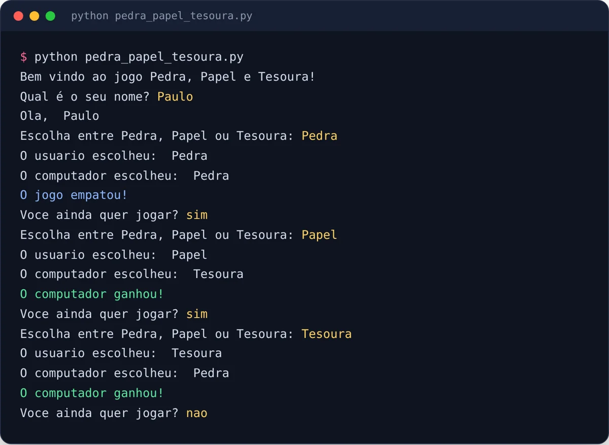

<div align="center">

# ✊ Joken-Po em Python

**Pedra, papel e tesoura no terminal, contra o computador.**

Um dos meus primeiros programas, feito para praticar lógica de programação.


<br>



<sub>Uma partida de verdade: em amarelo, o que foi digitado.</sub>

</div>

<br>

## ✨ Como funciona

1. O jogo pergunta o seu nome e dá oi.
2. Você escolhe **Pedra**, **Papel** ou **Tesoura**.
3. O computador sorteia a dele com `random.choice`.
4. O programa compara as duas e diz quem ganhou ou se empatou.
5. Ele pergunta se você quer jogar de novo. Responda `nao` para sair.

> [!TIP]
> Digite as opções com a primeira letra maiúscula (`Pedra`, `Papel`, `Tesoura`), do jeito que o programa espera.

## 🧠 O que pratiquei

| Conceito | Onde aparece |
|---|---|
| `print` e `input` | Mensagens e as escolhas do jogador |
| Listas | `opcoes = ["Pedra", "Papel", "Tesoura"]` |
| Módulo `random` | A escolha do computador |
| `while True` e `break` | Repetir as rodadas até a pessoa sair |
| `if`, `elif`, `else` e `and` | Comparar as escolhas e definir o resultado |
| f-strings | `f"O {nome} ganhou!"` |

O código tem um comentário explicando cada comando, para servir de material de estudo.

## 🛠️ Como rodar

Na pasta do projeto:

```bash
python pedra_papel_tesoura.py
```

Em alguns sistemas o comando é `python3`:

```bash
python3 pedra_papel_tesoura.py
```

## 📁 Estrutura

```text
Joken-Po-Python/
├── pedra_papel_tesoura.py   # o jogo, comentado linha a linha
└── docs/                    # imagem deste README
```

<div align="center">
<br>

Feito com 🐍 por **Paulo Marcelli** · ADS · FECAP

</div>
