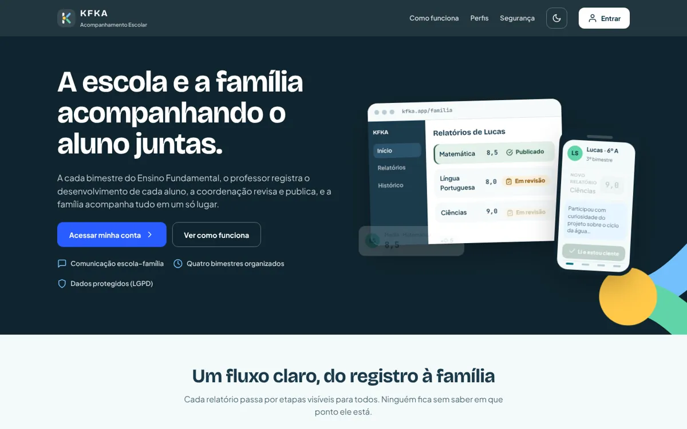
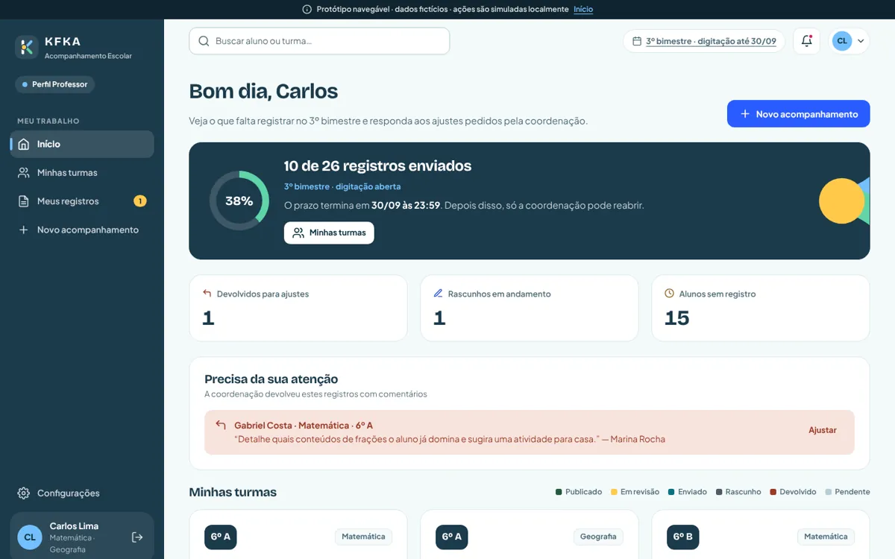
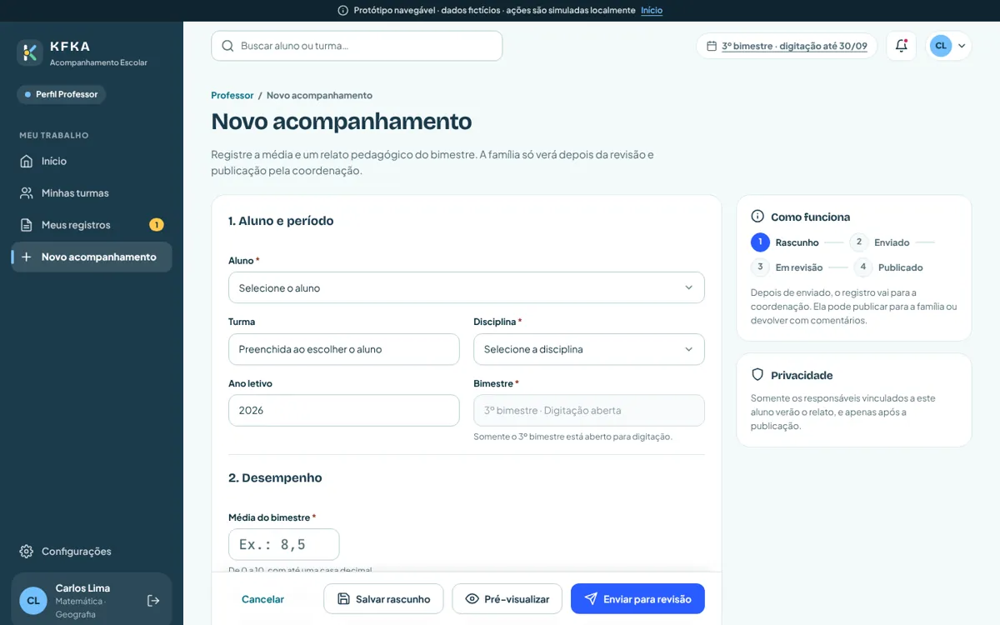
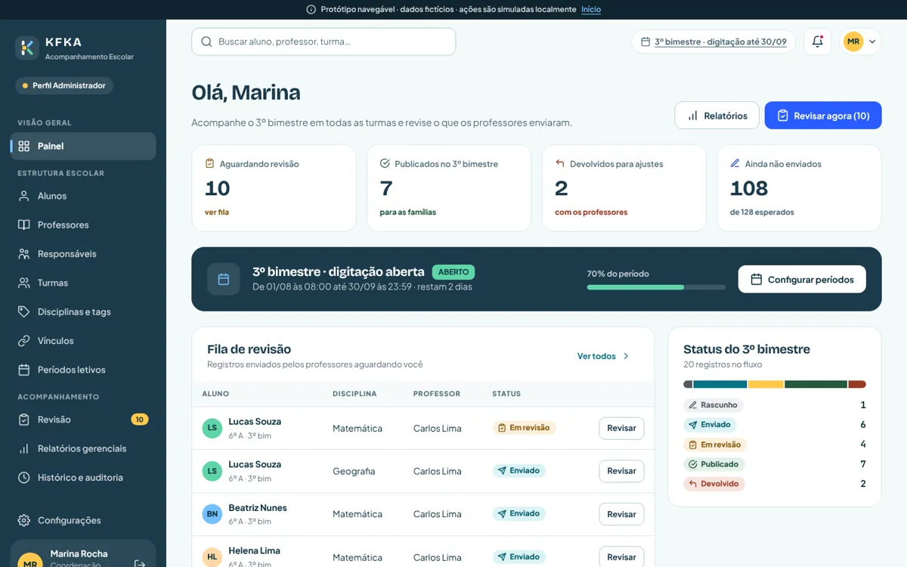
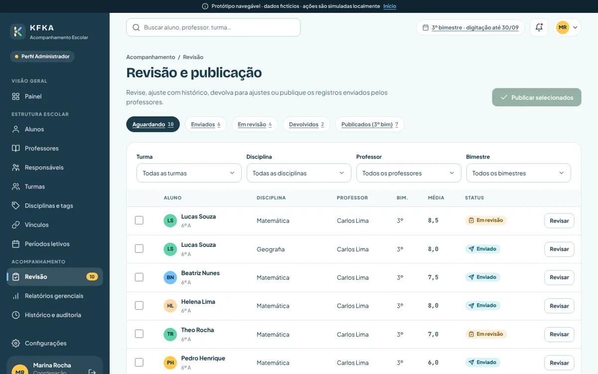
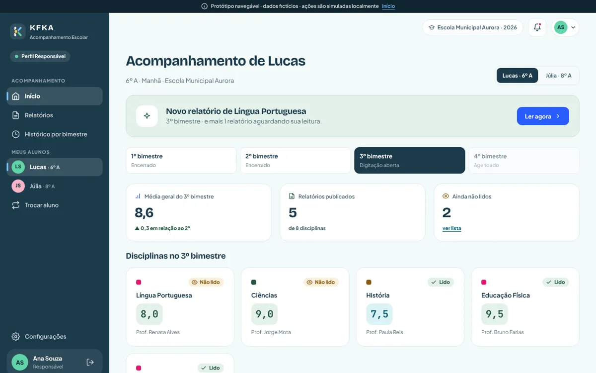
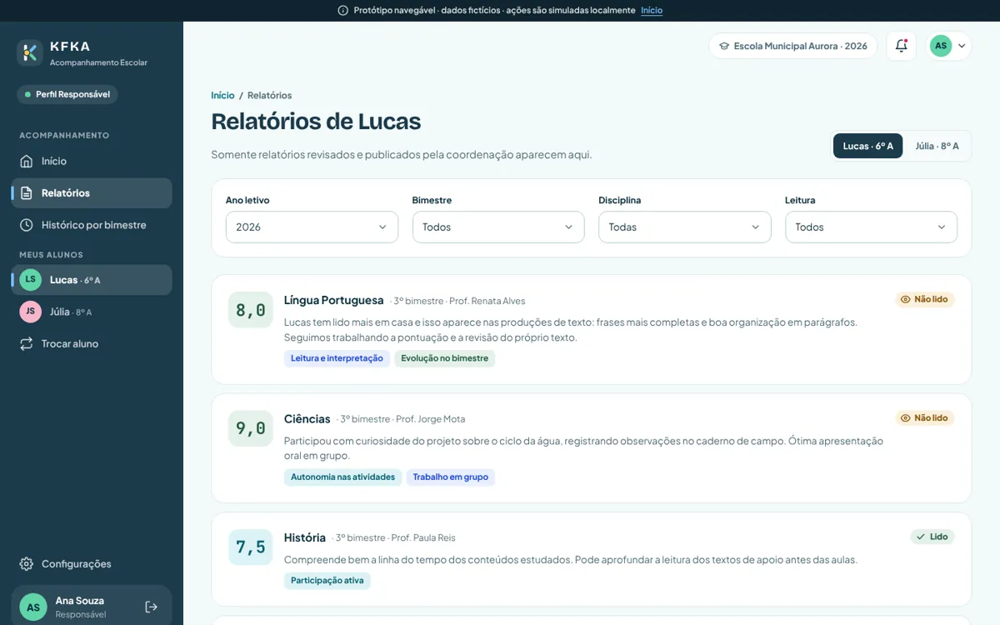
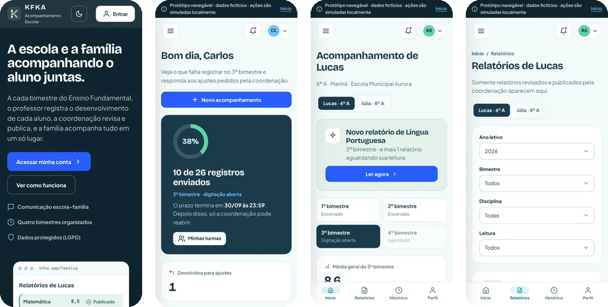
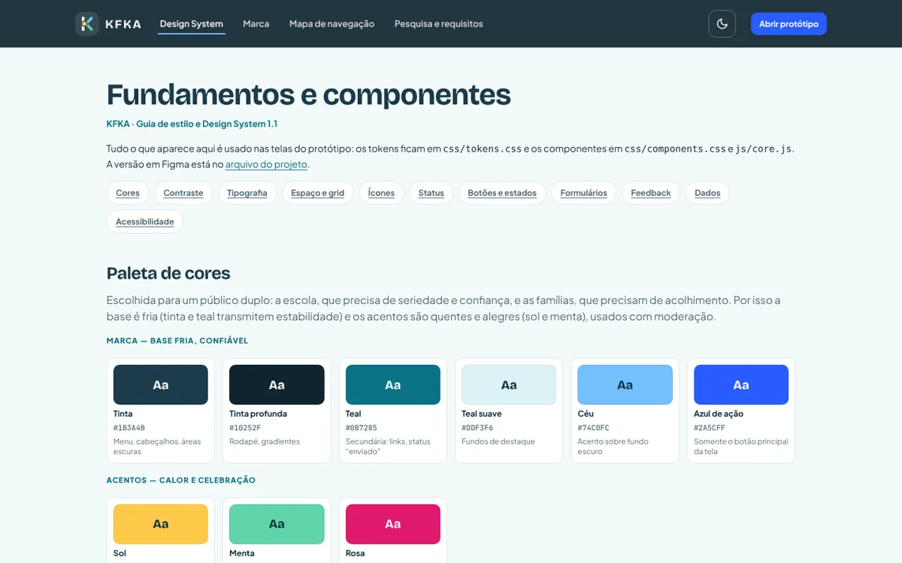
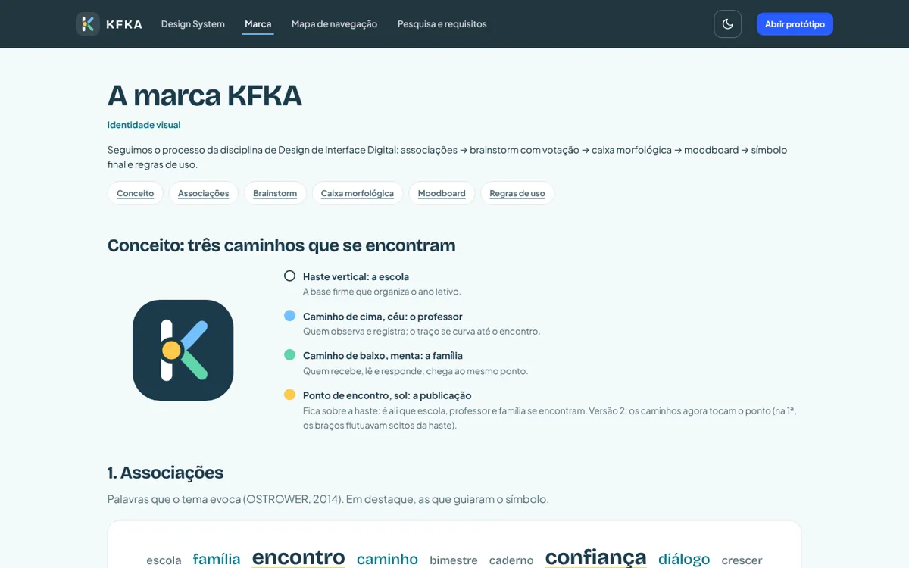

<div align="center">

# 🎒 KFKA · Acompanhamento Escolar

**A escola e a família acompanhando o aluno juntas.**

Protótipo navegável do **Projeto Interdisciplinar** · 2º semestre de ADS · **FECAP** 2026

[](https://paulomarcelli.github.io/Projetos/Projetos/KFKA/)


<br>



</div>

<br>

> [!NOTE]
> Protótipo **só de design**. Não há servidor, banco nem login de verdade: os dados são fictícios e toda ação é simulada no navegador (o aviso "SIMULAÇÃO LOCAL" aparece na tela).

## ✨ A ideia

A cada bimestre do Ensino Fundamental, o **professor** registra o desenvolvimento de cada aluno, a **coordenação** revisa e publica, e a **família** acompanha tudo num só lugar, registra que leu e pode responder.

O fluxo é visível para todos: **Rascunho → Enviado → Em revisão → Publicado**, com as saídas *Devolvido* e *Cancelado*. A família só vê o que já foi revisado e publicado, e só dos alunos ligados a ela.

| Cor | | Uso |
|---|---|---|
| Tinta | `#1B3A4B` | Marca e fundos escuros |
| Teal | `#0B7285` | Cor secundária |
| Azul de ação | `#2A5CFF` | Botões principais |
| Sol e menta | `#FFC94A` · `#5FD4A8` | Destaques e celebração |

Fontes: **Bricolage Grotesque** nos títulos, **Plus Jakarta Sans** nos textos e **JetBrains Mono** nas médias. Tem **modo escuro**.

## 👥 Três perfis

<table>
  <tr>
    <td width="50%"></td>
    <td width="50%"></td>
  </tr>
  <tr>
    <td align="center"><sub><b>Professor</b>: o andamento do bimestre e o que a coordenação pediu</sub></td>
    <td align="center"><sub><b>Novo acompanhamento</b>: média e relato pedagógico, com prévia antes de enviar</sub></td>
  </tr>
  <tr>
    <td width="50%"></td>
    <td width="50%"></td>
  </tr>
  <tr>
    <td align="center"><sub><b>Coordenação</b>: o bimestre inteiro num painel</sub></td>
    <td align="center"><sub><b>Revisão e publicação</b>: revisar, devolver com comentário ou publicar em lote</sub></td>
  </tr>
  <tr>
    <td width="50%"></td>
    <td width="50%"></td>
  </tr>
  <tr>
    <td align="center"><sub><b>Família</b>: o bimestre do filho, com o que ainda não foi lido</sub></td>
    <td align="center"><sub><b>Relatórios</b>: só os publicados, com ciência, resposta e PDF</sub></td>
  </tr>
</table>

<p align="center">
  <br>
  <sub><b>No celular</b>: barra de abas embaixo, tabelas viram cartões e os modais abrem como folha</sub>
</p>

## 🎨 Documentação de design

O próprio protótipo traz as entregas de Design de Interface Digital:

<table>
  <tr>
    <td width="50%"></td>
    <td width="50%"></td>
  </tr>
  <tr>
    <td align="center"><sub><b>Design System</b> (<code>#/design</code>): tokens, contraste, componentes e estados</sub></td>
    <td align="center"><sub><b>Marca</b> (<code>#/marca</code>): associações, brainstorm, caixa morfológica e regras de uso</sub></td>
  </tr>
</table>

Também há o **mapa de navegação** clicável (`#/mapa`) e a **pesquisa e matriz de requisitos** (`#/documentacao`).

## ♿ Cuidados

- Responsivo no computador, no tablet (menu em gaveta) e no celular.
- Navegação pelo teclado, foco visível, alvos de toque de 44 px e contraste AA.
- Status sempre com **texto, ícone e cor**, nunca só cor.
- Respeita **"reduzir movimento"** e tem tamanho de texto ajustável.
- Modo pior caso (`index.html?dados=pior`) com nomes e textos extremos, para testar o layout.

## 🛠️ Como rodar

Não tem build: abra o `index.html` no navegador ou rode na pasta:

```bash
python3 -m http.server 8000
```

Depois é só abrir `http://localhost:8000`.

## 🧪 Testes

Testes automáticos com Playwright: navegação por todas as rotas, fluxos dos três perfis, estouro de layout e pior caso.

```bash
node tests/crawl.js
node tests/flows.js
node tests/overflow.js
node tests/pior-caso.js
```

## 📁 Estrutura

```text
KFKA/
├── index.html          # carrega os estilos e os scripts na ordem
├── css/                # tokens, base, layout, componentes e páginas
├── js/
│   ├── core.js         # ícones, logo, roteador, avisos, modal e validação
│   ├── data.js         # dados fictícios e KFKA.api
│   ├── shell.js        # layout das áreas logadas
│   └── pages/          # público, coordenação, professor, família, configurações e documentação
├── tests/              # Playwright
├── docs/               # PRD, auditoria de requisitos, pesquisa e as imagens deste README
└── agents/             # revisões de SEO e de segurança
```

O próximo passo previsto é a fase funcional com **Node/Express e MySQL**: só a `KFKA.api` passa a usar `fetch()`.

<div align="center">
<br>

Feito com 💛 pela equipe do Projeto Interdisciplinar · ADS · FECAP

</div>
