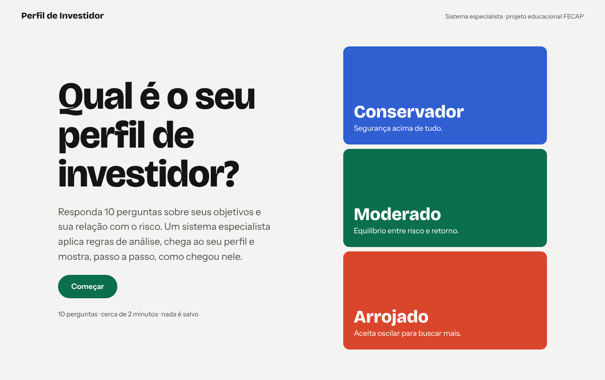
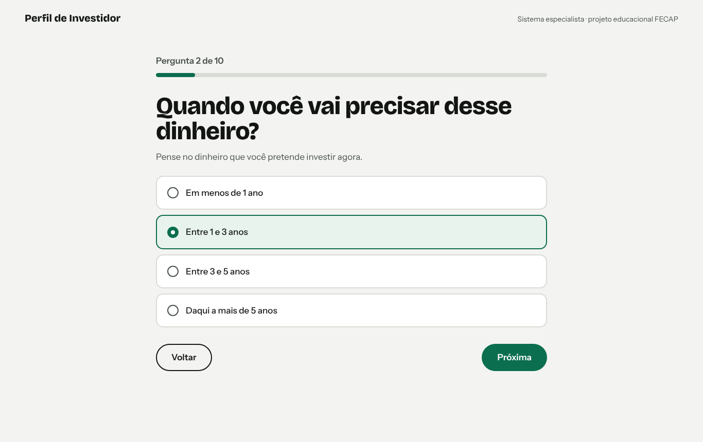
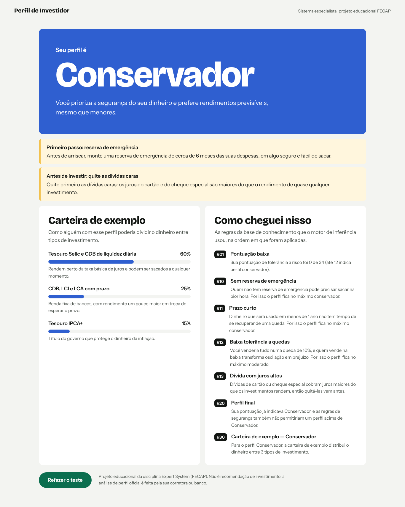

# Qual é o seu perfil de investidor? — Sistema Especialista

Projeto da atividade **Expert System — FECAP**. Um **sistema especialista** faz 10 perguntas sobre a sua vida
financeira, aplica uma **base de regras** e conclui se o seu perfil de investidor é **conservador, moderado ou arrojado**.
Depois mostra uma carteira de exemplo e **explica o raciocínio**, regra por regra.

> ⚠️ Projeto educacional. Não é recomendação de investimento: a análise de perfil oficial (*suitability*) é feita pela sua corretora ou banco.

| Início | Pergunta | Resultado |
|--------|----------|-----------|
|  |  |  |

## Como usar
1. Baixe ou clone o repositório.
2. Abra `Projetos/Perfil-Investidor/index.html` no navegador (dois cliques). Não precisa instalar nada.
3. Clique em **Começar**, responda as perguntas e veja o resultado.

## Como funciona um sistema especialista
Um sistema especialista imita o raciocínio de um especialista humano usando **conhecimento escrito como regras**.
Ele tem três partes, e aqui cada uma está em um arquivo:

| Parte | Arquivo | O que faz |
|-------|---------|-----------|
| **Base de conhecimento** | `js/base-conhecimento.js` | Perguntas, pontos de risco, regras SE → ENTÃO e carteiras de exemplo |
| **Motor de inferência** | `js/motor.js` | Executa as regras: parte dos fatos (as respostas), dispara as regras verdadeiras e repete até não haver novidade (**encadeamento para frente**) |
| **Interface e explicação** | `index.html`, `css/estilo.css`, `js/app.js` | Faz as perguntas e mostra o resultado com a seção **"Como cheguei nisso"** |

O motor **não sabe nada de investimentos**: ele só executa regras. Trocando a base de conhecimento, o mesmo motor vira
especialista em outro assunto.

### As regras
Cada resposta vale de 0 a 4 pontos de tolerância a risco (máximo de 34).

| Regra | SE | ENTÃO |
|-------|----|-------|
| R01 | pontuação ≤ 12 | perfil preliminar conservador |
| R02 | pontuação entre 13 e 23 | perfil preliminar moderado |
| R03 | pontuação ≥ 24 | perfil preliminar arrojado |
| R10 | não tem reserva de emergência | perfil no máximo conservador + alerta para montar a reserva |
| R11 | vai precisar do dinheiro em menos de 1 ano | perfil no máximo conservador |
| R12 | venderia tudo numa queda de 10% | perfil no máximo moderado |
| R13 | tem dívida com juros altos | alerta para quitar as dívidas antes de investir |
| R14 | reserva de emergência incompleta | alerta para completá-la |
| R20 | existe perfil preliminar | perfil final = o menor entre o preliminar e o limite das regras de segurança |
| R30–R32 | perfil final definido | carteira de exemplo daquele perfil |

As regras de segurança (R10–R14) têm **prioridade**: rodam antes da conclusão e podem rebaixar o perfil.

## Testes
Precisa do [Node.js](https://nodejs.org) 18 ou mais recente.
```bash
cd Projetos/Perfil-Investidor
npm test
```
São 20 testes: 7 do motor de inferência e 13 das regras do domínio.

## Como o projeto foi versionado (Git e GitHub)
```
main
 └─ perfil-investidor/develop                    (integração)
     ├─ perfil-investidor/feature/motor-inferencia  → merge (#2)
     ├─ perfil-investidor/feature/base-de-regras    → merge (#3)
     ├─ perfil-investidor/feature/interface         → merge (#4)
     └─ perfil-investidor/docs/readme               → merge (#5)
```
- Cada funcionalidade tem uma **issue** e uma **branch** própria.
- Cada branch foi mesclada em `develop` com `git merge --no-ff`, então o histórico mostra cada merge.
- Um **pull request** leva `develop` para `main` e fecha as issues.

## Passo a passo no GitHub Desktop
Para refazer o fluxo no seu computador com o [GitHub Desktop](https://desktop.github.com):

1. **Clonar:** *File → Clone repository → GitHub.com*, escolha `paulomarcelli/Projetos` e uma pasta → **Clone**.
2. **Ver as branches:** clique em **Current branch** (no topo) para ver `perfil-investidor/develop` e as `feature/...`.
3. **Criar uma branch:** *Current branch → New branch*, dê um nome (ex.: `perfil-investidor/feature/minha-melhoria`)
   e escolha criar a partir de `perfil-investidor/develop`.
4. **Fazer um commit:** edite um arquivo no editor; o GitHub Desktop mostra as mudanças. Escreva um resumo no canto
   inferior esquerdo (ex.: `Ajusta texto da pergunta 3 (#4)`) e clique em **Commit to …**.
5. **Enviar ao GitHub:** clique em **Publish branch** (ou **Push origin**).
6. **Fazer o merge:** troque para `perfil-investidor/develop` em *Current branch*, depois
   *Branch → Merge into current branch…*, escolha a sua branch e confirme. Clique em **Push origin**.
7. **Abrir um pull request:** *Branch → Create pull request*. O navegador abre no GitHub: escreva o título,
   cite a issue com `Closes #número` e clique em **Create pull request**.
8. **Issues:** no site do GitHub, aba **Issues → New issue**.

## Tecnologias
HTML, CSS e JavaScript puro (sem bibliotecas). Testes com o testador nativo do Node.js (`node --test`).
Fontes: Bricolage Grotesque e Instrument Sans (Google Fonts).

## Documentação
- `docs/design.md`: o design do sistema e as decisões.
- `docs/plano.md`: o plano de implementação, tarefa por tarefa.
