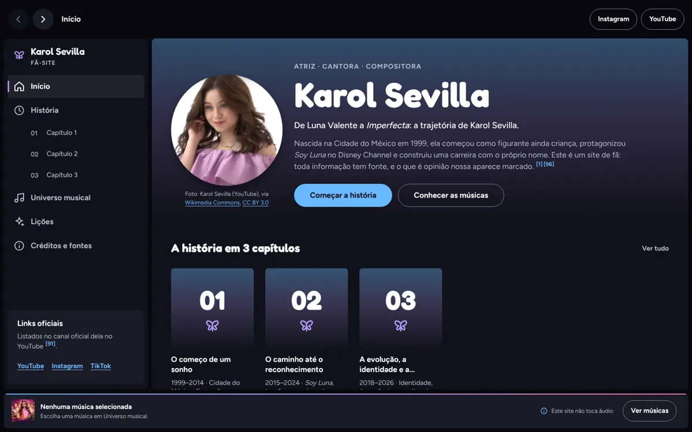
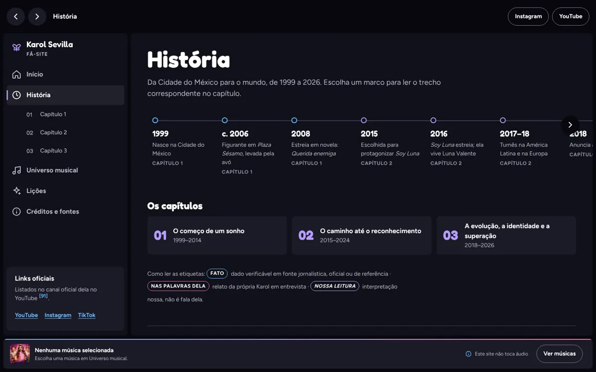
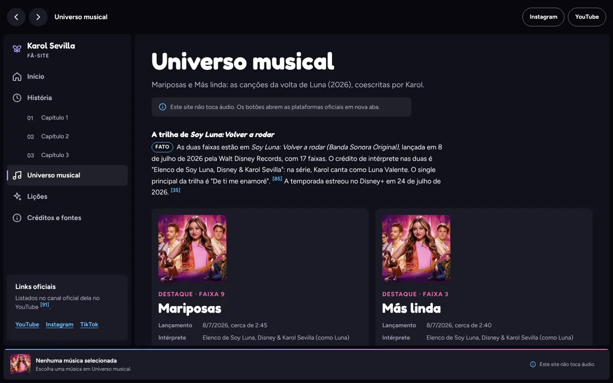
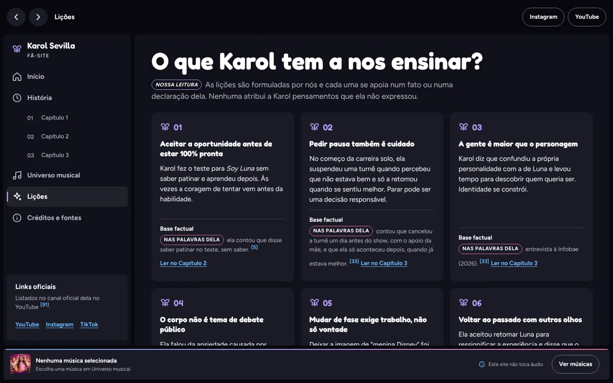
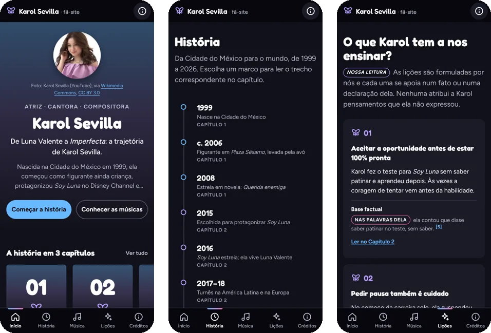

<div align="center">

# 🌐 Site Karol Sevilla

**Um fã-site sobre a história, a superação e a música de uma das minhas grandes ídolas.**

[](https://paulomarcelli.github.io/Projetos/)
[](https://paulomarcelli.github.io/Projetos/primeira-versao/)


<br>



<sub>A navegação lembra um app de música: menu lateral, cartões, faixas e uma barra de player embaixo.</sub>

</div>

<br>

> [!NOTE]
> Site **de fã**, sem vínculo oficial com Karol Sevilla, Disney, gravadoras ou Spotify. Toda informação tem fonte citada, e o que é opinião minha aparece marcado como **"Nossa leitura"**.

## ✨ A ideia

O Site Karol Sevilla foi o meu **primeiro projeto web** e ganhou uma versão nova. Ele conta a trajetória da Karol, atriz, cantora e compositora, em três capítulos, apresenta *Mariposas* e *Más linda* e pergunta: **o que a história dela tem a nos ensinar?**

A navegação foi inspirada em players de música, mas as cores, os textos, os ícones e a identidade são meus.

| Cor | | Uso |
|---|---|---|
| Noite | `#0D0D15` | Fundo |
| Azul | `#69B9FF` | Botões, links e marcos da linha do tempo |
| Rosa | `#FF69B4` | Destaques |
| Lilás | `#B79CFF` | Etiquetas e detalhes |

Fontes: **Fredoka** nos títulos e **Figtree** nos textos.

## 🖼️ As seções

<table>
  <tr>
    <td width="50%"></td>
    <td width="50%"></td>
  </tr>
  <tr>
    <td align="center"><sub><b>História</b>: uma linha do tempo de 1999 a 2026 que abre o trecho certo do capítulo</sub></td>
    <td align="center"><sub><b>Universo musical</b>: <i>Mariposas</i> e <i>Más linda</i> com os links oficiais</sub></td>
  </tr>
  <tr>
    <td width="50%"></td>
    <td width="50%"></td>
  </tr>
  <tr>
    <td align="center"><sub><b>Lições</b>: seis lições, cada uma ligada a um fato ou a uma fala dela</sub></td>
    <td align="center"><sub><b>Celular</b>: barra de navegação embaixo, como num app</sub></td>
  </tr>
</table>

## 🎧 O que o site tem

- **Início** com apresentação, atalhos para os capítulos, destaques musicais e cartões de reflexão.
- **História** com uma linha do tempo: ao clicar (ou apertar Enter) num marco, o site abre o trecho certo do capítulo.
- **Três capítulos** com etiquetas que mostram o tipo de informação: *Fato*, *Nas palavras dela* e *Nossa leitura*, além das fontes numeradas.
- **Universo musical** com lista de faixas, filtros e links oficiais (YouTube, Apple Music e Spotify, quando confirmados).
- **Player honesto**: ao escolher uma música, a barra de baixo mostra o título e os links. O site **não toca áudio** e avisa isso na tela.
- **Créditos e fontes** com todas as referências e os créditos das imagens.
- Funciona no celular, no tablet e no computador, pelo teclado e até com o JavaScript desligado.

## 🛠️ Como rodar

Não tem build: é HTML, CSS e JavaScript puro. Abra o `index.html` no navegador, use o **Live Server** do VS Code ou rode na pasta:

```bash
python3 -m http.server 8000
```

Depois é só abrir `http://localhost:8000`.

## 📁 Estrutura

```text
Site-Karol-Sevilla/
├── index.html              # o site novo (todas as seções)
├── assets/
│   ├── css/
│   │   ├── tokens.css      # cores, fontes e espaçamentos
│   │   └── main.css        # layout e componentes
│   ├── js/
│   │   ├── ui.js           # prateleiras, imagens com erro, realce de trechos
│   │   ├── player.js       # player honesto e filtros de músicas
│   │   └── app.js          # estado do site e navegação por #
│   └── img/                # fotos (WebP), ícone e imagem de compartilhamento
├── primeira-versao/        # o meu primeiro site, preservado
└── docs/                   # planejamento, pesquisa, design, testes e as imagens deste README
```

## 📷 Imagens e créditos

- **Fotos do Wikimedia Commons**, com licenças abertas (CC BY 3.0 e CC BY-SA 4.0): eu só redimensionei e converti para WebP. Os créditos completos (autor, licença e link do arquivo) estão na seção **Créditos e fontes** do site.
- **Capas das músicas, imagens de divulgação de *Soy Luna* e a foto do Capítulo 1**: enviadas por mim. Os direitos pertencem aos respectivos titulares (artistas, gravadoras e Disney), e as imagens aparecem só para identificar e ilustrar as obras citadas. A autoria da foto do Capítulo 1 ainda não foi informada.

Todos os espaços de imagem já estão preenchidos. Em *Mariposas*, *Más linda*, na lista de faixas e no player aparece uma imagem de divulgação de *Soy Luna: Volver a rodar* (recortada em quadrado), porque não usei capas individuais dessas duas faixas.

### Como trocar uma imagem

1. No `index.html`, aperte `Ctrl+Shift+F` e procure por `IMAGEM PREENCHIDA`. Cada comentário diz **qual imagem é**, **onde aparece**, **a proporção** e **qual arquivo está em uso**.
2. Salve a nova imagem em `assets/img/` (de preferência em WebP ou JPG, com até 640 px nas capas) e troque o `src` da tag `` logo abaixo do comentário.
3. Atualize o `alt` e, se a imagem for de outra fonte, o crédito na seção "Créditos de imagem".
4. **Não apague os comentários**, eles ajudam a lembrar qual imagem é.

| Imagem | Onde aparece | Arquivo atual |
|---|---|---|
| *Mariposas* e *Más linda* | Início · Universo musical · lista de faixas · player | `capa-soy-luna-volver-a-rodar.webp` |
| *Imperfecta*, *Otro Mood*, *Cenicienta*, *Una noche más* | Início · lista de faixas | `capa-<nome>.webp` |
| *Weekend*, *Anónimo*, *Miedo de sentir*, *Dime dime*, *Tus besos*, *Vuélveme a mirar así*, *Mil besos por segundo* | Lista de faixas | `capa-<nome>.webp` |
| Karol na infância | Capítulo 1 | `cap1-infancia.webp` |
| Capa de um álbum de *Soy Luna* | Capítulo 2 | `cap2-soy-luna.webp` |
| Arte da trilha de *Soy Luna* no Disney+ | Capítulo 3 | `cap3-volver-a-rodar.webp` |

As imagens do Capítulo 1 (640 px) e do Capítulo 3 (354 px) são pequenas. Se tiver versões maiores, troque para o site ficar mais nítido.

## 🧪 Testes

Testei o site no navegador (Chromium, com Playwright e com a ferramenta REA) em 1440, 1024, 820, 390 e 320 px: navegação por clique, por `#` e pelo teclado, linha do tempo, player, filtros, imagens, contraste, links internos e externos. Os resultados estão em [`docs/TEST_REPORT.md`](docs/TEST_REPORT.md).

## 📚 Documentação

| Documento | Conteúdo |
|---|---|
| [`docs/PROJECT_BRIEF.md`](docs/PROJECT_BRIEF.md) | Briefing (PRD) do projeto |
| [`docs/RESEARCH_KAROL_SEVILLA.md`](docs/RESEARCH_KAROL_SEVILLA.md) | Pesquisa com fontes verificadas |
| [`docs/SPOTIFY_REVERSE_ENGINEERING.md`](docs/SPOTIFY_REVERSE_ENGINEERING.md) | Estudo da interface de referência e critérios F1–F24 |
| [`docs/DESIGN_SYSTEM.md`](docs/DESIGN_SYSTEM.md) | Cores, fontes, componentes e acessibilidade |
| [`docs/IMPLEMENTATION_PLAN.md`](docs/IMPLEMENTATION_PLAN.md) | Plano de implementação |
| [`docs/TEST_REPORT.md`](docs/TEST_REPORT.md) | Relatório de testes |
| [`docs/agents/`](docs/agents/) | Revisões de SEO e de segurança |

## 🕰️ Primeira versão

O meu primeiro site continua guardado em [`primeira-versao/`](primeira-versao/), do jeitinho que eu fiz. Online: [**Abrir a primeira versão**](https://paulomarcelli.github.io/Projetos/primeira-versao/). O site novo também tem um link para ela no rodapé.

<div align="center">
<br>

Feito com 💙 por **Paulo Marcelli** · ADS · FECAP

</div>
