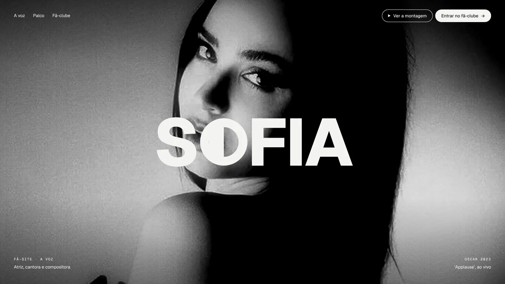
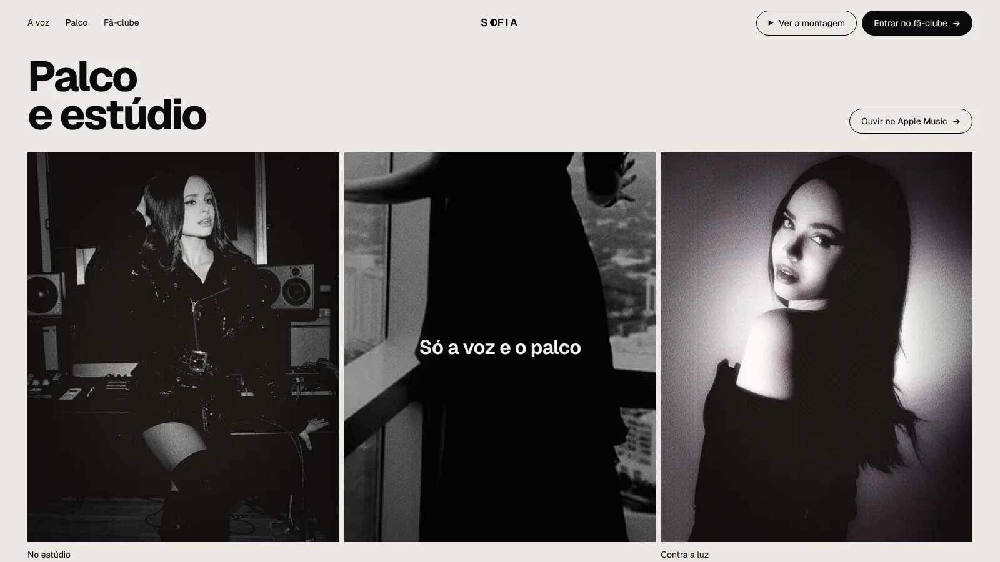
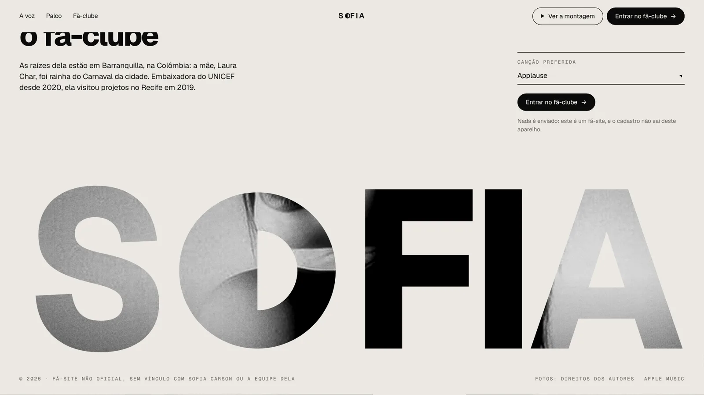

<div align="center">

# 🎤 Sofia Carson · a voz

**Um fã-site em preto e branco sobre a voz dela: o filme preso atrás da página e o nome sob o holofote.**

[](https://paulomarcelli.github.io/Projetos/Projetos/Sofia-Carson/)


<br>



</div>

<br>

> [!NOTE]
> Projeto **pessoal e de fã**. Não é oficial e não tem vínculo com a Sofia Carson nem com a equipe dela. O cadastro de fã **não envia nem guarda** nenhum dado. As fotos são de campanhas e redes sociais da artista; os direitos são dos autores.

## ✨ A ideia

O filme fica **preso atrás da página inteira** e a página é uma folha cor de osso com **furos** por onde ele aparece: uma janela cinemascope, o quadro do meio da galeria e as letras do nome no rodapé. No topo, o nome gigante sob o holofote vira **S◐FIA**, com o O de meia-luz.

Não havia vídeo dela para usar, então o filme é uma **montagem das fotos**: cinco planos com aproximação lenta, corte seco, preto e branco e grão de película, 13 s em 1 MB, montada com ffmpeg.

A estrutura e as animações vêm do modelo **Lusco** (Profitize Build): primeiro montei a demo e conferi com os prints do modelo, depois troquei a marca, os textos, as imagens e o filme.

## 🎬 O que acontece na página

| # | Seção | O que se mexe |
|---|---|---|
| 00 | **Intro** | `[ Sofia Carson ]` e a porcentagem; uma coluna de fotos sobe pelo meio e a última cresce até virar o fundo, só com `transform` |
| 01 | **Topo** | As letras de SOFIA sobem uma a uma sobre o filme; "Fã-site · a voz" e "Oscar 2023" nos cantos |
| 02 | **A voz** | ‘Applause’ no 95º Oscar, com Diane Warren ao piano; o filme aparece pela janela cinemascope, parado enquanto a folha sobe |
| 03 | **Palco e estúdio** | Dois retratos com película e grão; no meio, o furo com "Só a voz e o palco" |
| 04 | **Trajetória** | A folha se abre de ponta a ponta: Evie (2015), Cassie (2022) e ‘Come Back Home’ (2023) |
| 05 | **Fã-clube** | Raízes em Barranquilla e o UNICEF; o cadastro responde na hora e não envia nada; SOFIA vazado no rodapé, mostrando o filme |





## 📚 Fatos e fontes

Tudo o que o site afirma foi conferido antes de entrar:

| Fato | Fonte |
|---|---|
| ‘Applause’ no Oscar de 2023, com Diane Warren ao piano, e o pedido de aplausos para as mulheres | [Variety](https://variety.com/2023/music/news/sofia-carson-diane-warren-applause-oscars-1235544444), [Academia](https://press.oscars.org/news/sofia-carson-and-diane-warren-perform-oscarsr) |
| *Purple Hearts*: produtora executiva e coautora das quatro primeiras canções; ‘Come Back Home’ no MTV Movie & TV Awards 2023 | [Newsweek](https://mag.newsweek.com/purple-hearts-sound-track-sofia-carson-1734888), [Wikipedia](https://en.wikipedia.org/wiki/Purple_Hearts_(soundtrack)) |
| Barranquilla: a mãe, Laura Char, foi rainha do Carnaval da cidade | [El Heraldo](https://www.elheraldo.co/tendencias/2015/12/24/actriz-de-disney-sofia-carson-pasa-navidad-en-barranquilla-235329/) |
| UNICEF: embaixadora desde 2020; visita a projetos no Recife em 2019 | [UNICEF Brasil](https://www.unicef.org/brazil/comunicados-de-imprensa/sofia-carson-conhece-projetos-do-unicef-em-pernambuco) |

**Fora do site até ter confirmação:** "SC2" e o single "Her". Em 14/11/2026 nenhuma fonte confiável confirmava os dois.

## 🎨 Design system

No Figma: [Sofia Carson · a voz — Design System](https://www.figma.com/design/41SYetZSfkGCyXrWKMkLl1). Tem as variáveis de cor e de medida (modos desktop e celular), os estilos de texto em Geist, os componentes (marca S◐FIA, pílulas, rótulo, nota, campo, quadro do filme, furo e nav) e as telas de desktop e de celular montadas com eles.

## 📱 Responsivo

Conferido em 320, 375, 600, 768, 900, 1024, 1280, 1920 e 2560 px e com o celular deitado (844 × 390), sem rolagem lateral:

- **Nav:** no tablet, o "Ver a montagem" sai da nav e fica embaixo do nome; abaixo de 400 px, a pílula vira "Entrar".
- **A voz:** até 1100 px, a janela ocupa a largura e as notas vão para baixo.
- **Celular:** o furo vem antes dos retratos e as etapas empilham.

## 🧰 Como foi feito

- **Vite sem framework**: HTML, CSS e JavaScript puros; um CSS por seção em `src/sections/` e o movimento em `src/motion/`.
- **Furo**: um bloco transparente com `box-shadow: 0 0 0 300vmax` cor de osso numa seção com `overflow: hidden`; a sombra pinta o resto da seção e o filme só aparece pelo buraco.
- **Rodapé vazado**: uma `<mask>` de SVG com as letras e o círculo do O furando a folha.
- **Grão**: um PNG de ruído em `mix-blend-mode: overlay` que salta de posição com `steps(1)`.
- **Rolagem** suave com Lenis; com "reduzir movimento" no sistema, não há intro nem rolagem suave e o filme fica parado.

O guia, o prompt e os prints do modelo Lusco são material pago e ficam fora deste repositório público. Para mexer no projeto com uma IA, copie o `CLAUDE.md` do `lusco.zip` para esta pasta.

## ▶️ Rodar

```bash
npm install
npm run dev
```

`npm run build` gera o `dist/` com caminhos relativos (funciona em qualquer pasta). O GitHub Pages publica em `/Projetos/Projetos/Sofia-Carson/` pelo `.github/workflows/pages.yml`.
