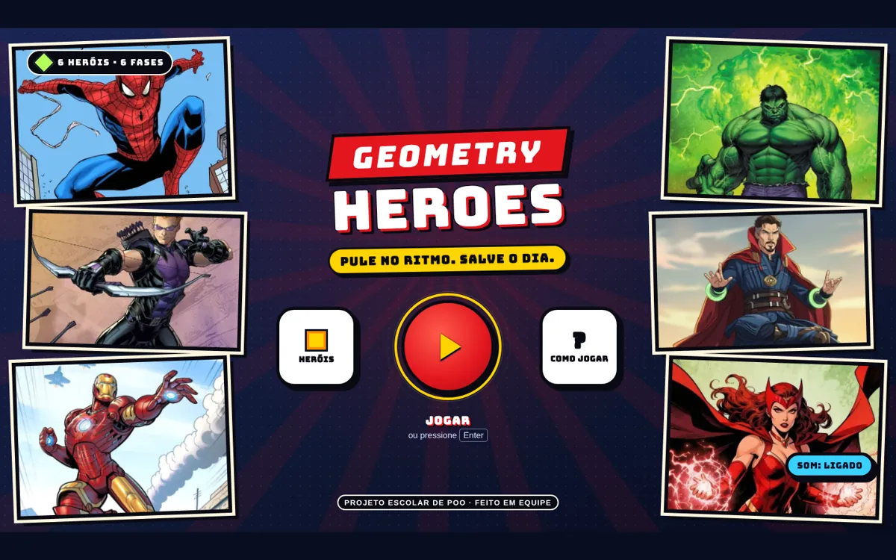
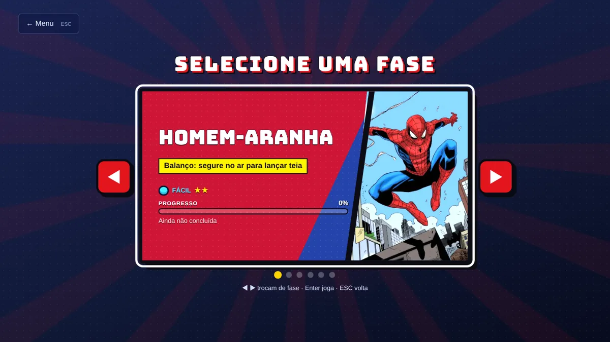
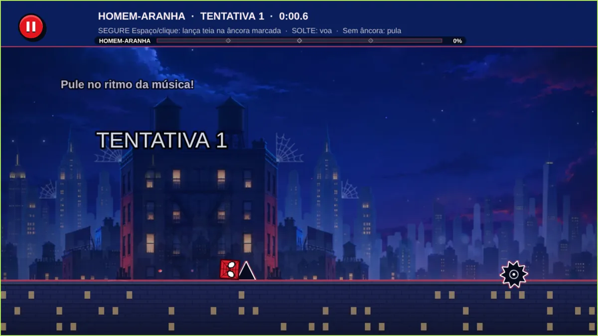
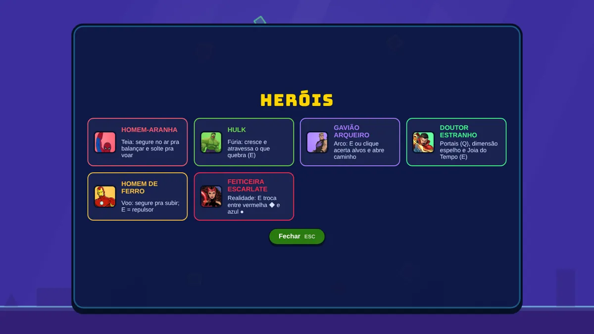

<div align="center">

# 🎮 Geometry Heroes

**Pule no ritmo. Salve o dia. Um jogo de plataforma musical com 6 heróis e 6 fases.**

Trabalho de **Programação Orientada a Objetos** · Análise e Desenvolvimento de Sistemas · **FECAP**

[](https://paulomarcelli.github.io/Projetos/Projetos/Geometry-Heroes/)


<br>



</div>

<br>

> [!NOTE]
> Projeto **acadêmico**, sem fins comerciais. Os personagens pertencem aos seus donos e aparecem só como tema do trabalho.

**Integrantes:** Paulo Marcelli, Pedro Henrique, Cauã Santos Nascimento e Leonardo Zachello.

## ✨ A ideia

Um jogo de plataforma no ritmo da música, em que cada fase é de um herói e cada herói tem uma habilidade diferente. O jogo foi o jeito de colocar a POO em prática: fases, obstáculos, habilidades e efeitos são classes que herdam umas das outras.

## 🦸 As 6 fases

| Herói | Habilidade | Dificuldade |
|---|---|---|
| Homem-Aranha | Teia: segure no ar para balançar | Fácil |
| Hulk | Fúria: cresce e atravessa o que quebra | Normal |
| Gavião Arqueiro | Mira: acerta alvos e abre caminho | Normal |
| Doutor Estranho | Portais, dimensão espelho e Joia do Tempo | Difícil |
| Homem de Ferro | Voo: segure para subir; o repulsor derruba drones (encostar no túnel mata) | Insano |
| Feiticeira Escarlate | Troca de realidade: vermelha ◆ e azul ● | Insano |

## 🖼️ As telas

<table>
  <tr>
    <td width="50%"></td>
    <td width="50%"></td>
  </tr>
  <tr>
    <td align="center"><sub><b>Seleção de fases</b>: dificuldade e progresso de cada herói</sub></td>
    <td align="center"><sub><b>Em jogo</b>: a fase do Homem-Aranha, com tentativa e tempo</sub></td>
  </tr>
</table>

<p align="center">
  <br>
  <sub><b>Heróis</b>: a habilidade de cada um, antes de jogar</sub>
</p>

## 🕹️ Como jogar

| Tecla | Ação |
|---|---|
| **Espaço**, **↑** ou clique/toque | Pular |
| **E**, **Shift** ou botão na tela | Usar o poder do herói |
| **R** | Reiniciar |
| **ESC** | Pausa |
| **Z** / **X** | Marcar / apagar ponto no modo prática |

## 🧩 Programação Orientada a Objetos

- **Classes e objetos:** 78 classes (fases, obstáculos, habilidades, jogador, efeitos e som).
- **Herança:** `Fase` é a base de `FaseHulk`, `FaseAranha`, `FaseGaviao`, `FaseFerro`, `FaseEstranho` e `FaseWanda`; `Obstaculo` tem cadeias como `Espinho → Serra → SerraDescendo`.
- **Polimorfismo:** a classe base chama ganchos (`checkpoints()`, `aoPressionar()`, `criarElemento()`) e cada fase responde do seu jeito (método template).
- **Encapsulamento:** a recarga de `Habilidade` só muda por `pronta()` e `ativar()`.

## 🛠️ Como rodar

O jogo precisa ser aberto por um servidor local (com duplo clique no `index.html` as imagens não carregam) e de internet, porque o Phaser vem de um CDN.

- **VS Code:** instale a extensão *Live Server* e clique em *Open with Live Server* no `index.html`.
- **Terminal**, na pasta do jogo:

```bash
python -m http.server 8000
```

Depois é só abrir `http://localhost:8000`.

## 🧪 Testes

São 7 suítes com 280 verificações: o jogo completo de cada fase com piloto automático, pulo, interface, checkpoints, dificuldade e renascimento. Precisam de Python, Playwright e do arquivo `phaser.local.min.js` (Phaser 3.90) na pasta do jogo:

```bash
python tests/gerar_teste_html.py
python tests/rodar_testes.py
```

## 📁 Estrutura

```text
Tarefa-POO-JavaScript/
├── index.html, style.css, main.js   # telas, estilo e inicialização do Phaser
├── js/                              # classes do jogo (js/fases/ tem uma por herói)
├── assets/                          # cenários em camadas e retratos dos heróis
├── tests/                           # testes automáticos em Python + Playwright
├── apresentacao/                    # scripts do vídeo de apresentação
├── src/                             # exemplo inicial de POO (playlist), anterior ao jogo
├── docs/                            # imagens deste README
└── DOCUMENTACAO.md, IMPLEMENTATION_NOTES.md, REA_ESQUEMA.md, PROMPTS_MANUS.md
```

<div align="center">
<br>

Feito com ⚡ por **Paulo Marcelli, Pedro Henrique, Cauã Santos Nascimento e Leonardo Zachello** · ADS · FECAP

</div>
