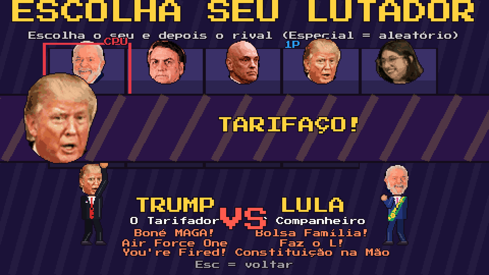

<div align="center">

# 🥊 Brasília Kombat

**A briga mais polarizada do país.** Um jogo de luta 2D no estilo fliperama dos anos 90, com caricaturas de políticos brasileiros e memes.


[](https://paulomarcelli.github.io/Projetos/Projetos/Treta-em-Brasilia/)


</div>

> [!NOTE]
> **Paródia e humor.** Os lutadores são caricaturas com apelidos e memes conhecidos, sem apoio a partido ou candidato. O elenco mistura todos os lados de propósito.

## 🎮 O jogo

- **Elenco com rosto de verdade em pixel art:** cada foto vira uma cabeça caricata de 16 bits (`ferramentas/cabeca_pixel.py`) num corpo animado em código.

| Lutador | Projétil | Investida | Gancho | Super | Golpe final do combo |
|---|---|---|---|---|---|
| Lula | Bolsa Família! | Faz o L! | Constituição na Mão | Picanha e Cervejinha | Nunca Antes Neste País! |
| Bolsonaro | Vai Virar Jacaré! | Motociata | Talquei? | Imbrochável! | E Daí? |
| Xandão | Inquérito! | Conta Bloqueada | Martelo da Justiça | Inelegível! | Prisão Preventiva! |
| Trump | Boné MAGA! | Air Force One | You're Fired! | Tarifaço 50%! | Make Brasília Great Again! |
| Eduarda Campopiano (cuia e dentes caricatos) | Corte Viral! | 1,9 Milhão de Votos | Lacração Reversa | Mais Votada de SP! | Direto de Praia Grande! |

Em breve: Flávio Bolsonaro, Milei, Pavanato e Janones.

- **Rostos animados:** cada personagem tem uma folha com 8 expressões em pixel art (neutro, piscar, esforço, grito, dor, nocaute, feliz, derrota). Os olhos, as sobrancelhas, a boca e os óculos são redesenhados em cada quadro, nos pontos do rosto detectados na foto (`ferramentas/rostos.py`). A cabeça fica presa no pescoço e se mexe sozinha: respira, pisca, recua no golpe e abaixa na derrota.
- **Personalidade:** corpo, roupa, jeito de ficar parado, provocação (tecla R / 4), vitória e derrota próprios de cada um. Veja `docs/GDD-combate.md`.
- **Combos:** Soco, Soco, Chute (enquanto acerta) termina no golpe final de cada um; soco e chute que acertam podem ser cancelados num especial.
- **Memes:** ao escolher o lutador e nos golpes fortes, o retrato entra na tela com uma frase do personagem. Se existir `audio/<id>/<n>.ogg` (ou .mp3/.wav), o áudio toca junto.
- **1 jogador contra a CPU** ou **2 jogadores** no mesmo teclado ou com dois controles.
- Melhor de 3 rounds, 99 segundos, combos, defesa alta e baixa, barra de super, pausa de impacto e tremor de tela.
- Cenário: a **Praça dos Três Poderes** no fim de tarde, com o Congresso, o pato amarelo inflável, a van da TV Treta e uma plateia pulando com cartazes ("FAZ O L", "TÁ OK?", "INELEGÍVEL", "CADÊ O PIX?").

## 🕹️ Controles

| | Jogador 1 | Jogador 2 |
|---|---|---|
| Andar | A / D | setas |
| Pular / agachar | W / S | seta para cima / para baixo |
| Soco | F | 1 do teclado numérico ou `,` |
| Chute | G | 2 do teclado numérico ou `.` |
| Especial | H | 3 do teclado numérico ou `;` |

Controle: direcional, X soco, A chute, B especial.

**Especiais:**
- **Projétil:** Especial, ou ↓↘→ + Soco.
- **Investida:** frente + Especial, ou ↓↙← + Chute.
- **Gancho:** cima + Especial, ou →↓↘ + Soco.
- **Super:** com a barra cheia, ↓ + Especial.

**Defesa:** segure para trás. Agachado defende a rasteira; em pé defende a voadora.

## 🖼️ Telas

<table>
  <tr>
    <td width="50%"></td>
    <td width="50%"></td>
  </tr>
</table>

## 🎨 Visual 16 bits

Não há nenhuma imagem pronta: tudo é desenhado em código (`scripts/desenho.gd`). O jogo pensa em 1280×720, mas desenha numa tela de **480×270**, ampliada sem suavização. Os personagens têm contorno escuro e sombreado, o céu usa pontilhado (dithering) e os textos usam a fonte pixelada **Press Start 2P** (licença OFL, em `fontes/`).

## ▶️ Como rodar

1. Instale o [Godot 4.3](https://godotengine.org/download/archive/4.3-stable/).
2. Abra o Godot, clique em **Importar** e escolha o `project.godot` desta pasta.
3. Aperte **F5**.

## 🧪 Testes

```bash
godot --headless --path . --script res://tests/mecanica.gd
godot --headless --fixed-fps 60 --path . --script res://tests/simular.gd
```

- `mecanica.gd`: defesa alta e baixa, comandos ↓↘→ e →↓↘, super só com a barra cheia, nocaute.
- `simular.gd`: 12 partidas CPU x CPU com todos os lutadores até o fim.
- `capturas.gd`: tira as capturas das telas (precisa de tela, por exemplo com `xvfb-run`).

## 📁 Estrutura

```text
treta-em-brasilia/
├── project.godot
├── cenas/main.tscn
├── scripts/
│   ├── main.gd            # troca de telas
│   ├── telas.gd           # título, como jogar, seleção e resultado
│   ├── luta.gd            # rounds, colisões, combos, HUD e efeitos
│   ├── lutador.gd         # movimento, golpes quadro a quadro, defesa e comandos
│   ├── ia.gd              # CPU
│   ├── projetil.gd
│   ├── personagens.gd     # elenco, golpes e falas
│   ├── desenho.gd         # todos os desenhos e o texto pixelado
│   ├── controles.gd       # teclas e controles dos dois jogadores
│   ├── entrada_humana.gd
│   └── camada.gd
├── sprites/               # cabeças e retratos em pixel art (gerados das fotos)
├── ferramentas/           # cabeca_pixel.py: foto -> pixel art
├── web-build/             # versão exportada para o navegador (só na pasta Projetos)
├── fontes/                # Press Start 2P (OFL)
├── tests/
└── docs/                  # capturas
```

## 🛣️ Próximos passos

- Sons e música chiptune.
- Mais cenários (Planalto, Esplanada em dia de manifestação, sessão da Câmara).
- Agarrão, finalizações cômicas e modo arcade com chefe final.
- Multiplayer online com código de sala.
- Áudios dos memes.
