<div align="center">

# 🥊 Brasília Kombat

**A briga mais polarizada do país.** Um jogo de luta 2D no estilo fliperama dos anos 90, com caricaturas de políticos e memes, golpes absurdos, Superpowers, Ultimates com cinemática e arenas cheias de manifestação.


[](https://paulomarcelli.github.io/Projetos/Projetos/Treta-em-Brasilia/)

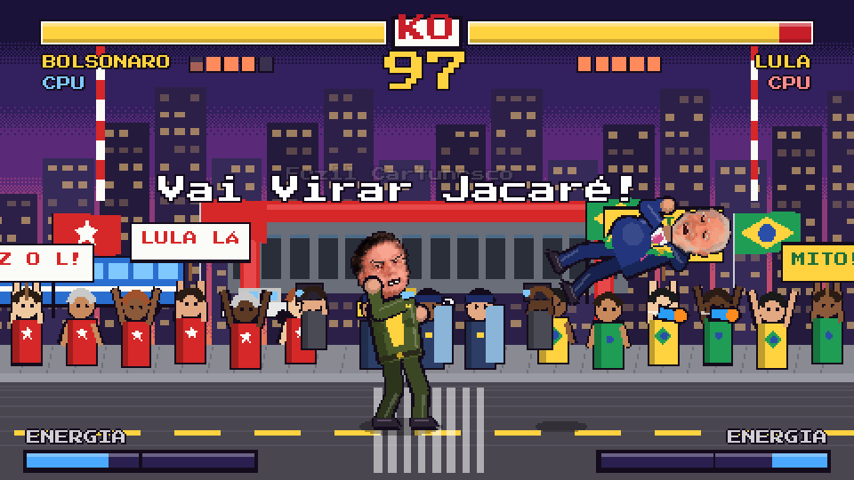

</div>

> [!NOTE]
> **Paródia e humor.** Os lutadores são caricaturas com apelidos, memes e referências públicas conhecidas, sem apoio a partido ou candidato. O elenco e as manifestações mostram todos os lados de propósito, e a violência é de desenho animado: armas de brinquedo, explosões de confete, ninguém se machuca.

## 🎮 Modos

| Modo | O que é |
|---|---|
| **PLAY** | 1 jogador contra a CPU: escolhe os lutadores e a arena |
| **MULTIPLAYER** | 2 jogadores no mesmo aparelho (teclado ou dois controles) |
| **ONLINE** | 2 jogadores pela internet, cada um no seu aparelho: um cria a sala e passa o código de 4 letras (ou o link `?sala=CODIGO`), o outro entra |
| **ARCADE MODE** | enfrente todo o elenco em sequência, uma arena por luta, cada CPU mais difícil |
| **TRAINING** | contra um boneco parado, com barra infinita, vida que volta e contador de combo |
| **CHARACTER SELECT** | ficha de cada lutador: biografia, atributos, golpes com os comandos e demonstração animada |
| **SETTINGS** | volume de música e efeitos, dificuldade, tremor de tela, controles de toque, tempo do round e tela cheia |

## 🌐 Online

- **Criar sala:** ONLINE → CRIAR SALA mostra o código (4 letras, sem I e O) e o botão COPIAR LINK.
- **Entrar:** ONLINE → ENTRAR NA SALA e digitar o código (teclado, setas ou toque), ou abrir o link `.../Treta-em-Brasilia/?sala=CODIGO`.
- **Seleção em rede:** cada um move só o próprio lado (anfitrião 1P à esquerda, convidado 2P à direita); o anfitrião escolhe a arena. Na luta, os dois usam os comandos do jogador 1 (WASD + F G H J R T, ou o toque).
- **Lockstep determinístico:** as duas telas rodam a mesma simulação quadro a quadro. Cada um manda a sua entrada para alguns quadros à frente (o atraso sai do ping, de 3 a 8 quadros) e só avança quando tem a entrada dos dois; a aleatoriedade que muda o jogo usa uma semente combinada. A cada 60 quadros as telas trocam um resumo do estado: se divergir, a partida para com aviso.
- **Como conecta:** WebRTC direto entre os navegadores; o servidor público do [PeerJS](https://peerjs.com) só apresenta um ao outro (a biblioteca, MIT, vai junto em `web/peerjs.min.js`). Sem servidor TURN, algumas redes (corporativas, alguns 4G) bloqueiam a conexão direta: o jogo avisa e sugere outra rede.
- **Feito para o celular:**
  - **sala que não cai no WhatsApp:** quem cria pode sair da tela para mandar o código ou o link. Se o celular derrubar a conexão com o servidor em segundo plano, a página volta sozinha com o **mesmo código**.
  - **convidado espera:** quem abre o link enquanto o amigo ainda está fora da tela fica em "procurando a sala" por até 2 minutos.
  - **reconexão na luta:** se a conexão direta piscar (troca de Wi-Fi para 4G, notificação, segundo plano), os dois ficam "RECONECTANDO..." e se acham de novo por até 45 s. O que foi enviado nesse meio-tempo fica numa fila, as jogadas guardadas são reenviadas e a luta continua exatamente de onde parou.
  - **sair da tela avisa o outro:** aparece "O OUTRO JOGADOR SAIU DA TELA", e ele espera até 3 minutos.
  - **a pausa em segundo plano não conta como silêncio**, então ninguém cai só por ter trocado de app.
- **Revanche** só começa quando os dois apertam. Sair da sala ou passar do tempo de espera volta os dois para o título com aviso.

## 👊 Combate

- **Movimentação de fliperama:** todos lutam na guarda (de lado, joelhos dobrados, punhos perto do rosto, balançando no ritmo); pulo para a frente ou para trás vira cambalhota; braços e pernas têm cotovelo e joelho de verdade (cinemática inversa), sem esticar; chutes recolhem o joelho antes de esticar; o corpo quica ao cair.
- **Golpes normais:** soco fraco e **soco forte** (frente + Soco), chute médio, **chute alto** (frente + Chute), **rasteira** (baixo + Chute), soco aéreo, voadora e **pisão** (baixo + Chute no ar).
- **Combos:** Soco, Soco, Chute termina no golpe final de cada um; Chute, Chute vira chute alto; golpes que conectam cancelam em especial, e qualquer coisa cancela no SUPER.
- **Agarrão e arremesso:** botão Agarrar (ou Soco + Chute) de perto; com trás, joga para o outro lado. Se os dois agarram juntos, **escapam**.
- **Dash e esquiva:** dois toques para a frente ou para trás. A esquiva para trás é invencível no começo.
- **Defesa e contra-ataque:** segure para trás (agachado defende rasteira). Começar a defender bem na hora do golpe é **DEFESA PERFEITA**: não perde vida e o rival fica desequilibrado. Acertar quem está preparando um golpe é **CONTRA-ATAQUE** (mais dano).
- **Peso nos golpes:** antecipação antes de cada ataque, pausa de impacto proporcional à força, empurrão (knockback), reação diferente se pega na cabeça, no corpo ou nas pernas, recuperação no fim, preparação do pulo e aterrissagem.
- **Efeitos:** faíscas, anel de impacto, poeira, fumaça, estrelas, confete, linhas de velocidade, rastro de silhueta nos dashes e investidas, tremor de tela moderado, zoom e câmera lenta no nocaute.
- **Balões de quadrinho:** golpes fortes estouram um "POW!", "PÁ!", "TOMA!"; especiais e SUPER mostram a palavra de quem bateu ("PICANHA!", "TALKEY?", "INQUÉRITO!", "YOU'RE FIRED!", "6x1 NÃO!", "VIRALIZOU!", "É SÓ CHOCOLATE!", "NEM-NEM!"...). Quem apanha sacode na pausa de impacto.
- **Entrada e K.O.:** no 1º round cada lutador entra provocando, um de cada vez, com um bordão; no nocaute, depois do "K.O.!", estoura um balão gigante com a palavra de quem venceu. Trocar de lado andando e o fim do dash derrapam com poeira.

## ⚡ SUPER e Ultimate

A **barra de energia** enche batendo, defendendo, apanhando e provocando. Ela tem dois níveis:

- **Meia barra = SUPERPOWER:** o botão SUPER solta a habilidade especial do personagem.
- **Abertura do SUPER:** clarão na cor do lutador, onda no chão, raios na cor dele e o cut-in com o nome do golpe e um bordão do personagem.
- **Barra cheia = ULTIMATE:** a tela congela, a câmera dá zoom e começa uma **cinemática** exclusiva. Dá para escapar pulando ou defendendo na hora certa.

O botão SUPER (tecla **J**, ou o botão grande na tela do celular) mostra a carga num anel, brilha quando dá para usar, fica dourado no Ultimate e treme e faz "bzz" quando não há energia. Cada especial tem **recarga** (os quadradinhos ao lado do nome). Ao soltar o Superpower, o retrato do lutador cruza a tela com o nome do golpe. A **Censura Suprema** do Xandão cala o rival: tarja preta e mosaico no rosto, falas viram ####, o nome no placar vira CENSURADO e ele fica sem especiais por 5 segundos.

| Lutador | Especiais (Especial + direção) | SUPERPOWER | ULTIMATE |
|---|---|---|---|
| **Lula** | Discurso do Planalto · Picanha Gigante · Faz o L! · Bolsa Família · Picanha Voadora | Picanha na Brasa | **Picanha Suprema** |
| **Bolsonaro** | Fuzil Cartunesco · Motociata · Talquei? · Operação Cloroquina · Vai Virar Jacaré! | Rajada do Capitão | **Motociata Nacional** |
| **Xandão** | Inquérito! · Conta Bloqueada · Martelo da Justiça · Canetada do STF · Suspensão de Conta | Censura Suprema | **Decisão Monocrática** |
| **Trump** | Presidential Speech · Hair Attack · You're Fired! · Make America Dance Again · Boné MAGA! | YMCA Presidencial | **Tarifaço Presidencial** |
| **Eduarda** | Corte Viral! · Microfone Explosivo · Lacração Reversa · Debate Infinito · 1,9 Milhão de Votos | Polêmica nas Redes | **Treta Nacional** |
| **Erika** | PEC 6x1 · Vida Além do Trabalho · Não Me Calarão! · Abaixo-Assinado · Representação! | Fim da Escala 6x1 | **PEC Aprovada** |
| **Pavanato** | Tá Gravando? · Visita Surpresa na USP · Mais Votado da História! · Frente Antiwoke · Treta no Aeroporto | 3 Milhões de Votos | **Presidente?!** |
| **Nikolas** | O Vídeo do Pix · Caminhada até Brasília · Mais Votado do Brasil! · Revoga! · Story de 1 Minuto | 300 Milhões de Views | **Caminhada!** |
| **Flávio** | Bombom Lavado · Rachadinha! · Cadê o Queiroz? · Mansão de R$ 6 Mi · Carta (Versão 3) | TariFlávio | **Saiu Escondido!** |
| **Renan** | Corte da Live · Megafone do Impeachment · Vota 14! · Superpresídio · LIVE EMERGENCIAL | Chuva de Cortes | **Confirma!** |
| **Dilma** | Estocar Vento · Pedalada Fiscal · Mulher Sapiens! · Saudação à Mandioca · Tchau, Querida! | Dobraremos a Meta | **Estocando Vento!** |

<table>
  <tr>
    <td width="50%">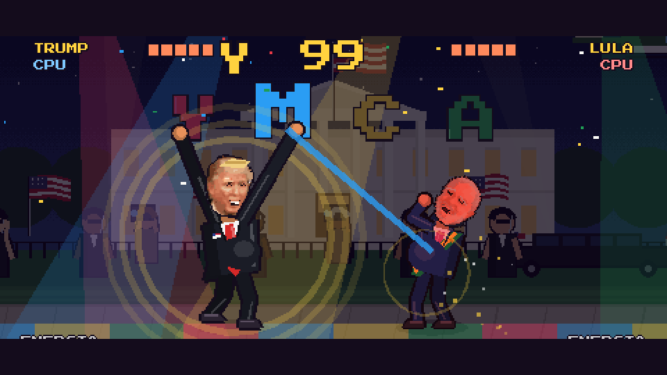</td>
    <td width="50%">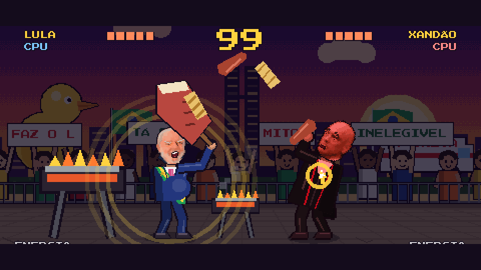</td>
  </tr>
  <tr>
    <td>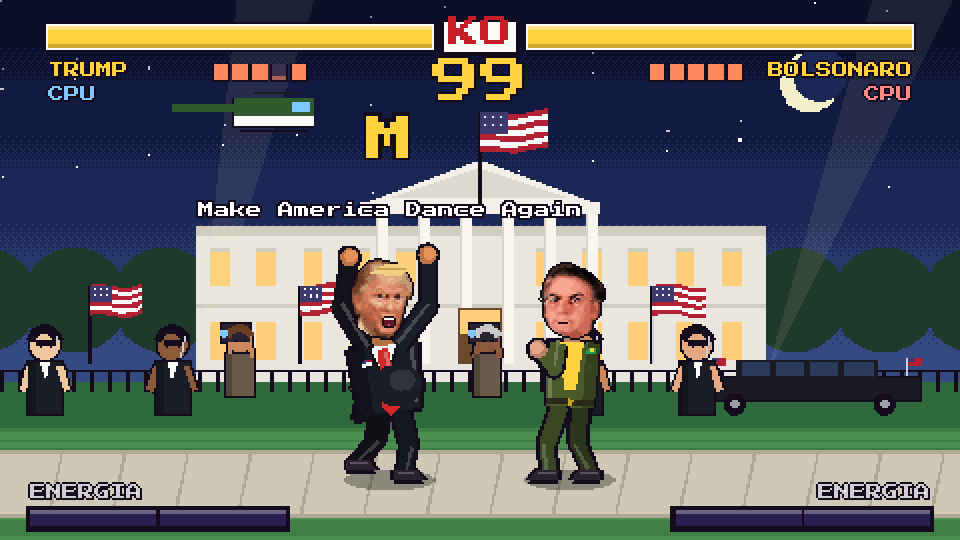</td>
    <td>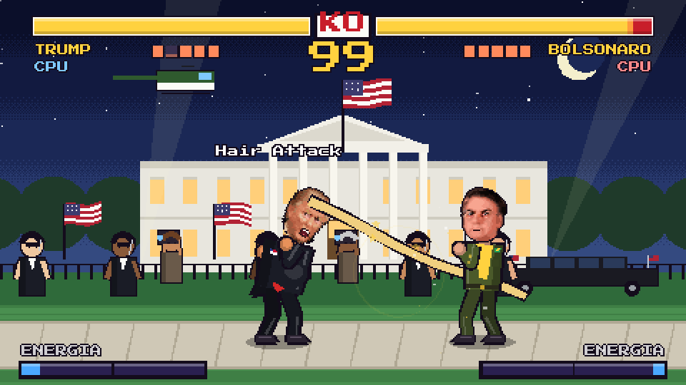</td>
  </tr>
</table>

- **Ultimates dos 5 primeiros refeitas:** Lula (churrascão no Planalto ao pôr do sol, a placa da picanha despencando de R$ 89,90 a R$ 9,99, a multidão fazendo o L, "A PICANHA VOLTOU!"), Bolsonaro (Motociata Nacional na Esplanada, comboio de motos passando por cima do rival e o contador até 12.000, "TÁ OK?"), Xandão (colunas do STF e a estátua da Justiça, perfis caindo e levando o carimbo SUSPENSO, contador de perfis suspensos e o martelo, "INQUÉRITO ABERTO!"), Trump (comício com bandeirolas, telão de neon Y M C A acendendo na batida do YMCA, plateia de bonés e caixotes de tarifa, contador até 500%, "YOU'RE FIRED!") e Eduarda (orla da Praia Grande, celulares e corações subindo, o pino do mapa caindo no rival e 1,9 milhão de votos, "PRAIA GRANDE NO MAPA!").

## 🧑‍🎤 Lutadores

- **Rosto da foto, parecido de verdade** (`ferramentas/cabeca_foto.py`): a expressão neutra é a própria foto (com contraste, cor, nitidez e contorno de desenho), em alta resolução; as outras 7 (piscar, esforço, grito, dor, nocaute, feliz e derrota) mexem só nos olhos, sobrancelhas e boca: a região é apagada com inpainting (OpenCV) e o traço novo é desenhado no lugar e no tamanho certos, seguindo os contornos do rosto do MediaPipe (`ferramentas/rostos.py`). No jogo, a cabeça é reduzida pela GPU com mipmaps (só as cabeças usam filtro linear; corpo, texto e cenário continuam em pixel duro), então olho e boca não somem na tela de 480x270, e a cabeça ficou 15% maior, no estilo caricatura. A Eduarda continua na caricatura do boneco abridor de garrafas (`ferramentas/cabeca_pixel.py`).
- **Erika Hilton** (deputada federal, PSOL-SP): sátira do papel público dela, a PEC pelo fim da escala 6x1 (44 h para 36 h, movimento Vida Além do Trabalho), os abaixo-assinados e as representações. Vestido-blazer preto sem manga, escarpim e pulseira dourada; a Ultimate é a votação no plenário com o painel enchendo de SIM.
- **Lucas Pavanato** (PL-SP, vereador mais votado da história de SP e deputado federal com ~3 milhões de votos): blazer azul-marinho aberto sobre a camiseta preta "ANTI WOKE", tênis e celular sempre gravando. A Frente Antiwoke é um muro de escudos que apaga projéteis; a Ultimate é a "posse" no palanque, com holofotes, a bandeira gigante, flashes dos fotógrafos e o contador de votos disparando até "MAIS VOTADO!".
- **Nikolas Ferreira** (PL-MG, deputado federal mais votado do Brasil em 2022): terno azul-marinho e gravata, bandeira do Brasil no mastro. O vídeo do Pix vira um losango girando, a Caminhada até Brasília é uma marcha com armadura e 4 acertos, e o "Revoga!" derruba um carimbo gigante. Na Ultimate, a estrada BR-040 na chuva com a placa contando de 240 km até "CHEGAMOS!".
- **Flávio Bolsonaro** (PL-RJ, senador, candidato derrotado no 2º turno de 2026): terno azul-marinho com a faixa verde e amarela e o brasão dourado; cabeça feita do retrato oficial do Senado (Agência Senado, Wikimedia Commons). O bombom da lojinha voa deixando bolhas de sabão, a Rachadinha avança com o envelope, a mansão sobe com a piscina que deixa lento, a carta sai em 3 versões e o TariFlávio faz chover caixotes de 50%. Na Ultimate, o aeroporto à noite com o voo para Miami, a lupa do "CADÊ O FLÁVIO?" e "SAIU ESCONDIDO!". As piadas são sobre fatos públicos e investigações noticiadas, não condenações.
- **Renan Santos** (cofundador do MBL, candidato do Missão em 2026, 4º lugar com 2,24%): terno azul-marinho, barba e o megafone das manifestações. A tesoura do "corte" de live gira com rastro laranja, o megafone empurra com ondas de som, o superpresídio desce como uma grade com cadeado, as lives emergenciais saem em selos AO VIVO e a Chuva de Cortes derruba celulares com vídeos. Na Ultimate, a urna eletrônica gigante digita 1, 4 e CONFIRMA, e as teclas voam no rival.
- **Dilma Rousseff** (presidenta de 2011 a 2016, hoje à frente do Banco dos BRICS): terninho creme com a faixa presidencial e o brasão. O pote de vidro com o vento estocado gira no ar, a Pedalada Fiscal chega de bicicleta, as mandiocas brotam do chão ("Saúdo a mandioca!"), o telefone do "Tchau, querida!" voa em arco e o SUPER faz chover alvos de META X2. Na Ultimate, o parque eólico gira cada vez mais rápido, o tornado pega o rival, os potes voam e o medidor chega a "VENTO ESTOCADO: 100%". Bordões das falas públicas dela, sem piada de gênero ou aparência.
- **Tela de seleção nova:** grade 4 colunas só com retratos (fundo e faixa na cor de cada lutador), última linha centralizada, "?" para quem ainda vai entrar, e o confronto escrito embaixo do VS.
- **Efeitos de poder na cor de cada lutador:** brilho e faíscas no início de cada especial, rastro nos projéteis, faíscas dos especiais puxando para a cor de quem bate e borda pulsando no chão das zonas.
- **Cabeça independente:** atrasa em relação ao corpo, recua no golpe, balança andando, pisca sozinha.
- **Roupa com movimento:** gravata, toga e aba do paletó balançam; o topete do Trump mexe com o vento.
- **Proporções e silhueta próprias**, jeito de ficar parado, provocação, vitória e derrota de cada um (a vitória do Trump é a dança).

Em breve: Flávio Bolsonaro, Milei e Janones.

## 🏟️ Arenas

- **Memes de fundo em todas as arenas:** um teco-teco puxa faixa com manchetes satíricas ("STF INVESTIGA O INQUÉRITO", "CARTA DO FLÁVIO: VERSÃO 4", "TRABALHADOR PEDE ESCALA 7x0"...), o vira-lata caramelo atravessa, senta para assistir e late quando a briga esquenta (na USP é a capivara do campus com o passarinho nas costas), a Paulista ganhou um telão de LED com PLANTÃO e a Casa Branca mostra os posts do presidente ("FLAVIO WHO??", "COVFEFE").

| Arena | O que tem |
|---|---|
| **Praça dos Três Poderes** | Congresso no pôr do sol, o pato amarelo inflável, a van da TV Treta e a plateia com cartazes |
| **USP** | Torre do Relógio, prédio brutalista com faixa de greve, estudantes passando, manifestação de camiseta vermelha com estrela, bandeiras LGBT e da Palestina, cartaz "RECUA, FASCISTA, RECUA!" e sinalizador de fumaça |
| **Avenida Paulista** | MASP, antenas, prédios acesos, trânsito, manifestantes dos dois lados (vermelho e verde-amarelo), polícia no meio, imprensa com flash e um empurra-empurra de desenho animado |
| **Casa Branca** | fachada com o pórtico, bandeiras, agentes de terno e óculos escuros, limusine, holofotes e helicóptero passando |

A plateia pula mais quando a luta esquenta.

<table>
  <tr>
    <td width="50%">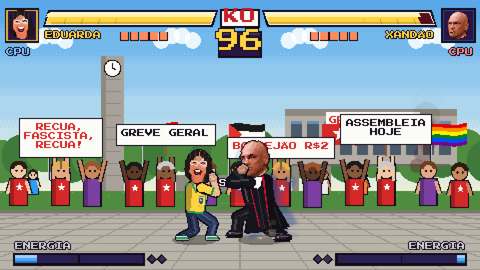</td>
    <td width="50%">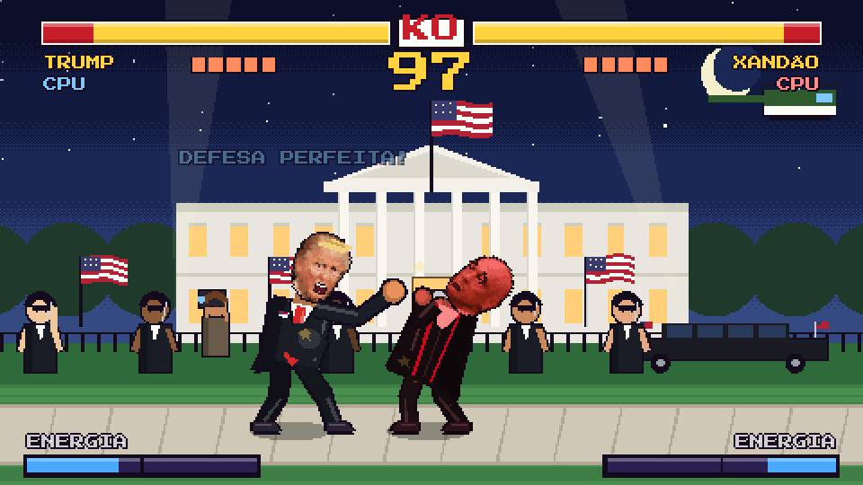</td>
  </tr>
</table>

## 🔊 Áudio

- **Efeitos, vozes e músicas das arenas:** originais e sintetizados (`ferramentas/sons.py`): 45 efeitos, vozes caricatas curtas de cada lutador e 6 músicas chiptune em loop, uma por arena.
- **Memes em áudio** (enviados pelos idealizadores, convertidos por `ferramentas/memes_audio.py`: corte do silêncio, limite de duração, volume nivelado, OGG mono): cada lutador com áudio solta os memes dele com a legenda certa na luta e **ao ser escolhido na seleção** (sorteado). Lula, Bolsonaro, Xandão, Trump, Dilma, Nikolas, Flávio e Renan.
- **Rádio de memes:** durante a luta, a cada 7 a 13 segundos sai um meme em áudio de **qualquer** personagem do elenco (não só de quem está lutando), com o retrato e a legenda. Nunca por cima de outro meme, da trilha ou da cinemática.
- **Sem repetição:** os memes saem de um **baralho** embaralhado que vale a sessão inteira: os 32 áudios do rádio tocam todos antes de algum voltar, e cada lutador tem o próprio baralho (também na seleção). De vez em quando entra a frase escrita de quem não tem áudio (Erika, Pavanato, Eduarda) com a voz caricata, e quem tem poucos áudios (Xandão, Flávio) solta a frase escrita em vez de repetir o mesmo áudio em seguida.
- **Zé Gotinha:** escolher um modo de jogo no título (PLAY, MULTIPLAYER, ONLINE, ARCADE, TRAINING) toca o "cadê o Zé Gotinha?".
- **Trilha da Ultimate para todos:** Lula, Bolsonaro, Xandão, Nikolas e Dilma tocam a própria música na cinemática (o trecho mais forte da faixa, escolhido pela energia); o Trump toca o YMCA; Erika, Pavanato, Flávio, Renan e Eduarda ganharam temas chiptune originais (subida, pancada de orquestra, tema e acorde final, gerados em `ferramentas/sons.py ultimates`). A música da arena abaixa enquanto isso. A trilha **só toca se a Ultimate pegar**: se o rival defende ou esquiva, fica em silêncio; e some com a cena.
- **Música na vitória:** quem tem música própria (Lula, Bolsonaro, Xandão, Nikolas, Dilma e o Trump com o YMCA) vence a partida ao som da trilha da Ultimate, que segue na tela de resultado. A Dilma solta o "ganhar ou perder" ao vencer um round.
- **YMCA no SUPER e na Ultimate do Trump:** a dança é sincronizada com a música (125 BPM medidos na faixa): a cada batida ele faz uma letra com os braços (Y, M, C, A), a pista de dança acende e o letreiro de neon **Y M C A** acende a mesma letra, pulsando na batida (em cima dele no SUPER, no telão do palco na Ultimate).
- **Vitória da Dilma:** "Não acho que quem ganhar ou quem perder vai ganhar ou perder..." toca quando ela vence a partida.
- **USP:** uma vez por partida a torcida canta "RECUA!".
- **Dilera:** no meio da luta, depois de uma derrubada, ele pode surgir no canto da tela (como o "Toasty!" dos fliperamas) e soltar um áudio. Uma vez por partida. A foto (`fotos/dilera.jpg`) vira `sprites/dilera.png` com `ferramentas/dilera.py` (fundo removido, contorno), e sobe do canto com a tarja "DILERA!".

## 🕹️ Controles

| | Jogador 1 | Jogador 2 |
|---|---|---|
| Andar / pular / agachar | A D / W / S | setas |
| Soco · Chute | F · G | `,` · `.` (ou 1 · 2 do numérico) |
| Especial | H | `/` (ou 3) |
| **SUPER** | **J** | **K** (ou 5) |
| Agarrar | T | L (ou 6) |
| Provocar | R | `;` (ou 4) |
| Pausa | Esc ou P | |

Controle: direcional, X soco, A chute, B especial, Y provocar, **RB super**, LB agarrar.

**Celular e tablet:** direcional à esquerda; SOCO, CHUTE, ESPECIAL, AGARRA e o botão **SUPER** grande à direita; pausa no meio da tela. Aceita vários dedos ao mesmo tempo. No primeiro toque o jogo entra em **tela cheia** e trava na horizontal (no iPhone o Safari não permite tela cheia; use "Adicionar à Tela de Início").

## 🖼️ Telas

<table>
  <tr>
    <td width="50%">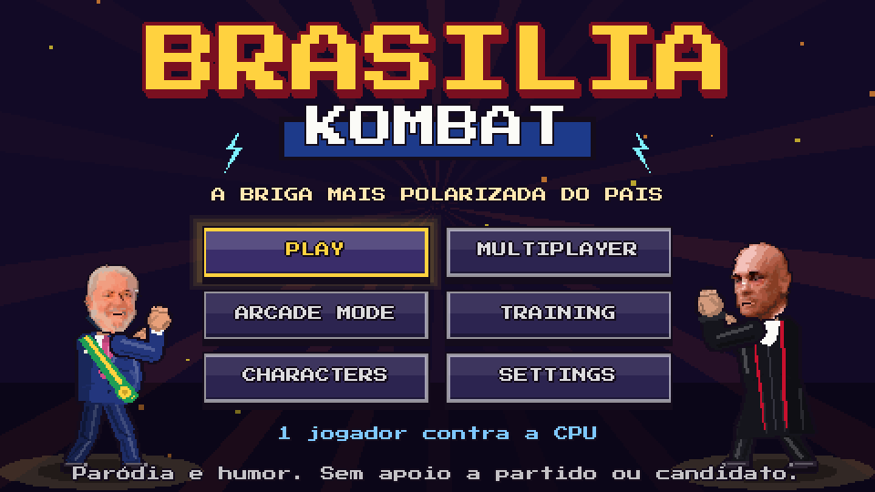</td>
    <td width="50%">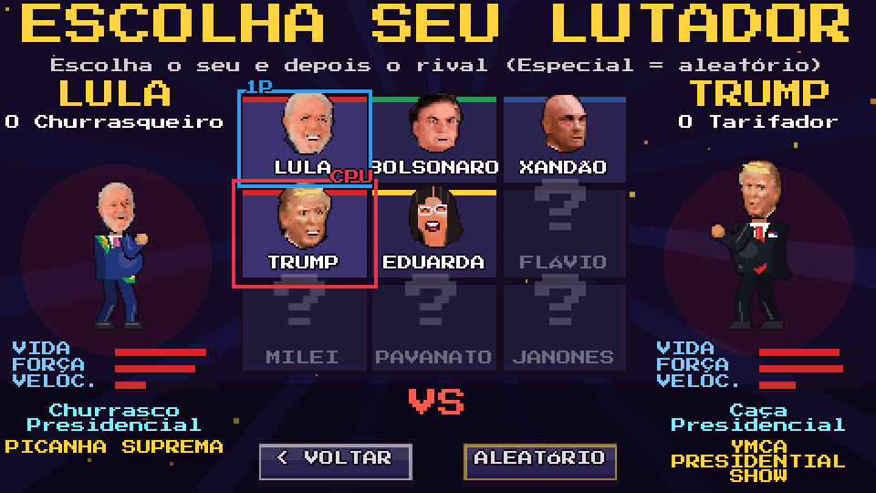</td>
  </tr>
  <tr>
    <td>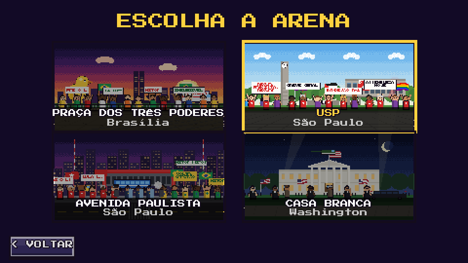</td>
    <td>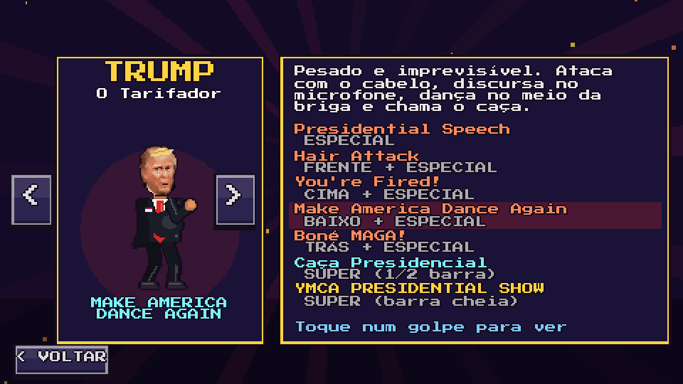</td>
  </tr>
</table>

## 📱 Leve em qualquer aparelho

- **Download menor:** os rostos e retratos de foto vão em WebP com perda leve (qualidade 85, ~3 vezes menores, sem diferença visível no jogo) e os memes e trilhas em OGG a 22 kHz. O pacote do jogo caiu de 9,5 MB para 5,5 MB (de 8,6 MB para 4,4 MB baixados).
- **Motor enxuto:** a versão web roda num Godot 4.3 compilado só com o que o jogo usa (2D, fonte TTF, OGG, WebP e o JavaScriptBridge), sem 3D, XR, a rede do próprio Godot (o online é a PeerJS), vídeo, JPG/SVG/MP3 e o servidor de texto avançado. O `index.wasm` caiu de 35,4 MB para 23,6 MB (de 8,0 MB para 4,9 MB baixados) e o navegador tem bem menos código para compilar antes de abrir. O perfil está em `web/motor/custom.py`; `ferramentas/motor_web.sh` recompila do zero (Emscripten 3.1.64 + Godot 4.3-stable, ~20 min em 4 núcleos) e o `export_presets.cfg` usa o zip gerado em `web/motor/`.
- **Modo leve automático** (CONFIGURAÇÕES > DESEMPENHO): o jogo mede a fluidez; se o aparelho fica abaixo de ~47 quadros por segundo, passa a desenhar a 30 quadros por segundo, com metade das partículas e a plateia atualizada menos vezes. A luta continua a 60 passos por segundo, na mesma velocidade e igual no online. Dá para forçar LEVE ou MÁXIMO.
- **Pouco trabalho por quadro:** cenário e plateia ficam guardados em imagens (1 chamada de desenho em vez de centenas), os lutadores saem num lote só de triângulos e a luta gasta ~1,5 ms de processador por quadro num computador (`tests/perf.gd` mede cada tela).

## 🎨 Visual 16 bits

Não há imagens prontas além das cabeças: tudo é desenhado em código. O jogo pensa em 1280×720 e desenha numa tela de **480×270** ampliada sem suavização, com contorno escuro, sombreado, céu pontilhado (dithering) e a fonte pixelada **Press Start 2P** (OFL, em `fontes/`). Para rodar bem em aparelhos modestos, cenário, plateia e controles de toque viram textura (atualizada só quando muda) e cada lutador é enviado à placa de vídeo num único lote de triângulos (`scripts/lote.gd`): a luta inteira cabe em ~35–55 chamadas de desenho por quadro.

Detalhes de acabamento: punhos fechados com nós dos dedos e polegar, sombra embaixo das mangas e atrás das pernas, sapatos com sola e salto, dobras do tecido, dragonas e condecorações na farda, lenço no bolso dos paletós e as estrelas na camisa da seleção. Na movimentação, a caminhada acelera e freia (patch da Manus), os punhos acompanham o corpo com atraso, os passos e as freadas levantam poeira e o golpe acerta com um clarão branco. Nos efeitos, cada impacto tem um estalo de quadrinho com riscos, os tiros têm clarão no cano e as explosões viram bola de fogo com estilhaços e onda de choque no chão. No HUD, as barras de vida são inclinadas, com rastro vermelho do dano, marcas a cada 10%, retrato do lutador (que muda de expressão quando apanha), medalhas de round, placa do relógio e a barra de energia com brilho correndo e dois losangos de Super. HUD e partículas também saem em lote.

## ▶️ Como rodar

1. Instale o [Godot 4.3](https://godotengine.org/download/archive/4.3-stable/).
2. Abra o Godot, clique em **Importar** e escolha o `project.godot` desta pasta.
3. Aperte **F5**.

## 🧪 Testes

```bash
godot --headless --path . --script res://tests/mecanica.gd
godot --headless --fixed-fps 60 --path . --script res://tests/simular.gd
```

- `mecanica.gd` (50 verificações): golpes fortes, defesa alta e baixa, defesa perfeita, contra-ataque, dash, comandos, recarga, SUPER sem energia, Superpower, Ultimate, agarrão, Bloqueio Supremo e todas as habilidades de todos os lutadores.
- `simular.gd`: 10 partidas CPU x CPU com todos os lutadores até o fim.
- `capturas.gd`: capturas de todas as telas, golpes e ultimates (precisa de tela, por exemplo com `xvfb-run`).
- `cpu.gd`: custo de CPU por quadro de uma luta.
- `online.gd`: duas lutas online ligadas por uma ponte falsa (atraso de 2 a 7 quadros, fora de ordem, e uma queda de 300 quadros com reenvio das jogadas), com entradas aleatórias nos dois lados e barra cheia (SUPER e Ultimate): o estado tem de sair idêntico em todos os quadros.
- `perf.gd`: custo de processador de cada tela (média, p95 e pior quadro), sem placa de vídeo.
- `web_telas.js`: passeio pela versão web (título, configurações, como jogar, créditos, lutadores, online, seleção, arena, VS, luta e pausa), com captura de cada tela e os erros do console. Serve para conferir uma troca de motor.
- `som_luta.gd`: a trilha da Ultimate só toca quando pega (defendida e esquivada: silêncio), a música de vitória de quem tem o rádio de memes com vários personagens e sem repetir antes de tocar todos, e o Zé Gotinha ao escolher um modo.
- `perf_web.js`: tempo de abertura, fps do título e o modo leve automático, com CPU e rede limitadas (celular simulado).
- `poligonos.gd`: deixa cada tela rodando para achar polígonos inválidos (o motor avisa quando não consegue triangular um).
- `online_reconexao.js`: no navegador, com o servidor real, testa a sala com o anfitrião fora da tela (o convidado espera e entra na mesma sala), a conexão piscando no meio da luta e um jogador saindo da tela por 20 s, conferindo que a luta segue igual nas duas telas.
- `online_web.js`: o online de verdade em duas páginas do Chromium (Playwright), com a sala no PeerJS, seleção, arena e luta, conferindo os resumos de estado das duas telas.

## 📁 Estrutura

```text
treta-em-brasilia/
├── scripts/
│   ├── main.gd          # modos de jogo e transições entre telas (inclusive o fluxo online)
│   ├── rede.gd          # online: sala no PeerJS, canal WebRTC, ping
│   ├── telas.gd         # título, seleção, arena, lutadores, configurações, VS, resultado
│   ├── luta.gd          # rounds, colisões, câmera, HUD, cinemática, treino, pausa
│   ├── lutador.gd       # movimento, golpes quadro a quadro, defesa, agarrão, habilidades
│   ├── personagens.gd   # elenco e habilidades (dados)
│   ├── poses.gd         # poses das habilidades e a dança
│   ├── desenho.gd       # corpo, rosto, roupas, texto pixelado, Praça dos Três Poderes
│   ├── arte.gd          # objetos, projéteis, zonas, caça, churrasqueira
│   ├── cenarios.gd      # USP, Avenida Paulista, Casa Branca
│   ├── cinematica.gd    # ultimates
│   ├── particulas.gd · projetil.gd · zona.gd
│   ├── ia.gd            # CPU
│   ├── toque.gd         # controles de toque
│   ├── som.gd · config.gd · controles.gd · entrada_humana.gd · camada.gd
├── audio/               # sfx, vozes e músicas (gerados por ferramentas/sons.py)
├── sprites/             # cabeças e retratos em pixel art (gerados das fotos)
├── ferramentas/         # cabeca_foto.py, rostos.py, sons.py, memes_audio.py, motor_web.sh
├── web/                 # peerjs.min.js (copiado ao lado do jogo exportado)
│   └── motor/           # perfil do motor web enxuto (custom.py) e o modelo de exportação gerado
├── fontes/ · tests/ · docs/
```

## 🙌 Créditos

- **Idealizadora do jogo:** Lorena Oliveira Nascimento
- **Desenvolvedor:** Paulo Marcelli

Os créditos aparecem na tela inicial e no menu CRÉDITOS, uma tela de fim de fliperama: os cartões entram deslizando, o elenco inteiro dança em fila com um holofote passando de um em um (com nome e apelido na placa), confete caindo e o "OBRIGADO POR JOGAR!" ondulando.

## 🛣️ Próximos passos

- Servidor TURN próprio para o online funcionar em qualquer rede.
- Os próximos lutadores: Milei e Janones.
