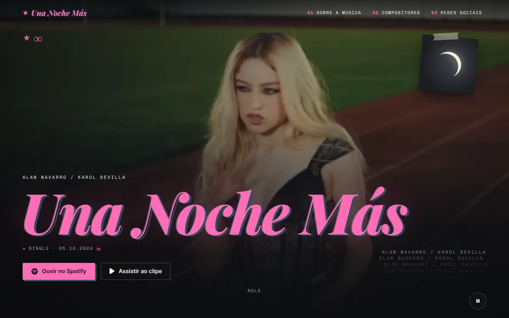
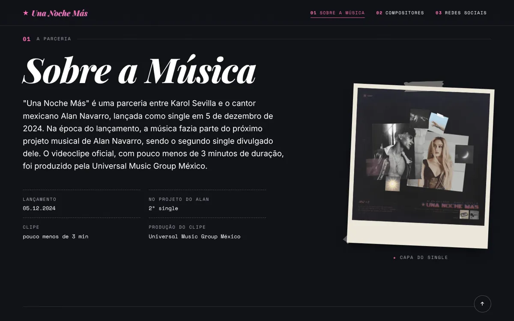
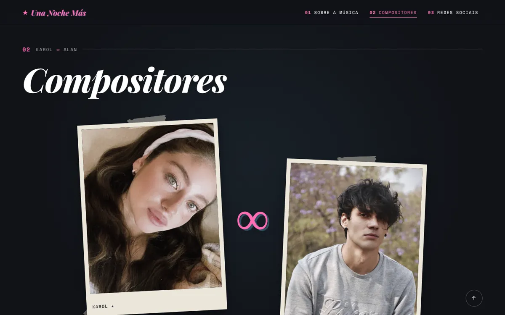
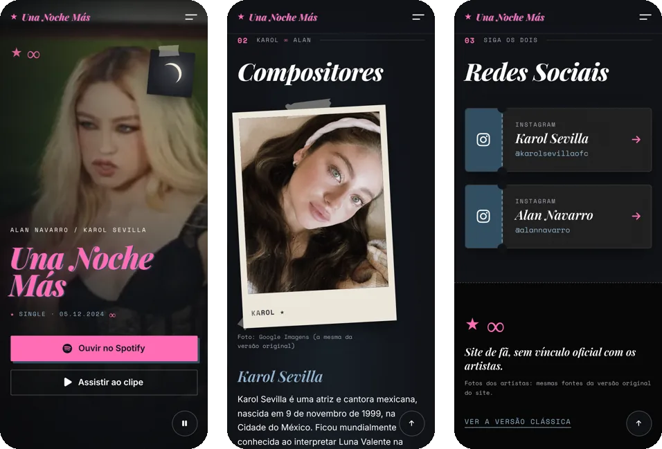

<div align="center">

# 🌙 Una Noche Más · Alan Navarro & Karol Sevilla

**Um site de fã para o single de 2024, montado como uma colagem noturna inspirada na capa.**

[](https://paulomarcelli.github.io/Projetos/Projetos/Una-Noche-Mas/)


<br>



<sub>O título rosa com sombra azul, a lua colada com fita e o clipe ao fundo.</sub>

</div>

<br>

> [!NOTE]
> Projeto **de fã**, sem vínculo oficial com os artistas. O clipe, a capa e as fotos pertencem aos seus autores.

## ✨ A ideia

A identidade vem da capa do single: fotos coladas com fita, a lua, ★ e ∞, rótulos de máquina de escrever e o título rosa com um deslocamento azul. O site é a noite em que a música acontece.

| Cor | | Uso |
|---|---|---|
| Rosa | `#FF69B4` | Título, botões e números das seções |
| Noite | `#0B0D12` | Fundo |
| Azul | `#2C4A5E` | Sombra do título e cartões |
| Papel | `#ECE6DA` | Molduras das polaroides |

Fontes: **Playfair Display** nos títulos, **Inter** nos textos e **Space Mono** nos rótulos.

## 🖼️ As seções

<table>
  <tr>
    <td width="50%"></td>
    <td width="50%"></td>
  </tr>
  <tr>
    <td align="center"><sub><b>Sobre a Música</b>: ficha técnica e a capa colada</sub></td>
    <td align="center"><sub><b>Compositores</b>: Karol ∞ Alan, como um dueto</sub></td>
  </tr>
</table>

<p align="center">
  <br>
  <sub><b>No celular</b>: botões grandes e menu de tela cheia</sub>
</p>

## 🎬 O que o site tem

- **Clipe no topo**, numa versão leve (2,7 MB) que já começa no trecho certo, com entrada animada e botão de pausar.
- **Sobre a Música** com ficha técnica e players do **Spotify** e do **YouTube** que só carregam quando você clica.
- **Compositores** como dueto, com as fotos da versão original e as iniciais caso alguma imagem não carregue.
- **Redes Sociais** em cartões de ingresso.
- Funciona pelo teclado, tem contraste AA e respeita **"reduzir movimento"**.

## 🕰️ Versão clássica

A primeira versão do site continua no ar em [`classic/`](https://paulomarcelli.github.io/Projetos/Projetos/Una-Noche-Mas/classic/), do jeito que era, com um botão para a versão nova.

## 🛠️ Como rodar

Abra o `index.html` no navegador ou use o **Live Server** do VS Code. Se preferir o terminal:

```bash
python3 -m http.server 8000
```

Depois é só abrir `http://localhost:8000`.

## 📁 Estrutura

```text
Una-Noche-Mas/
├── index.html            # versão nova
├── style.css             # cores, tipografia e layout
├── components.css        # menu, players, avisos e fotos
├── motion.css, motion.js # animações
├── script.js             # funcionalidades
├── assets/               # vídeo leve, imagem de espera, capa e imagem de compartilhamento
├── classic/              # a primeira versão, preservada
├── unanochemas.mp4       # vídeo original (usado pela versão clássica)
├── nochemas.png          # capa original (ícone da aba)
└── docs/                 # DIRECAO.md, DESIGN_SYSTEM.md e as imagens deste README
```

## 🙌 Créditos

- Música de **Alan Navarro** e **Karol Sevilla**; clipe produzido pela Universal Music Group México.
- Fontes **Playfair Display**, **Inter** e **Space Mono** (Google Fonts).

<div align="center">
<br>

Feito com 💗 por **Paulo Marcelli** · ADS · FECAP

</div>
