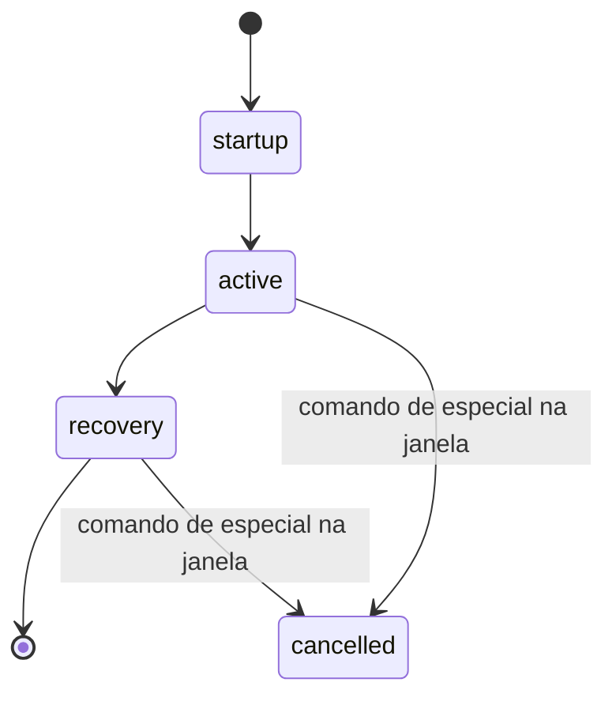

# E-001 Attack
Product term: golpe · Parent: E-002 · Status: draft

Modelo para o BRIGA DE PODER (Resource `AttackData`), derivado das regras do gênero. Nenhum valor vem do jogo original.

## Fields

| Field | Type | Required | Default | Constraints or enum | Source |
|---|---|---|---|---|---|
| id | String | yes | | único por personagem | [doc SRC-002] |
| startup | int (quadros) | yes | | ≥ 1 | [doc SRC-002] |
| active | int (quadros) | yes | | ≥ 1 | [doc SRC-002] |
| recovery | int (quadros) | yes | | ≥ 0 | [doc SRC-002] |
| damage | int | yes | | ≥ 0 | [doc SRC-001] |
| chip_damage | int | no | 0 | normalmente 10–25% de damage | [doc SRC-002] |
| hitstun | int (quadros) | yes | | | [doc SRC-002] |
| blockstun | int (quadros) | yes | | | [doc SRC-002] |
| hitstop | int (quadros) | yes | | | [doc SRC-002] |
| pushback | int (unidades) | yes | | | [doc SRC-002] |
| hitboxes | Array[Rect por quadro ativo] | yes | | relativo ao lutador | [doc SRC-002] |
| guard | enum | yes | mid | high, mid, low, unblockable (agarrão) | [doc SRC-001] [doc SRC-002] |
| knockdown | enum | no | none | none, soft, hard | [doc SRC-002] |
| cancel_into | Array[String] | no | [] | ids de especiais | [doc SRC-002] |
| input | String | yes | | botão + comando (motion/charge) | [doc SRC-001] [doc SRC-002] |

## Relations

| Relation | Target | Cardinality | On delete | Source |
|---|---|---|---|---|
| pertence a | E-002 | N:1 | remove | [doc SRC-001] |

## Lifecycle

## System fields

| Field | Set when | Source |
|---|---|---|
| frame | a cada quadro da simulação | [doc SRC-002] |

## Rules

- R-008, R-009, R-010, R-011, R-013, R-017

## Not tested

- Valores numéricos: fora do escopo (definidos pelo BRIGA na Fase 2).
