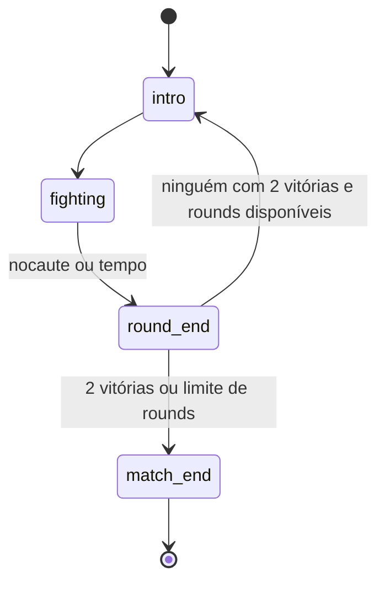

# E-003 Match
Product term: luta · Parent: none · Status: draft

## Fields

| Field | Type | Required | Default | Constraints or enum | Source |
|---|---|---|---|---|---|
| round | int | yes | 1 | ≤ max_rounds | [doc SRC-001] |
| max_rounds | int | yes | 4 | evita luta infinita | [doc SRC-001] |
| wins | Array[int] (2) | yes | [0, 0] | 2 vitórias encerram | [doc SRC-001] |
| timer_frames | int | yes | | relógio do round | [doc SRC-001] |
| frame | int | yes | 0 | quadro da simulação | [doc SRC-002] |
| rng_seed | int | yes | | gerador próprio, nunca global | [doc SRC-002] |
| result | enum | no | | p1, p2, draw, both_lose | [doc SRC-001] |

## Relations

| Relation | Target | Cardinality | On delete | Source |
|---|---|---|---|---|
| tem lutadores | E-002 | 1:2 | remove | [doc SRC-001] |

## Lifecycle

## System fields

| Field | Set when | Source |
|---|---|---|
| frame | a cada passo de 1/60 s | [doc SRC-002] |

## Rules

- R-001, R-002, R-003, R-004, R-005

## Not tested

- Duração do relógio no original: não necessária (decisão do BRIGA).
