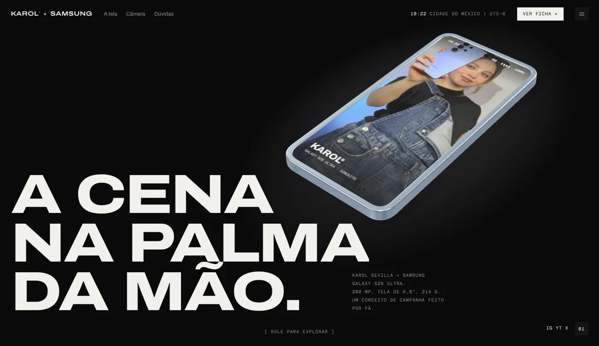
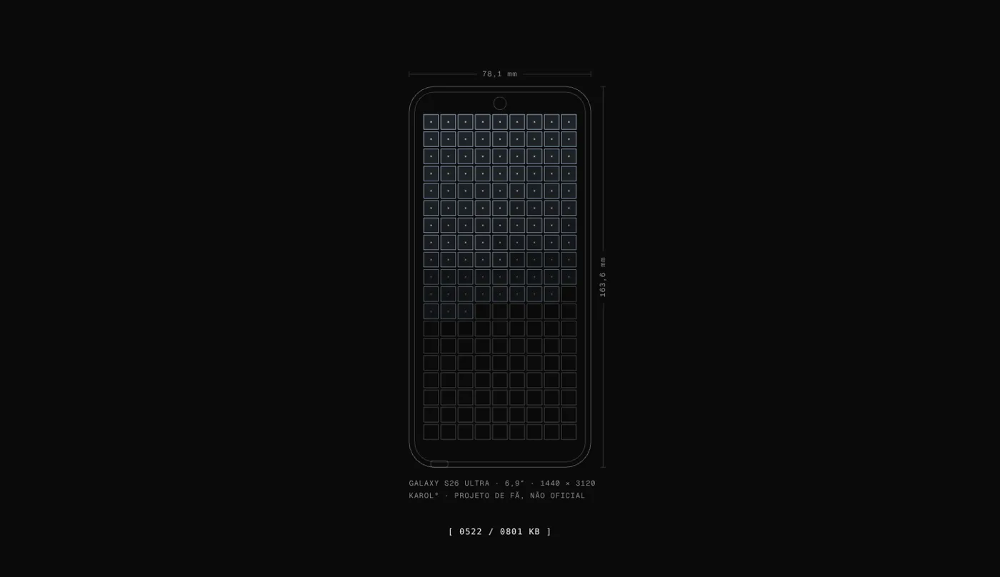
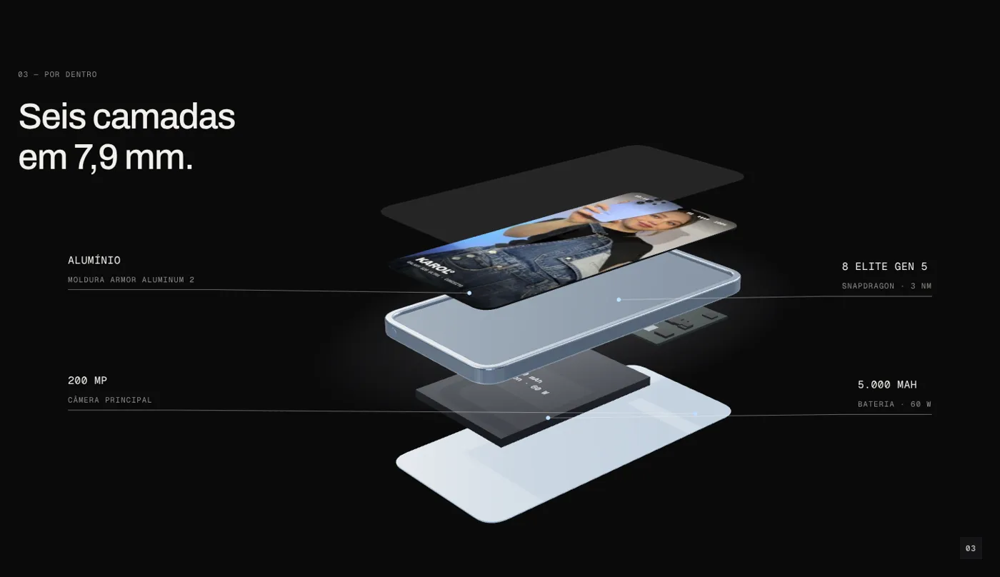
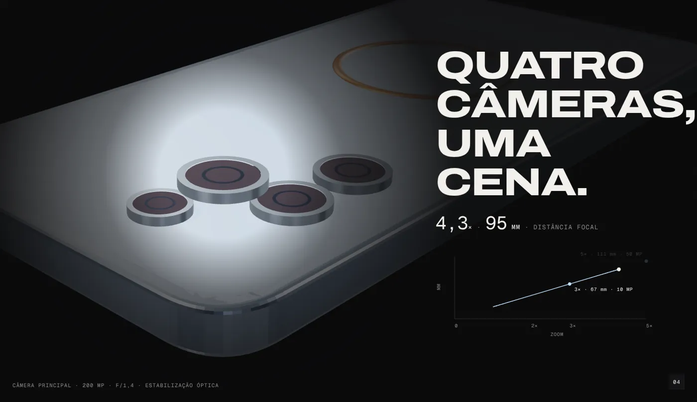
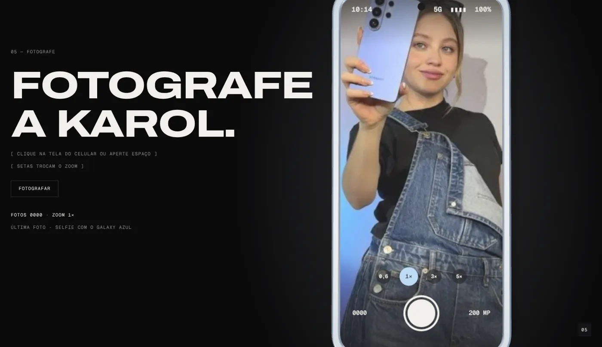
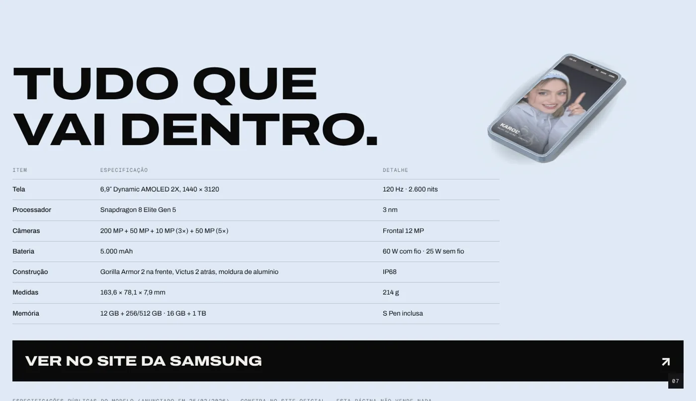

<div align="center">

# 📱 Karol° × Samsung · Galaxy S26 Ultra

**Uma landing page animada em 3D, feita em código: a cena na palma da mão.**

[](https://paulomarcelli.github.io/Projetos/Projetos/Karol-x-Samsung/)


<br>



</div>

<br>

> [!NOTE]
> Projeto **pessoal e de fã**. Não é oficial e não tem vínculo com a Samsung nem com a Karol Sevilla. A página não vende nada e não pede nenhum dado. As fotos são de campanhas e redes sociais da artista; os direitos são dos autores.

## ✨ A ideia

Um único celular em 3D fica atrás da página inteira e muda de pose conforme você rola: deitado em três quartos no topo, a câmera rasando a tela, as camadas se separando, o close na lente principal, visto de cima virando câmera, de costas girando devagar e, por fim, pequeno sobre o azul-claro da ficha técnica.

O aparelho não é um modelo baixado: foi desenhado em código (Three.js) a partir das medidas públicas do Galaxy S26 Ultra, **163,6 × 78,1 × 7,9 mm**, na cor Sky Blue.

## 🎬 O que acontece na página

| # | Seção | O que se mexe |
|---|---|---|
| 00 | **Carga** | A planta do aparelho em fios, com cotas; os pixels da tela acendem conforme os **KB reais** chegam. Pronta, a planta deita em perspectiva e pousa em cima do 3D |
| 01 | **Topo** | As seis camadas caem no lugar (`[ 0 / 6 CAMADAS ]`) e o título sobe da máscara; o cursor inclina o aparelho |
| 02 | **A tela** | A câmera desce até rasar o vidro: "Seis vírgula nove polegadas de palco." |
| 03 | **Por dentro** | Vista explodida: vidro traseiro, bateria, placa, moldura, tela e vidro frontal, com rótulos presos ao 3D |
| 04 | **A câmera** | Vira de costas e mergulha na lente de 200 MP, que sai do corpo; um gráfico de zoom × distância focal se desenha com a rolagem |
| 05 | **Fotografe** | A tela vira câmera: clique nela (ou aperte espaço) e ela "fotografa" a próxima foto da Karol; as setas trocam o zoom |
| 06 | **A campanha** | O aparelho gira de costas enquanto passa uma tira com as fotos da Karol com o Galaxy |
| 07 | **Ficha** | Uma cortina azul-clara sobe atrás do celular, com as especificações públicas |
| 08 | **Dúvidas** | Acordeão e o rodapé com o KAROL° gigante |

<table>
  <tr>
    <td width="50%"></td>
    <td width="50%"></td>
  </tr>
  <tr>
    <td align="center"><sub><b>Carga</b>: a planta acende com os KB reais</sub></td>
    <td align="center"><sub><b>Por dentro</b>: seis camadas em 7,9 mm</sub></td>
  </tr>
  <tr>
    <td width="50%"></td>
    <td width="50%"></td>
  </tr>
  <tr>
    <td align="center"><sub><b>A câmera</b>: zoom de 1× a 5×</sub></td>
    <td align="center"><sub><b>Fotografe</b>: interativo, com clique ou teclado</sub></td>
  </tr>
</table>

<div align="center"></div>

## 📋 Especificações usadas

Tela de 6,9″ Dynamic AMOLED 2X (1440 × 3120, 120 Hz, 2.600 nits) · Snapdragon 8 Elite Gen 5 · câmeras de 200 + 50 + 10 (3×) + 50 MP (5×), frontal de 12 MP · bateria de 5.000 mAh (60 W com fio, 25 W sem fio) · Gorilla Armor 2 e Victus 2 · moldura de alumínio · IP68 · 214 g. São as especificações divulgadas no anúncio de 25/02/2026; confira no site oficial da Samsung.

## 🛠️ Como rodar

```bash
npm install
npm run dev
```

Build estático (sai em `dist/`):

```bash
npm run build
```

No GitHub Pages, o workflow do repositório gera e publica sozinho a cada push na `main`.

Extras na URL: `?hd` grava em alta (pixel ratio 2, sombra 4096). Com "reduzir movimento" ligado no sistema, a página abre sem a abertura e as poses trocam por corte.

## 📁 Estrutura

```text
landing page Karol Sevilla x Samsung/
├── index.html              # todas as seções + a marcação da tela de carga
├── src/
│   ├── main.js             # entrada: CSS + tela de carga (sem three nem gsap)
│   ├── app.js              # o resto do site, baixado pela carga contando os bytes
│   ├── three/              # o celular (phone.js), a tela (screen.js), o palco, a planta e as medidas
│   ├── motion/             # carga, roteiro de poses, textos por tempo, rótulos, HUD, abertura, Fotografe
│   └── styles/             # cores, base e seções
├── public/fotos/           # fotos da Karol
└── docs/                   # imagens deste README
```

## 🙌 Créditos

- Estrutura de animação adaptada do template **Tecla°** (o teclado virou o S26 Ultra).
- Fontes **Archivo** e **Geist Mono** (Fontsource).
- Fotos da Karol Sevilla: campanhas e redes sociais da artista, só para fins de estudo.

<div align="center">
<br>

Feito com 💙 por **Paulo Marcelli**

</div>
