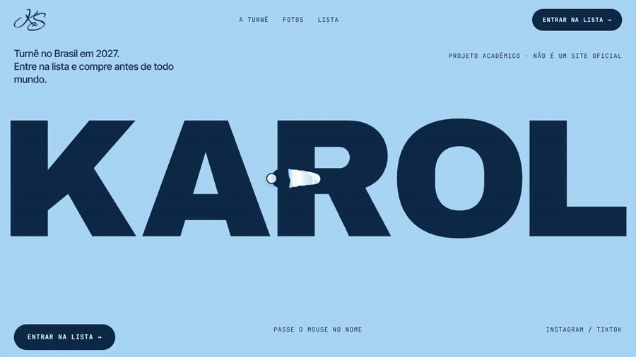
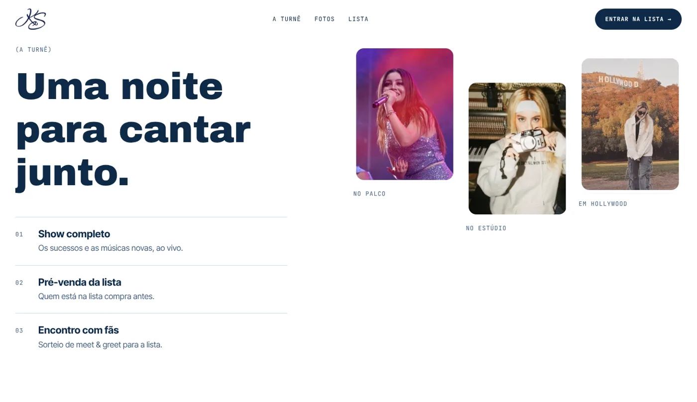
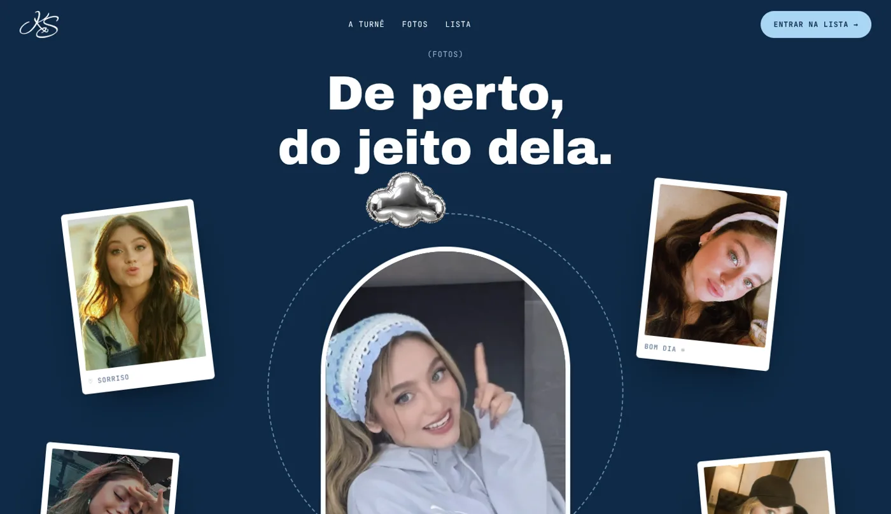
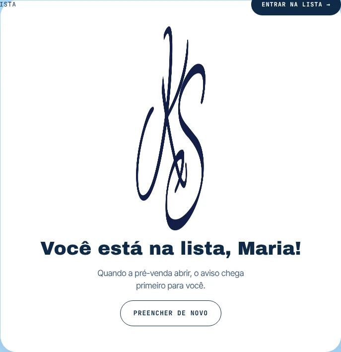
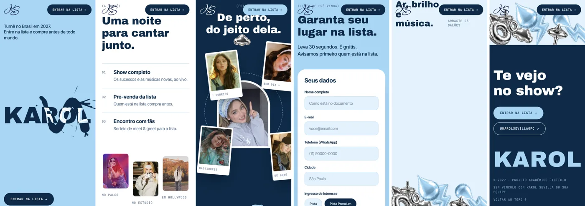

<div align="center">

# 💙 Landing page · Karol Sevilla

**Turnê no Brasil 2027 · lista de pré-venda**

Atividade da aula de **Design da FECAP**: uma landing page construída a partir dos princípios da **Gestalt**.

[](https://paulomarcelli.github.io/Projetos/Projetos/Landing-Page-Karol-Sevilla/)


<br>



<sub>Passe o mouse no nome: a tinta revela as letras infladas.</sub>

</div>

<br>

> [!NOTE]
> Projeto **acadêmico e fictício**. Não existe essa turnê, o formulário não envia nenhum dado e o site não tem vínculo com a Karol Sevilla ou com a equipe dela.

## ✨ A ideia

O desafio era criar uma landing page com título, subtítulo, imagem, descrição, formulário e um botão de chamada para ação, e justificar cada escolha visual com a Gestalt.

O tema escolhido foi um evento: a lista de pré-venda de uma turnê da Karol no Brasil. As cores vieram de um moletom azul-bebê dela, com um monograma **KS** bordado, que foi redesenhado como logo do projeto.

| Cor | | Uso |
|---|---|---|
| Azul-bebê | `#A9D6F5` | Fundo principal, botões secundários |
| Branco | `#FFFFFF` | Detalhes, molduras, logo |
| Azul-marinho | `#0E2A47` | Texto e o botão principal (o único que se destaca) |

## 🧠 Gestalt na prática

| Princípio | Onde aparece |
|---|---|
| **Figura e fundo** | A tinta azul-marinho revela as letras infladas por cima do nome |
| **Centralização e simetria** | Na seção de fotos, o arco fica no centro e as polaroides se equilibram em volta |
| **Fechamento** | O anel tracejado aberto em volta do arco e o laço do logo KS |
| **Hierarquia** | KAROL → frase → botão: só o "Entrar na lista" é marinho cheio |
| **Regra dos terços** | Na seção "A turnê", o texto ocupa o terço da esquerda e as fotos, os dois terços da direita |
| **Proximidade e similaridade** | Itens numerados agrupados por fios, fotos do mesmo tamanho, botões em pílula |
| **Continuidade** | As fotos sobem e descem em degraus, levando o olho para a direita |
| **Leitura em Z e região comum** | O formulário vai do título ao cartão e ao botão, com todos os campos num único cartão branco |
| **Pregnância** | Formas simples (pílulas, arco, círculos) e só duas cores com branco |

## 🖼️ As seções

<table>
  <tr>
    <td width="50%"></td>
    <td width="50%"></td>
  </tr>
  <tr>
    <td align="center"><sub><b>A turnê</b>: descrição em frases curtas e fotos que abrem ao rolar</sub></td>
    <td align="center"><sub><b>Fotos</b>: polaroides que enchem como balão e fogem do mouse</sub></td>
  </tr>
  <tr>
    <td width="50%"></td>
    <td width="50%"></td>
  </tr>
  <tr>
    <td align="center"><sub><b>Formulário</b>: validação campo a campo e confirmação</sub></td>
    <td align="center"><sub><b>Celular</b>: a tinta também funciona com o dedo</sub></td>
  </tr>
</table>

## 🎬 Animações

- **Abertura**: o logo KS no marinho, com um anel que enche como balão e uma contagem de 100 a 000.
- **Tinta com massa** (WebGL): segue o cursor por uma mola, cresce com o embalo, solta gotas na freada e respingos no clique.
- **Letras infladas**: o nome KAROL foi renderizado em 3D no Blender, como balões de tecido.
- **Polaroides e balões** que flutuam, fogem do mouse e sobem em velocidades diferentes no scroll.
- **Balões com física**: caem, quicam e dá para pegar e arremessar.
- **Rodapé**: as letras do KAROL fogem do cursor e voltam com mola.
- Tudo respeita **"reduzir movimento"** do sistema e pausa quando sai da tela.

## 🛠️ Como rodar

```bash
npm install
npm run dev
```

Para gerar a versão final (`dist/`):

```bash
npm run build
```

No GitHub Pages, o workflow do repositório faz o build e publica sozinho a cada push na `main`.

## 📁 Estrutura

```text
landing page Karol Sevilla/
├── index.html            # todas as seções
├── public/
│   ├── fotos/            # fotos da Karol
│   ├── img/              # logo KS e balões
│   └── infla/            # KAROL inflado (Blender) + caixa.json
├── src/
│   ├── main.js           # liga tudo
│   ├── motion/           # tinta, herói, fotos, física, rodapé, abertura, formulário
│   └── styles/           # cores, base e seções
└── docs/                 # imagens deste README
```

## 🙌 Créditos

- Base de animação adaptada do pacote **Sopro** (tinta, física e rodapé).
- Fontes **Archivo Black**, **Inter Tight** e **JetBrains Mono** (Fontsource).
- Fotos da Karol Sevilla usadas só para fins acadêmicos; os direitos são dos autores originais.

<div align="center">
<br>

Feito com 💙 por **Paulo Marcelli** · Design · FECAP

</div>
