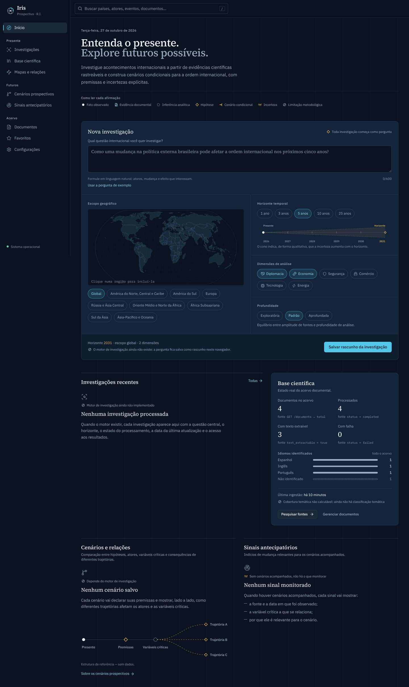

# Projeto Iris: interface

Interface web do Projeto Iris: React 19, Vite, TypeScript e Tailwind CSS 4, com os tokens de design
centralizados em `src/styles/index.css`.



## Direção de design

**Conceito:** compreender as relações de poder do presente para investigar os futuros possíveis da
ordem internacional. A interface é um gabinete de análise noturno: fundo cartográfico, painéis
institucionais, linhas finas de coordenadas e tipografia editorial.

- **Cores com significado fixo.** O ciano marca interação, conexão e vínculo com uma fonte. O âmbar
  marca incerteza, hipótese e horizonte. Verde e vermelho aparecem só em estados reais do sistema
  (no ar, falha), nunca como decoração.
- **Tipografia.**
  - Source Serif 4 para títulos e texto analítico.
  - IBM Plex Sans para a interface.
  - IBM Plex Mono para dados, hashes e a origem dos números.
  - Números sempre tabulares. As fontes ficam no pacote, sem chamadas externas.
- **Linguagem epistêmica.** Sete marcadores, cada um com forma e rótulo próprios (não só cor):
  fato observado, evidência documental, inferência analítica, hipótese, cenário condicional,
  incerteza e limitação metodológica. Aparecem no início, na ficha de cada documento (a origem de
  cada metadado), nos estados vazios e nas limitações.
- **Símbolo.** Um globo visto como íris. Meridiano e equador formam o sistema de coordenadas (o
  presente mapeado); o arco ciano é a abertura do diafragma (o olhar adiante).
- **Navegação pela estrutura intelectual:** Início, depois *Presente* (Investigações, Base
  científica, Mapas e relações), *Futuros* (Cenários, Sinais) e *Acervo* (Documentos, Favoritos,
  Configurações).
- **Movimento.** Toque de 140 ms (escala 0,97), cores em 180 ms e entradas em 240 ms. A curva de
  saída é forte e a saída é mais rápida que a entrada. Ações de teclado não têm animação, e o modo
  "reduzir movimento" do sistema é respeitado.

A referência completa (cores, tipos, marcadores, componentes) fica na rota `/design-system`.

## O que é real e o que ainda não existe

| Área | Situação |
|---|---|
| Documentos (envio, lista, filtros, leitura por página, remoção) | **Real**: usa a API (`/documents`) |
| Base científica (contagens, idiomas, última ingestão, busca de fontes) | **Real**: cada número mostra a sua origem (`fonte GET /documents → total`) |
| Estado do sistema | **Real**: `/health/ready` |
| Nova investigação | Formulário completo, com mapa de escopo, horizonte, dimensões e profundidade. **O motor ainda não existe**: a pergunta é salva como *rascunho neste navegador*, e a tela diz isso |
| Favoritos | Reais, mas guardados só neste navegador |
| Investigações processadas, cenários, sinais, mapas de relações | **Sem API ainda.** Mostram estados vazios que explicam o que vai aparecer; nenhum dado é simulado |
| Busca global | Procura em documentos (os 100 mais recentes) e rascunhos. Avisa que países, atores e eventos ainda não estão indexados |

## Executar

Pré-requisito: a API rodando em `http://127.0.0.1:8000` (veja o README da raiz).

```bash
cd frontend
npm install
npm run dev            # http://localhost:5173 (proxy para a API: /documents e /health)
```

Para outra porta ou máquina da API: `API_URL=http://host:porta npm run dev`.

Build de produção (`dist/`):

```bash
npm run build
npm run preview        # serve o build em http://localhost:4173, com o mesmo proxy
```

Em produção, sirva `dist/` e a API **na mesma origem** (por exemplo, atrás de um proxy reverso),
ou defina `VITE_API_BASE` no build e habilite CORS na API.

## Testes e verificações

```bash
npm test               # vitest: formatação, cliente da API, formulário, rascunhos, base científica
npm run typecheck
```

### Dados de pior caso (só em desenvolvimento)

Com `npm run dev`, um alternador no rodapé troca a fonte dos documentos entre:

- **API real**;
- **Pior caso**: 1.284 documentos, títulos de 180 caracteres, nomes compostos, árabe, chinês e
  vietnamita, arquivos sem título, falhas e um documento de 1.284 páginas;
- **Vazio**;
- **Um item**.

Também funciona pela URL: `?dados=pior`, `?dados=vazio` ou `?dados=um`. Esses dados não entram no
build de produção.
