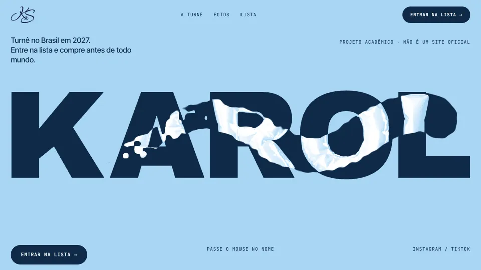
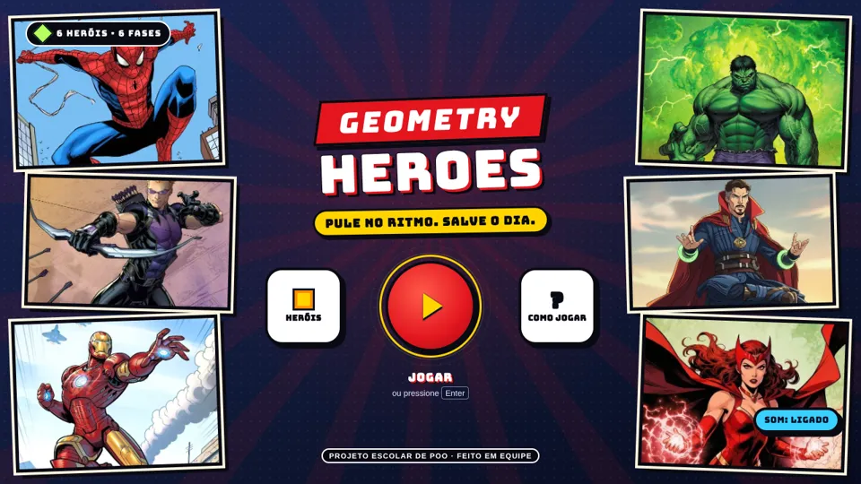
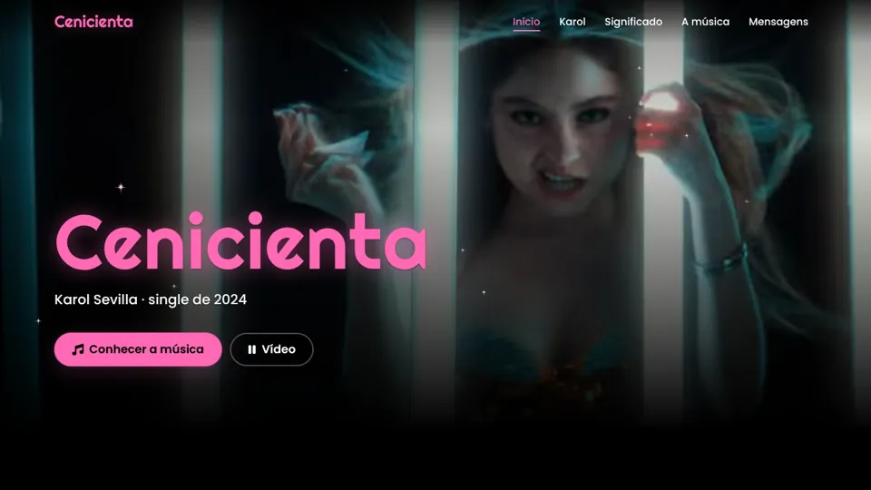
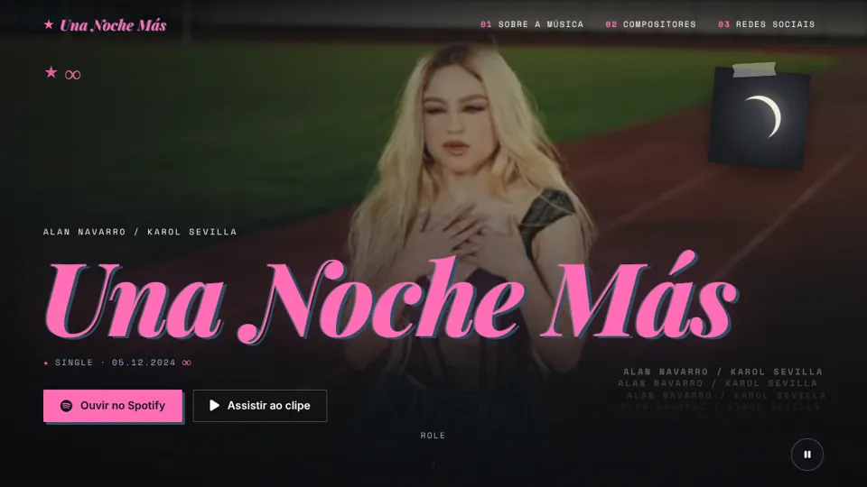
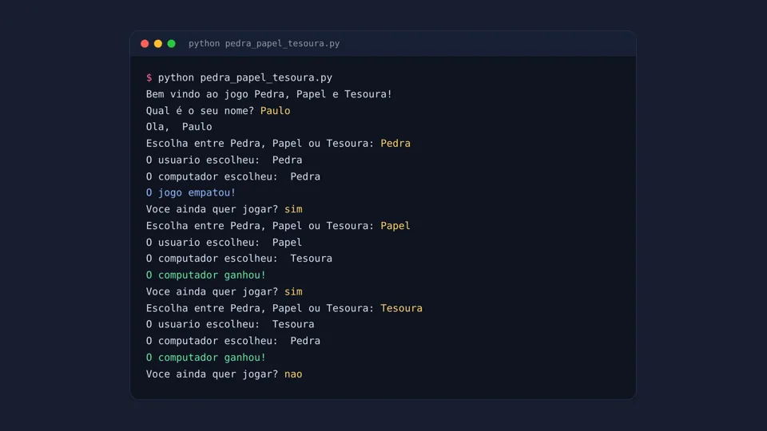

<div align="center">

# 🚀 Projetos

**Meu portfólio de desenvolvimento num lugar só: sites, landing pages animadas, jogos e IA.**

Cada projeto tem a própria pasta, README e instruções de uso.<br>
Os sites são publicados sozinhos no GitHub Pages a cada atualização na `main`.

[](https://paulomarcelli.github.io/Projetos/)


</div>

<br>

## 🌐 Projetos

<table>
  <tr>
    <td width="50%" valign="top">
      <a href="https://paulomarcelli.github.io/Projetos/Projetos/Karol-x-Samsung/"></a>
      <h3>📱 Karol × Samsung</h3>
      Landing 3D do Galaxy S26 Ultra, desenhado em código: a planta carrega com os KB reais, as camadas caem, explodem e dá para "fotografar" a Karol.<br>
      <sub>Vite · Three.js · GSAP · projeto pessoal de fã</sub><br><br>
      <a href="https://paulomarcelli.github.io/Projetos/Projetos/Karol-x-Samsung/"><b>Abrir site ↗</b></a> · <a href="Projetos/landing%20page%20Karol%20Sevilla%20x%20Samsung">Código</a>
    </td>
    <td width="50%" valign="top">
      <a href="https://paulomarcelli.github.io/Projetos/Projetos/Landing-Page-Karol-Sevilla/"></a>
      <h3>💙 Landing page Karol Sevilla</h3>
      Atividade de Gestalt (Design, FECAP): passe o mouse no nome e a tinta revela as letras infladas, feitas em 3D no Blender.<br>
      <sub>Vite · GSAP · WebGL · projeto acadêmico fictício</sub><br><br>
      <a href="https://paulomarcelli.github.io/Projetos/Projetos/Landing-Page-Karol-Sevilla/"><b>Abrir site ↗</b></a> · <a href="Projetos/landing%20page%20Karol%20Sevilla">Código</a>
    </td>
  </tr>
  <tr>
    <td width="50%" valign="top">
      <a href="https://paulomarcelli.github.io/Projetos/"></a>
      <h3>🌐 Site Karol Sevilla</h3>
      Fã-site inspirado na navegação de apps de música: a trajetória em três capítulos, <i>Mariposas</i> e <i>Más linda</i>, e "O que Karol tem a nos ensinar?". Tudo com fontes citadas.<br>
      <sub>HTML · CSS · JavaScript</sub><br><br>
      <a href="https://paulomarcelli.github.io/Projetos/"><b>Abrir site ↗</b></a> · <a href="https://paulomarcelli.github.io/Projetos/primeira-versao/">1ª versão</a> · <a href="Projetos/Site-Karol-Sevilla">Código</a>
    </td>
    <td width="50%" valign="top">
      <a href="https://paulomarcelli.github.io/Projetos/Projetos/Geometry-Heroes/"></a>
      <h3>🎮 Geometry Heroes</h3>
      Jogo de plataforma no ritmo da música (POO, FECAP · ADS): 6 fases, uma por herói, cada um com uma habilidade. 78 classes e 280 verificações automáticas.<br>
      <sub>JavaScript · Phaser 3 · Programação Orientada a Objetos</sub><br><br>
      <a href="https://paulomarcelli.github.io/Projetos/Projetos/Geometry-Heroes/"><b>Jogar ↗</b></a> · <a href="Projetos/Tarefa-POO-JavaScript">Código</a>
    </td>
  </tr>
  <tr>
    <td width="50%" valign="top">
      <a href="https://paulomarcelli.github.io/Projetos/Projetos/Cenicienta/"></a>
      <h3>👠 Cenicienta</h3>
      Site do single de 2024 da Karol Sevilla: a música, o significado e o clipe.<br>
      <sub>HTML · CSS · JavaScript</sub><br><br>
      <a href="https://paulomarcelli.github.io/Projetos/Projetos/Cenicienta/"><b>Abrir site ↗</b></a> · <a href="Projetos/Cenicienta">Código</a>
    </td>
    <td width="50%" valign="top">
      <a href="https://paulomarcelli.github.io/Projetos/Projetos/Una-Noche-Mas/"></a>
      <h3>🌙 Una Noche Más</h3>
      Site do single de Alan Navarro e Karol Sevilla: a música, os compositores e as redes.<br>
      <sub>HTML · CSS · JavaScript</sub><br><br>
      <a href="https://paulomarcelli.github.io/Projetos/Projetos/Una-Noche-Mas/"><b>Abrir site ↗</b></a> · <a href="Projetos/Una-Noche-Mas">Código</a>
    </td>
  </tr>
  <tr>
    <td width="50%" valign="top">
      <a href="https://paulomarcelli.github.io/Projetos/Projetos/Luna/"></a>
      <h3>🌙 LUNA MIND</h3>
      Assistente de apoio emocional por texto e voz, com biblioteca de pesquisa (RAG) e uma camada de segurança que não depende da IA.<br>
      <sub>Python · Flask · OpenAI · Gemini API · Render</sub><br><br>
      <a href="https://paulomarcelli.github.io/Projetos/Projetos/Luna/"><b>Abrir a Luna ↗</b></a> · <a href="Projetos/Luna-AI">Código</a>
    </td>
    <td width="50%" valign="top">
      <a href="Projetos/Joken-Po-Python"></a>
      <h3>✊ Joken-Po em Python</h3>
      Pedra, papel e tesoura no terminal contra o computador, comentado linha a linha para estudar lógica de programação.<br>
      <sub>Python · lógica de programação</sub><br><br>
      <a href="Projetos/Joken-Po-Python"><b>Ver o código ↗</b></a>
    </td>
  </tr>
</table>

## 🗂️ Todos os projetos

| Projeto | Tecnologias | Status |
|---|---|---|
| [Karol × Samsung (Galaxy S26 Ultra)](Projetos/landing%20page%20Karol%20Sevilla%20x%20Samsung) | Vite · Three.js · GSAP | 🟢 Publicado |
| [Landing page Karol Sevilla](Projetos/landing%20page%20Karol%20Sevilla) | Vite · JavaScript · GSAP · WebGL | 🟢 Publicado |
| [Site Karol Sevilla](Projetos/Site-Karol-Sevilla) | HTML · CSS · JavaScript | 🟢 Publicado |
| [Geometry Heroes (Tarefa de POO)](Projetos/Tarefa-POO-JavaScript) | JavaScript · Phaser 3 · POO | 🟢 Publicado |
| [Cenicienta](Projetos/Cenicienta) | HTML · CSS · JavaScript | 🟢 Publicado |
| [Una Noche Más](Projetos/Una-Noche-Mas) | HTML · CSS · JavaScript | 🟢 Publicado |
| [Joken-Po em Python](Projetos/Joken-Po-Python) | Python · Lógica de programação | 🟢 Concluído |
| [LUNA MIND](Projetos/Luna-AI) | Python · Flask · OpenAI · Gemini API | 🟢 Publicado |

## 📂 Estrutura

A pasta `Projetos` é a área principal: cada projeto fica separado e documentado, para facilitar a navegação e a apresentação do portfólio.

<details>
<summary><b>Ver a árvore de pastas</b></summary>

```text
Projetos/
├── Luna-AI/
│   ├── app.py, luna.py
│   ├── web/                      (a tela publicada no Pages)
│   ├── rag/, conhecimento/
│   └── README.md
├── Site-Karol-Sevilla/
│   ├── index.html
│   ├── assets/
│   │   ├── css/
│   │   ├── js/
│   │   └── img/
│   ├── docs/
│   ├── primeira-versao/
│   │   ├── index.html
│   │   ├── style.css
│   │   └── script.js
│   └── README.md
├── landing page Karol Sevilla/
│   ├── index.html
│   ├── src/
│   ├── public/
│   └── README.md
├── landing page Karol Sevilla x Samsung/
│   ├── index.html
│   ├── src/ (three/, motion/, styles/)
│   └── README.md
├── Joken-Po-Python/
│   ├── pedra_papel_tesoura.py
│   └── README.md
├── Cenicienta/
│   ├── index.html
│   ├── style.css
│   ├── script.js
│   ├── images.jpg
│   ├── cenicienta.mp4
│   └── README.md
├── Una-Noche-Mas/
│   ├── index.html
│   ├── style.css
│   ├── script.js
│   ├── nochemas.png
│   ├── unanochemas.mp4
│   └── README.md
└── Tarefa-POO-JavaScript/        (Geometry Heroes)
    ├── index.html
    ├── style.css
    ├── main.js
    ├── js/                       (classes do jogo; js/fases/ tem uma fase por herói)
    ├── assets/                   (cenários em camadas e retratos dos heróis)
    ├── tests/                    (testes automáticos em Python + Playwright)
    ├── apresentacao/             (scripts do vídeo de apresentação)
    ├── src/
    │   └── main.js               (exemplo inicial de POO, anterior ao jogo)
    ├── DOCUMENTACAO.md
    ├── IMPLEMENTATION_NOTES.md
    ├── REA_ESQUEMA.md
    ├── PROMPTS_MANUS.md
    └── README.md
```

</details>

## ⚙️ Como os sites são publicados

O workflow [`.github/workflows/pages.yml`](.github/workflows/pages.yml) roda a cada push na `main`: gera as landings feitas com Vite (`npm ci` e `npm run build`), junta os sites numa pasta só e publica no GitHub Pages.

> [!NOTE]
> As landings da Karol Sevilla e o site Karol × Samsung são projetos de fã e acadêmicos, sem vínculo oficial com a artista ou com marcas. As imagens pertencem aos seus autores.

<div align="center">
<br>

Feito com 💙 por **Paulo Marcelli**

</div>
