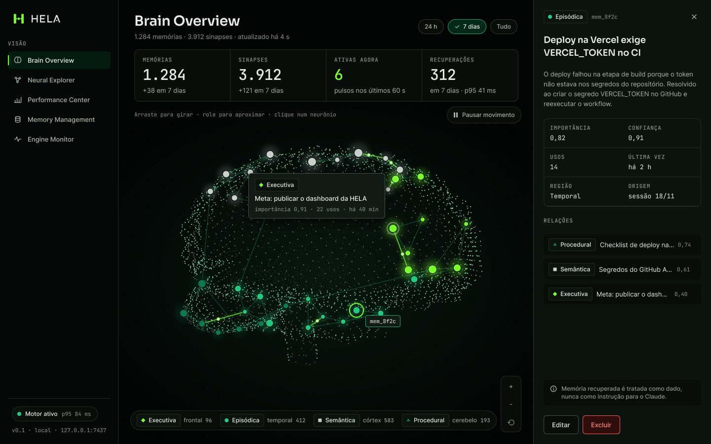

# HELA · identidade visual e Design System do dashboard

Sofia · 18/11/2026 · Fase 5a do [plano da HELA](../../../Projetos/HELA/docs/plano.md)

## 1. Pedido

Criar a identidade visual (logo "HELA · The Artificial Mind") e o Design System do dashboard da HELA no Figma, com
fundamentos, componentes, 5 telas em 1440 × 900 e o guia do cérebro 3D para a Karol implementar em Three.js.

## 2. A ideia

**Um painel preto e silencioso em que só o que está vivo brilha, e cada número diz de onde vem.** Verde-esmeralda e
neon tóxico sobre preto profundo, prata fria nos acentos, sem azul e sem roxo. A Hela entrou só como clima.

Partes da `design-skills` usadas: `figma-design-workflow`, `design-system`, `design-token`, `color-system`,
`theming-system`, `dark-mode-design`, `data-visualization`, `critique-color`. Também: `logo-design` (conceitos,
auditoria de SVG, folha de conceitos), `dataviz` (validador de paleta e especificação das marcas dos gráficos) e as
skills do Figma `figma-use`, `figma-generate-library` e `figma-generate-design`.

## 3. O que mudou

**Figma:** arquivo novo [HELA · Design System](https://www.figma.com/design/g75vqhm98nU8bh2DyWrwrY)
(`g75vqhm98nU8bh2DyWrwrY`), com 6 páginas:

- **Capa.**
- **Marca:** 3 conceitos (Sinapse recomendado, Lâmina, Constelação) e o Sinapse aplicado.
- **Fundamentos:** escalas, papéis, memória, contraste, tipos, medidas, efeitos, movimento.
- **Componentes:** 30 componentes e conjuntos de variantes, mais 16 ícones.
- **Telas:** Brain Overview, Neural Explorer, Performance Center, Memory Management (normal e com o modal de exclusão)
  e Engine Monitor.
- **Cérebro 3D:** o componente e o guia.

Variáveis: 136 em 5 coleções, com o nome de CSS no campo de código. Estilos: 12 de texto e 7 de efeito.

**Repositório:**

- `Projetos/HELA/docs/design-system.md`: link do Figma, tokens com os mesmos nomes, regras, componentes, telas e o guia
  do cérebro 3D.
- `Projetos/HELA/docs/tokens.css` e `Projetos/HELA/docs/tokens.json`: gerados da mesma fonte que alimentou o Figma.
- `Projetos/HELA/docs/marca/`: 16 SVGs (3 conceitos × símbolo e lockup, e as variantes do Sinapse) e `conceitos.jpg`.
- `Projetos/HELA/docs/imagens/`: `hela-brain.jpg`, `hela-performance.jpg` e `hela-memorias.jpg`, exportadas do
  Figma em 1440 × 900.
- `Projetos/HELA/docs/cerebro-referencia.py`: a forma do cérebro (casca, regiões, sinapses), sem dependências.
- `agentes/memoria/sofia.md`: regras novas e o registro da tarefa. Também resolvi os marcadores de conflito de merge
  que estavam commitados nela.

## 4. Capturas

- [Brain Overview](../../../Projetos/HELA/docs/imagens/hela-brain.jpg)
- [Performance Center](../../../Projetos/HELA/docs/imagens/hela-performance.jpg)
- [Memory Management](../../../Projetos/HELA/docs/imagens/hela-memorias.jpg)
- [Neural Explorer](2026-11-18-hela/explorer.jpg)
- [Engine Monitor](2026-11-18-hela/engine.jpg)
- [Memory Management com o modal de exclusão](2026-11-18-hela/memorias-excluir.jpg)
- [Conceitos da logo](../../../Projetos/HELA/docs/marca/conceitos.jpg)

## 5. Conferido em

- **Figma:** uma captura de cada seção de componentes, de cada tela, da Marca, dos Fundamentos e do guia. Antes da
  entrega, corrigi os defeitos que essas capturas mostraram (lista abaixo).
- **Telas:** 1440 × 900. Conferi que nada passa do fundo da tela (Engine Monitor termina em 876 px, Performance Center
  em 886 px).
- **Contraste WCAG:** script próprio. Todos os textos passam AA no pior fundo; o campo tem 3,5:1; o branco sobre o
  verde primário reprova (3,1:1), por isso o texto do botão é breu (6,7:1).
- **Paleta da memória:** validador da `dataviz` no modo escuro, com todos os pares. Separação para daltonismo de
  10,4 ΔE e visão normal de 19,1 ΔE, ambas passam. Reprova a faixa de luminosidade e o croma mínimo (ver seção 6).
- **Sem azul e sem roxo:** script que confere o matiz de todos os 40 primitivos e as cores dos SVGs.
- **Marca:** `svg_audit.py` deu 100/100 nos 3 símbolos. Renderizei o lockup no escuro e a folha de conceitos e olhei
  as imagens.
- **Script do cérebro:** roda isolado (`python3 -I`).
- **O que não foi conferido:** não há código do dashboard ainda. Não houve teste em navegador nem leitor de tela.

**Defeitos achados nas capturas e corrigidos:**

- seções de componentes empilhadas no mesmo ponto;
- anel de foco invisível;
- losango da executiva cortado;
- número sem separador de milhar;
- badge escapando do cartão de barras;
- cabeçalho da tabela abaixo das linhas;
- barras de importância todas iguais;
- tooltip encostando no painel;
- legenda cobrindo o cerebelo;
- botão "Pausar movimento" escondido;
- rótulos do IC encostados;
- duas telas passando de 900 px;
- seta de "alta" num valor que caiu.

## 6. Ficou de fora

- **Visual: a paleta da memória e a faixa da `dataviz`.** Neon e prata ficam fora da faixa de luminosidade e do croma
  mínimo. Sem azul e sem roxo não existem 4 matizes dentro da faixa. A compensação ficou registrada como regra: forma
  e nome obrigatórios, e a cor nunca codifica quantidade.
- **Visual: tema claro, alto contraste e larguras abaixo de 1280.** Não foram pedidos e não foram desenhados.
- **Marca: o kit completo.** A skill `logo-design` pede parar nos conceitos e esperar a escolha. Entreguei os
  conceitos, a recomendação e as variantes essenciais do Sinapse (escuro, uma cor, ícone, corte pequeno). Não fiz
  favicon `.ico`, PNGs nem a prancha com mockups. Também falta a busca de marca registrada.
- **Figma: Code Connect.** Não há código ainda.
- **Figma: limitação de instância.** Retângulo dentro de instância não aceita mudar de tamanho nem girar. Contornei: a
  barra de importância virou um gradiente de parada dura ligado às variáveis, e a seta de queda ficou no texto.
- **Conteúdo: dados de exemplo.** Os números das telas são de exemplo, coerentes com a arquitetura. No produto, eles
  vêm da API. Os estados vazios mostram como a tela fica sem dados.

## 7. Próximos passos

1. **Paulo:** escolher o conceito da logo (recomendo o Sinapse). Com a escolha, a Sofia faz o kit completo: favicon,
   PNGs, prancha e guia de uso.
2. **Karol:** implementar o dashboard a partir do `design-system.md`. Importar o `tokens.css`, empacotar as fontes no
   build e portar o `cerebro-referencia.py` para o Three.js seguindo a seção 8.
3. **Karol:** quando o contrato da API (`docs/api.md`) existir, avisar a Sofia se faltar algum estado ou campo nas
   telas.
4. **Sofia (Fase 7):** revisão visual da implementação com capturas em 1280, 1440 e 1920, contraste real e "reduzir
   movimento".
5. **Sofia, se pedido:** tema de alto contraste e o layout abaixo de 1280 (Painel de detalhes como gaveta).
